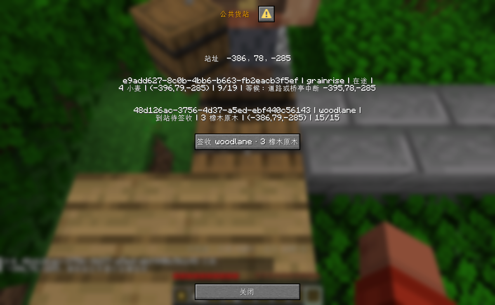

# 《封建社会》0.16.0 逐项核对清单

截至 2026 年 11 月 27 日，按玩家、领主和服主可以实际办理的事项整理。正文含 **17 个模块、195 项**。例如「建领」拆成资格、公示、异议和裁定，可给每一步单独打勾。编号也是 Excel 表的行标。

[下载可填写的 Excel 核对表](0.16.0-%E9%80%90%E9%A1%B9%E6%A0%B8%E5%AF%B9.xlsx?raw=1) · [玩法代码快照 02aba1f](https://github.com/XuanYuanYunBai/feng-jian-she-hui/tree/02aba1f8ea2559b34bb370411e1cffb636fc6d3e) · [当前插件](https://github.com/XuanYuanYunBai/feng-jian-she-hui/blob/02aba1f8ea2559b34bb370411e1cffb636fc6d3e/examples/imperial-atlas/feudal-survey-0.16.0.jar) · [河台庄试玩地图](https://github.com/XuanYuanYunBai/feng-jian-she-hui/blob/02aba1f8ea2559b34bb370411e1cffb636fc6d3e/examples/imperial-atlas/RiverManor-0.14.0.zip)

在 Excel 的「逐项核对」按模块或证据筛选，在第一列选“通过／有差异／暂缓”，第二列写你看见的结果。发回意见时可直接写“编号＋现象”。「实拍选页」内嵌六张原截图，离线也可看。

## 从哪里开始试玩

| 阶段 | 在世界里做什么 | 核对编号 | 达成后能看见什么 |
|---|---|---|---|
| 安家 | 点进服消息或空手 Shift＋F，选址、造院、登记。 | A08、B01–B05 | 看到首庄 100 人。 |
| 过冬粮与下一季 | 登记住房、水磨和田界，用手磨或派工烘焙，把面包送回厅仓。 | B09、C02–C06、D01–D12 | 查到本季吃粮、储备、出生与可用工时。 |
| 领地化 | 养到 200 人，登记议事厅，保留三份公粮，供养满季。回厅开公示、等期并裁定。 | B12、E01–E04 | 领地出现区块、国印、人口与治所。 |
| 分封与经营 | 在自己的领地登记税仓，查看授益与授土选项。在玩家商柜实际成交。 | F01–F09、H01–H07、N01–N08 | 对照私人庄产、公共辖权、独立税权与柜中实物。 |
| 交通与工程 | 在已登记线路发具名实际货单。看断路、缴费、换装、签收与修路。 | K01–K12、L01–L12、M01–M06、O01–O08 | 待卸时实桶保留前货，货主、工班及收货人各有回执。 |
| 换代 | 婚配并开启养育，生前从亲谱预览私产、可操控者和各枚领印。 | I03–I06、J01–J11 | 下一代接续后，别家的税契与既有公库仍可查。 |

**核对时容易遇到的版本差异**

- 河台庄是预建普通地图。实测使用短季长、预置设施和起始货物。部分角色移动和死亡由控制台触发。正式服是六个活跃小时一季，公示另计 24 个现实小时。
- 0.14.0 试玩包可用 0.16.0 插件运行。存档已从 100 人首庄走到第二代。其结果与另一次河港赈运、再一次两队共站分别核验。
- 0.3.0 的平坦地图和 0.2.0 的早期存档报告页作为历史对照。0.13.0 的女性接班截图是更改继承法之前的样例。0.16.0 的现行规则见 B、E、J、K、L。
- 本次做了源码核对、干净构建与停服复核。截图和动作录像沿用各版原图，当前测试没有重新组织两位玩家跑遍全部条目。

## 各模块与证据

| 模块 | 项数 | 模块 | 项数 |
|---|---:|---|---:|
| [A　开服、地图种子与进入游戏](#mod-a) | 12 | [B　找地、立庄、测界与房舍](#mod-b) | 13 |
| [C　人口、季报、公粮与迁徙](#mod-c) | 14 | [D　小麦、手工制粮与水磨工班](#mod-d) | 12 |
| [E　建领、开拓、迁都、割地与实控](#mod-e) | 10 | [F　封君封臣、流官与官印继任](#mod-f) | 11 |
| [G　国家、帝国、联盟、会费与桥权争端](#mod-g) | 12 | [H　税仓、公库、亲征与减征](#mod-h) | 13 |
| [I　家族、婚姻、教育、分房与无地生活](#mod-i) | 20 | [J　家法、领地继承法与玩家换代](#mod-j) | 11 |
| [K　道路材质、玩家负重、桥与渡船](#mod-k) | 12 | [L　公共货运、工班、船与水陆联运](#mod-l) | 12 |
| [M　收费亭、通行特许与实体路费](#mod-m) | 6 | [N　商站、定价、行情与经济边界](#mod-n) | 8 |
| [O　乡村铁匠铺、道路维修与出资](#mod-o) | 8 | [P　有限采矿、矿业许可、工具磨耗](#mod-p) | 9 |
| [Q　地图、勘测、存档与可安装资产](#mod-q) | 12 |  |  |

[建筑图谱逐卡对照](#cards) · [原案十二章对照](#scope) · [仍待制作或另行验收](#limits) · [本次复核结果](#proof) · [实测报告、截图与录像](#images) · [全部操作入口](#commands)

- **本次存档复核（67 项）**　本次从对应版本的停服世界、数据库、物品或地图快照再验该场景。脚本覆盖回执中列出的结果。其余条件可点源码核对。
- **本次规则测试（20 项）**　本次运行了链接里的 Java／SQLite 测试，覆盖相应规则或边界。
- **版本操作记录（96 项）**　有相应版本的操作说明或场景记录，图片和当时的预置条件见原报告。行内现版数值以所附源码为准。
- **代码核对（12 项）**　已找到现版处理入口和规则。此行未列出专门的原版客户端验收结果。

## 六张实拍

从首庄、建领到换代前三张来自同一轮主线验收。其余三张分别对应水运和 0.16.0 的坡道、共站场景。点击图片可查看原图。

**首庄的院舍、水磨与麦田**　河台庄普通地形试玩场景。庄屋、田地和商柜均在世界中。

**两百居民后的领地公示**　核对公示区块、答辩期以及异议入口。

**父逝后的逐项交割**　家产、头衔和现有收益封契可分别核对。

**赈粮在河中央遇到封航**　原批封粮由船工随身携带，河道受阻时在水上等候。

**台阶与楼梯接通货线**　碎石路经过木半砖和石砖坡道，接入更高的路面。

**同一货站的两张运单**　不同工班、货种、进度与指定签收人出现在同一站。

## A　开服、地图种子与进入游戏

- [ ] **A01　适用版本**　服务器将 0.16.0 插件放入 plugins，使用 Java 25、Paper 26.3 build 257。 
  插件内名 FeudalSurvey，玩家侧中文名《封建社会》，项目取名自马克·布洛赫。BlueMap 为可另装的联动插件。　[版本操作记录](https://github.com/XuanYuanYunBai/feng-jian-she-hui/blob/02aba1f8ea2559b34bb370411e1cffb636fc6d3e/docs/paper-0.16.0-roads.md) · [SurveyPlugin](https://github.com/XuanYuanYunBai/feng-jian-she-hui/blob/02aba1f8ea2559b34bb370411e1cffb636fc6d3e/src/main/java/social/feudal/survey/SurveyPlugin.java)

- [ ] **A02　普通随机地形**　新服留空世界种子，或解压河台庄示范地图进服。 
  新世界由服务端取种。示范包沿用已抽出的普通地形种子 −2999477474165736077，重开同一示范包会得到同一地形。　[版本操作记录](https://github.com/XuanYuanYunBai/feng-jian-she-hui/blob/02aba1f8ea2559b34bb370411e1cffb636fc6d3e/docs/paper-0.14.0-playthrough.md) · [FirstHolding](https://github.com/XuanYuanYunBai/feng-jian-she-hui/blob/02aba1f8ea2559b34bb370411e1cffb636fc6d3e/src/main/java/social/feudal/realm/FirstHolding.java)

- [ ] **A03　试玩地图里已有的东西**　从河台庄地图的出生点向西约 152 格，找到工作台（−408，70，−264）。 
  已有房屋、厅仓、议事厅、水磨、田地和起始物资，庄名、权属、公议、交易和换代由玩家办理。包内九个地形区块，外围由种子生成。　[版本操作记录](https://github.com/XuanYuanYunBai/feng-jian-she-hui/blob/02aba1f8ea2559b34bb370411e1cffb636fc6d3e/docs/paper-0.14.0-playthrough.md) · [FirstHolding](https://github.com/XuanYuanYunBai/feng-jian-she-hui/blob/02aba1f8ea2559b34bb370411e1cffb636fc6d3e/src/main/java/social/feudal/realm/FirstHolding.java)

- [ ] **A04　开局署理皇廷**　管理员首次执行 /realm init，可显式指定一位在线玩家。 
  默认由 NPC 署理。指定玩家则由该玩家即位并建立河湾公国。新玩家可独立登记私人庄宅。　[版本操作记录](https://github.com/XuanYuanYunBai/feng-jian-she-hui/blob/02aba1f8ea2559b34bb370411e1cffb636fc6d3e/docs/paper-0.5.0-slg.md) · [RealmService](https://github.com/XuanYuanYunBai/feng-jian-she-hui/blob/02aba1f8ea2559b34bb370411e1cffb636fc6d3e/src/main/java/social/feudal/realm/RealmService.java)

- [ ] **A05　开局政治地理**　从纹章院打开全图，再查王城、东境伯领、主教驻地。 
  三处初始直辖区域各 16×16 区块，基于主世界出生区块，东面两处相距王城分别约 1024、2048 方块。大片无主地可查询。　[版本操作记录](https://github.com/XuanYuanYunBai/feng-jian-she-hui/blob/02aba1f8ea2559b34bb370411e1cffb636fc6d3e/docs/paper-0.3.0-natural.md) · [RealmStore](https://github.com/XuanYuanYunBai/feng-jian-she-hui/blob/02aba1f8ea2559b34bb370411e1cffb636fc6d3e/src/main/java/social/feudal/realm/RealmStore.java)

- [ ] **A06　创始聚落与库存**　管理员查建村状态。自动选址失败时在该领整地后用 foundingvillages 指定补建。 
  王城近郊、修院佃庄、东境农庄按地形落址，每个初始聚落 100 人、100 住位、16 个实物面包。同地重复建村不再发粮，扫描最多 256 个候选区块仍无合格地时留下待办。　[本次存档复核](https://github.com/XuanYuanYunBai/feng-jian-she-hui/blob/02aba1f8ea2559b34bb370411e1cffb636fc6d3e/tests/paper/verify_resident_seasons.py) · [现场记录](https://github.com/XuanYuanYunBai/feng-jian-she-hui/blob/02aba1f8ea2559b34bb370411e1cffb636fc6d3e/docs/paper-0.11.0-residents.md) · [FoundingVillages](https://github.com/XuanYuanYunBai/feng-jian-she-hui/blob/02aba1f8ea2559b34bb370411e1cffb636fc6d3e/src/main/java/social/feudal/realm/FoundingVillages.java)

- [ ] **A07　季序与公示钟**　比较正式配置和河台庄加速配置，空服后再登录。 
  正式每季 21600 活跃秒，普通公示 86400 现实秒且须跨季。试玩分别为 180 活跃秒和 120 现实秒。财政税期另外计时。　[版本操作记录](https://github.com/XuanYuanYunBai/feng-jian-she-hui/blob/02aba1f8ea2559b34bb370411e1cffb636fc6d3e/docs/paper-0.14.0-playthrough.md) · [ManorOffice](https://github.com/XuanYuanYunBai/feng-jian-she-hui/blob/02aba1f8ea2559b34bb370411e1cffb636fc6d3e/src/main/java/social/feudal/realm/ManorOffice.java)

- [ ] **A08　进服入口和快捷键**　点欢迎消息「打开经营簿」，或在主世界双手留空按潜行＋交换副手键，默认 Shift＋F。 
  经营簿打开。有物品时允许正常换手。可从经营簿进安家、庄档、家族、政务、市场、路况与养路。　[版本操作记录](https://github.com/XuanYuanYunBai/feng-jian-she-hui/blob/02aba1f8ea2559b34bb370411e1cffb636fc6d3e/docs/paper-0.16.0-roads.md) · [StewardDesk](https://github.com/XuanYuanYunBai/feng-jian-she-hui/blob/02aba1f8ea2559b34bb370411e1cffb636fc6d3e/src/main/java/social/feudal/realm/StewardDesk.java)

- [ ] **A09　实体附近的入口**　在登记的工作台潜行右键、讲台右键、磨石或商牌右键。空手潜行右键公共站桶。 
  按地点显示庄档、田务、商柜或本站运单。一般工作台右键保留合成操作。　[版本操作记录](https://github.com/XuanYuanYunBai/feng-jian-she-hui/blob/02aba1f8ea2559b34bb370411e1cffb636fc6d3e/docs/paper-0.16.0-roads.md) · [RealmService](https://github.com/XuanYuanYunBai/feng-jian-she-hui/blob/02aba1f8ea2559b34bb370411e1cffb636fc6d3e/src/main/java/social/feudal/realm/RealmService.java) · [FreightService](https://github.com/XuanYuanYunBai/feng-jian-she-hui/blob/02aba1f8ea2559b34bb370411e1cffb636fc6d3e/src/main/java/social/feudal/freight/FreightService.java)

- [ ] **A10　界面、身份与切庄**　在经营簿挑选不同私庄，以庄主或持印人分别打开页面。 
  中文 Paper Dialog 显示当前住户、熟粮、下季需求、建领缺项、接续人。持印人另见领地政务。普通玩家可查公共图册。　[版本操作记录](https://github.com/XuanYuanYunBai/feng-jian-she-hui/blob/02aba1f8ea2559b34bb370411e1cffb636fc6d3e/docs/paper-0.14.0-playthrough.md) · [StewardDesk](https://github.com/XuanYuanYunBai/feng-jian-she-hui/blob/02aba1f8ea2559b34bb370411e1cffb636fc6d3e/src/main/java/social/feudal/realm/StewardDesk.java) · [Menus](https://github.com/XuanYuanYunBai/feng-jian-she-hui/blob/02aba1f8ea2559b34bb370411e1cffb636fc6d3e/src/main/java/social/feudal/ui/Menus.java)

- [ ] **A11　人物实体和美术**　接受服务器资源包，查看货站、税仓、领主驻地。右键驻地执事或教士。 
  使用原版 Mannequin 与四套原创像素皮肤（脚夫、粮仓、执事、教士），按岗位显示外观、名字与相应档案。　[版本操作记录](https://github.com/XuanYuanYunBai/feng-jian-she-hui/blob/02aba1f8ea2559b34bb370411e1cffb636fc6d3e/docs/paper-0.4.1-people.md) · [NpcSkins](https://github.com/XuanYuanYunBai/feng-jian-she-hui/blob/02aba1f8ea2559b34bb370411e1cffb636fc6d3e/src/main/java/social/feudal/npc/NpcSkins.java) · [SeatEnvoys](https://github.com/XuanYuanYunBai/feng-jian-she-hui/blob/02aba1f8ea2559b34bb370411e1cffb636fc6d3e/src/main/java/social/feudal/realm/SeatEnvoys.java)

- [ ] **A12　资源包可识别的四个岗位**　在驻地、货站对照原图，或同时比较四名人形样本。 
  税仓绿头巾、货站蓝帽皮包、世俗执事红袍、教士深色长袍配浅色圣带。每套源图 64×64，另有可安装资源包。　[版本操作记录](https://github.com/XuanYuanYunBai/feng-jian-she-hui/blob/02aba1f8ea2559b34bb370411e1cffb636fc6d3e/docs/paper-0.4.1-people.md) · [NpcSkins](https://github.com/XuanYuanYunBai/feng-jian-she-hui/blob/02aba1f8ea2559b34bb370411e1cffb636fc6d3e/src/main/java/social/feudal/npc/NpcSkins.java) · [SeatEnvoys](https://github.com/XuanYuanYunBai/feng-jian-she-hui/blob/02aba1f8ea2559b34bb370411e1cffb636fc6d3e/src/main/java/social/feudal/realm/SeatEnvoys.java)

## B　找地、立庄、测界与房舍

- [ ] **B01　寻找可建土地**　安家手册 → 查附近可建地。 
  查身边 16 区块内地籍、世界边界和庄院。已加载地块勘院心、四角高差和干湿。待勘地须到场确认，荐址不占地。　[版本操作记录](https://github.com/XuanYuanYunBai/feng-jian-she-hui/blob/02aba1f8ea2559b34bb370411e1cffb636fc6d3e/docs/paper-0.10.0-first-holding.md) · [FirstHolding](https://github.com/XuanYuanYunBai/feng-jian-she-hui/blob/02aba1f8ea2559b34bb370411e1cffb636fc6d3e/src/main/java/social/feudal/realm/FirstHolding.java)

- [ ] **B02　两种首庄定址**　在干燥有承托的地面定厅位，或瞄准现有工作台／讲台选址。登记前可清除重选。 
  以厅位 X、Z 为中心，四面各 4，含边 9×9＝81 个方块。候选地和正式庄籍分别保存。　[版本操作记录](https://github.com/XuanYuanYunBai/feng-jian-she-hui/blob/02aba1f8ea2559b34bb370411e1cffb636fc6d3e/docs/paper-0.14.0-playthrough.md) · [FirstHolding](https://github.com/XuanYuanYunBai/feng-jian-she-hui/blob/02aba1f8ea2559b34bb370411e1cffb636fc6d3e/src/main/java/social/feudal/realm/FirstHolding.java)

- [ ] **B03　建围院与诊断缺口**　沿四边围好院墙，至少留一扇栅栏门。回厅旁八格内重新查验。 
  逐格检查厅位上下两格内的围栏、墙、树篱或水界，失败指出缺口坐标。平地用 31 段围栏和一扇门可围起首院。　[版本操作记录](https://github.com/XuanYuanYunBai/feng-jian-she-hui/blob/02aba1f8ea2559b34bb370411e1cffb636fc6d3e/docs/paper-0.10.0-first-holding.md) · [ManorOffice](https://github.com/XuanYuanYunBai/feng-jian-she-hui/blob/02aba1f8ea2559b34bb370411e1cffb636fc6d3e/src/main/java/social/feudal/realm/ManorOffice.java)

- [ ] **B04　首庄人口与开户粮**　在厅位紧贴的水平一侧放木桶，建合格民房与公共床，放四个面包，填写庄名登记。 
  首批 100 名居民，三份公粮与一份本季口粮须实存。开家亲属从已有居民落籍，庄档可继续追踪第一批磨粉。　[本次存档复核](https://github.com/XuanYuanYunBai/feng-jian-she-hui/blob/02aba1f8ea2559b34bb370411e1cffb636fc6d3e/tests/paper/verify_playthrough.py) · [现场记录](https://github.com/XuanYuanYunBai/feng-jian-she-hui/blob/02aba1f8ea2559b34bb370411e1cffb636fc6d3e/docs/paper-0.14.0-playthrough.md) · [FirstHolding](https://github.com/XuanYuanYunBai/feng-jian-she-hui/blob/02aba1f8ea2559b34bb370411e1cffb636fc6d3e/src/main/java/social/feudal/realm/FirstHolding.java) · [SettlementRegister](https://github.com/XuanYuanYunBai/feng-jian-she-hui/blob/02aba1f8ea2559b34bb370411e1cffb636fc6d3e/src/main/java/social/feudal/realm/SettlementRegister.java)

- [ ] **B05　手工测量院落**　地籍 → 测量并立庄，瞄准讲台，填写东西南北方块界。 
  单边 8–96 格，含端点、须含庄厅，且不与已登记庄园重叠。登记前现场核验住房、围院与粮桶。　[版本操作记录](https://github.com/XuanYuanYunBai/feng-jian-she-hui/blob/02aba1f8ea2559b34bb370411e1cffb636fc6d3e/docs/paper-0.16.0-roads.md) · [ManorOffice](https://github.com/XuanYuanYunBai/feng-jian-she-hui/blob/02aba1f8ea2559b34bb370411e1cffb636fc6d3e/src/main/java/social/feudal/realm/ManorOffice.java) · [SettlementRegister](https://github.com/XuanYuanYunBai/feng-jian-she-hui/blob/02aba1f8ea2559b34bb370411e1cffb636fc6d3e/src/main/java/social/feudal/realm/SettlementRegister.java)

- [ ] **B06　读懂庄界和领界**　庄档查四界、尺寸和面积，对照政治地图。 
  面积＝（东－西＋1）×（南－北＋1），是平面方块面积。行政地块按 16×16 方块的区块登记，院界另管住房、设施、田界。　[本次存档复核](https://github.com/XuanYuanYunBai/feng-jian-she-hui/blob/02aba1f8ea2559b34bb370411e1cffb636fc6d3e/tests/paper/verify_shared_station.py) · [现场记录](https://github.com/XuanYuanYunBai/feng-jian-she-hui/blob/02aba1f8ea2559b34bb370411e1cffb636fc6d3e/docs/paper-0.16.0-roads.md) · [ManorOffice](https://github.com/XuanYuanYunBai/feng-jian-she-hui/blob/02aba1f8ea2559b34bb370411e1cffb636fc6d3e/src/main/java/social/feudal/realm/ManorOffice.java) · [BlueAtlas](https://github.com/XuanYuanYunBai/feng-jian-she-hui/blob/02aba1f8ea2559b34bb370411e1cffb636fc6d3e/src/main/java/social/feudal/realm/BlueAtlas.java)

- [ ] **B07　两角量界**　扩建庄界 → 瞄准五格内的一角，再走到对角分别测量。可重选、清草案。 
  系统记录本人、对应庄园与两角。新界要包住旧院并向外扩展，长宽各不超过 96，可从任一对角开始。　[版本操作记录](https://github.com/XuanYuanYunBai/feng-jian-she-hui/blob/02aba1f8ea2559b34bb370411e1cffb636fc6d3e/docs/paper-0.16.0-roads.md) · [ManorOffice](https://github.com/XuanYuanYunBai/feng-jian-she-hui/blob/02aba1f8ea2559b34bb370411e1cffb636fc6d3e/src/main/java/social/feudal/realm/ManorOffice.java)

- [ ] **B08　扩院验收**　围好新界，回原庄厅八格内提交。 
  复验全院、世界边界、他庄重叠与新范围的辖权。实测 33×28＝924 扩至 34×28＝952，原四个政治区块未增加。　[本次存档复核](https://github.com/XuanYuanYunBai/feng-jian-she-hui/blob/02aba1f8ea2559b34bb370411e1cffb636fc6d3e/tests/paper/verify_shared_station.py) · [现场记录](https://github.com/XuanYuanYunBai/feng-jian-she-hui/blob/02aba1f8ea2559b34bb370411e1cffb636fc6d3e/docs/paper-0.16.0-roads.md) · [ManorOffice](https://github.com/XuanYuanYunBai/feng-jian-she-hui/blob/02aba1f8ea2559b34bb370411e1cffb636fc6d3e/src/main/java/social/feudal/realm/ManorOffice.java) · [SettlementRegister](https://github.com/XuanYuanYunBai/feng-jian-she-hui/blob/02aba1f8ea2559b34bb370411e1cffb636fc6d3e/src/main/java/social/feudal/realm/SettlementRegister.java)

- [ ] **B09　居民床位**　在有坚实地板、围墙、门、屋顶与室内通道的房内放床，庄档点现场复验。 
  每个合格公共床头计 100 人，床旁需留两格高通路，屋顶可高出床 2–8 格。季结重验，拆顶使住位下降。　[本次存档复核](https://github.com/XuanYuanYunBai/feng-jian-she-hui/blob/02aba1f8ea2559b34bb370411e1cffb636fc6d3e/tests/paper/verify_resident_seasons.py) · [现场记录](https://github.com/XuanYuanYunBai/feng-jian-she-hui/blob/02aba1f8ea2559b34bb370411e1cffb636fc6d3e/docs/paper-0.11.0-residents.md) · [ManorHousing](https://github.com/XuanYuanYunBai/feng-jian-she-hui/blob/02aba1f8ea2559b34bb370411e1cffb636fc6d3e/src/main/java/social/feudal/realm/ManorHousing.java)

- [ ] **B10　家族大厅**　扩院后站在主宅大厅登记房间。 
  大厅至少 35 格连通可走地面、净高至少三格、有门及屋顶，按实际房间查验。　[版本操作记录](https://github.com/XuanYuanYunBai/feng-jian-she-hui/blob/02aba1f8ea2559b34bb370411e1cffb636fc6d3e/docs/paper-0.12.0-land.md) · [ManorRooms](https://github.com/XuanYuanYunBai/feng-jian-she-hui/blob/02aba1f8ea2559b34bb370411e1cffb636fc6d3e/src/main/java/social/feudal/realm/ManorRooms.java)

- [ ] **B11　庄主私室与私柜**　以门廊或楼梯连通大厅，分隔至少九格私室，在内登记一张家族床和一只木桶。 
  家族床从居民住位扣除，家用柜和公共厅仓分设。访客开已登记私柜受限，家族封银、婚款在实柜办理。　[版本操作记录](https://github.com/XuanYuanYunBai/feng-jian-she-hui/blob/02aba1f8ea2559b34bb370411e1cffb636fc6d3e/docs/paper-0.12.0-land.md) · [ManorRooms](https://github.com/XuanYuanYunBai/feng-jian-she-hui/blob/02aba1f8ea2559b34bb370411e1cffb636fc6d3e/src/main/java/social/feudal/realm/ManorRooms.java) · [ManorHousing](https://github.com/XuanYuanYunBai/feng-jian-she-hui/blob/02aba1f8ea2559b34bb370411e1cffb636fc6d3e/src/main/java/social/feudal/realm/ManorHousing.java)

- [ ] **B12　公共议事厅**　在独立厅或合格大厅内配讲台、钟、档案桶、两处楼梯方块旁听席，人在房内登记。 
  至少 35 格，家具需贴近可走地面。建领公议会核验此厅，私室的奢华装修不代替资格。　[版本操作记录](https://github.com/XuanYuanYunBai/feng-jian-she-hui/blob/02aba1f8ea2559b34bb370411e1cffb636fc6d3e/docs/paper-0.14.0-playthrough.md) · [ManorRooms](https://github.com/XuanYuanYunBai/feng-jian-she-hui/blob/02aba1f8ea2559b34bb370411e1cffb636fc6d3e/src/main/java/social/feudal/realm/ManorRooms.java)

- [ ] **B13　分庄与住户来源**　地籍登记另一庄，查原庄人数与承接资格。 
  一般从自己当季登记且至少 400 人的庄转出 300、至少留 100。绝嗣后重立新家的账号须从接纳庄实拨 100 人，详见 I10。　[版本操作记录](https://github.com/XuanYuanYunBai/feng-jian-she-hui/blob/02aba1f8ea2559b34bb370411e1cffb636fc6d3e/docs/paper-0.11.0-residents.md) · [SettlementRegister](https://github.com/XuanYuanYunBai/feng-jian-she-hui/blob/02aba1f8ea2559b34bb370411e1cffb636fc6d3e/src/main/java/social/feudal/realm/SettlementRegister.java) · [FamilyLivelihood](https://github.com/XuanYuanYunBai/feng-jian-she-hui/blob/02aba1f8ea2559b34bb370411e1cffb636fc6d3e/src/main/java/social/feudal/realm/FamilyLivelihood.java)

## C　人口、季报、公粮与迁徙

- [ ] **C01　地方与国家人口簿**　纹章院 → 各国人口簿 → 国家 → 各庄。庄主另查私人仓况。 
  以庄厅所在区块的实控归属汇总，未建领和帝位直属地分别列册。私庄所有者可与辖其居民的国家不同。　[本次存档复核](https://github.com/XuanYuanYunBai/feng-jian-she-hui/blob/02aba1f8ea2559b34bb370411e1cffb636fc6d3e/tests/paper/verify_resident_seasons.py) · [现场记录](https://github.com/XuanYuanYunBai/feng-jian-she-hui/blob/02aba1f8ea2559b34bb370411e1cffb636fc6d3e/docs/paper-0.11.0-residents.md) · [ManorOffice](https://github.com/XuanYuanYunBai/feng-jian-she-hui/blob/02aba1f8ea2559b34bb370411e1cffb636fc6d3e/src/main/java/social/feudal/realm/ManorOffice.java) · [SettlementRegister](https://github.com/XuanYuanYunBai/feng-jian-she-hui/blob/02aba1f8ea2559b34bb370411e1cffb636fc6d3e/src/main/java/social/feudal/realm/SettlementRegister.java)

- [ ] **C02　每季实物口粮**　在厅旁木桶存成品面包，跨季看已食、余份、缺口与下季预估。 
  一个面包供 100 人一季，只开需要的整面包，余下人份滚存。不足时吃已有份额。生麦、面粉、封粮和在途粮待加工或签收。　[本次存档复核](https://github.com/XuanYuanYunBai/feng-jian-she-hui/blob/02aba1f8ea2559b34bb370411e1cffb636fc6d3e/tests/paper/verify_resident_seasons.py) · [现场记录](https://github.com/XuanYuanYunBai/feng-jian-she-hui/blob/02aba1f8ea2559b34bb370411e1cffb636fc6d3e/docs/paper-0.11.0-residents.md) · [ResidentSeason](https://github.com/XuanYuanYunBai/feng-jian-she-hui/blob/02aba1f8ea2559b34bb370411e1cffb636fc6d3e/src/main/java/social/feudal/realm/ResidentSeason.java) · [ManorOffice](https://github.com/XuanYuanYunBai/feng-jian-she-hui/blob/02aba1f8ea2559b34bb370411e1cffb636fc6d3e/src/main/java/social/feudal/realm/ManorOffice.java)

- [ ] **C03　增长、储粮与住房**　在相同人口下对比空房、足食和额外库存的庄园。 
  足食有空房时基础季增长 2%，余粮与空位支持额外最高 6%，积存小数。人数受住位限制，开季库存快照限制搬同批粮重复算加成。　[本次规则测试](https://github.com/XuanYuanYunBai/feng-jian-she-hui/blob/02aba1f8ea2559b34bb370411e1cffb636fc6d3e/src/test/java/social/feudal/realm/ResidentSeasonTest.java) · [ResidentSeason](https://github.com/XuanYuanYunBai/feng-jian-she-hui/blob/02aba1f8ea2559b34bb370411e1cffb636fc6d3e/src/main/java/social/feudal/realm/ResidentSeason.java)

- [ ] **C04　满房情况下的自然更替**　在足食、住房足够的庄内读第四季的出生与死亡。 
  年度每满百人最多一名未具名居民自然更替，等量出生和死亡可同时发生。实测满房 200 人仍能登记家族新生儿。　[本次存档复核](https://github.com/XuanYuanYunBai/feng-jian-she-hui/blob/02aba1f8ea2559b34bb370411e1cffb636fc6d3e/tests/paper/verify_playthrough.py) · [现场记录](https://github.com/XuanYuanYunBai/feng-jian-she-hui/blob/02aba1f8ea2559b34bb370411e1cffb636fc6d3e/docs/paper-0.14.0-playthrough.md) · [ResidentSeason](https://github.com/XuanYuanYunBai/feng-jian-she-hui/blob/02aba1f8ea2559b34bb370411e1cffb636fc6d3e/src/main/java/social/feudal/realm/ResidentSeason.java) · [FamilyLife](https://github.com/XuanYuanYunBai/feng-jian-she-hui/blob/02aba1f8ea2559b34bb370411e1cffb636fc6d3e/src/main/java/social/feudal/realm/FamilyLife.java)

- [ ] **C05　工时与公共服务**　查庄簿可用工时，给本庄留够口粮及三份额外公粮，再连续供养一季。 
  每百人每季 64 工时，零头按比例。短粮会降低下季可用工时。供养和实有粮影响建领服务记录。　[版本操作记录](https://github.com/XuanYuanYunBai/feng-jian-she-hui/blob/02aba1f8ea2559b34bb370411e1cffb636fc6d3e/docs/paper-0.11.0-residents.md) · [WorkAllocation](https://github.com/XuanYuanYunBai/feng-jian-she-hui/blob/02aba1f8ea2559b34bb370411e1cffb636fc6d3e/src/main/java/social/feudal/realm/WorkAllocation.java) · [ManorOffice](https://github.com/XuanYuanYunBai/feng-jian-she-hui/blob/02aba1f8ea2559b34bb370411e1cffb636fc6d3e/src/main/java/social/feudal/realm/ManorOffice.java)

- [ ] **C06　饥荒累积**　持续撤走熟食，到第三个连续短粮季查季报。 
  前两季已可出现缺粮与劳力损失。从第三季起，当季缺口超过人口一半，死亡数为缺口人数除以 20 向上取整，季报可核算。　[本次规则测试](https://github.com/XuanYuanYunBai/feng-jian-she-hui/blob/02aba1f8ea2559b34bb370411e1cffb636fc6d3e/src/test/java/social/feudal/realm/ResidentSeasonTest.java) · [ResidentSeason](https://github.com/XuanYuanYunBai/feng-jian-she-hui/blob/02aba1f8ea2559b34bb370411e1cffb636fc6d3e/src/main/java/social/feudal/realm/ResidentSeason.java)

- [ ] **C07　签收容令**　有余房与熟粮的庄主在目的庄开放收容，让连续两季缺粮的庄沿登记陆线迁出。 
  须两庄各含同一路线的一端，每队至多 100，受来源短缺、目的地余房与口粮限制。封闭线路会暂停。　[本次存档复核](https://github.com/XuanYuanYunBai/feng-jian-she-hui/blob/02aba1f8ea2559b34bb370411e1cffb636fc6d3e/tests/paper/verify_resident_seasons.py) · [现场记录](https://github.com/XuanYuanYunBai/feng-jian-she-hui/blob/02aba1f8ea2559b34bb370411e1cffb636fc6d3e/docs/paper-0.11.0-residents.md) · [RefugeOffice](https://github.com/XuanYuanYunBai/feng-jian-she-hui/blob/02aba1f8ea2559b34bb370411e1cffb636fc6d3e/src/main/java/social/feudal/realm/RefugeOffice.java)

- [ ] **C08　途中人口与签收**　查两庄季报与迁居记录，在途中拆一段路再修通。 
  出发扣来源、在途单列，到庄后才添目的地，重复登记不增加人口。档案样例 94 人走 16 格，终点由 106 至 200。　[本次存档复核](https://github.com/XuanYuanYunBai/feng-jian-she-hui/blob/02aba1f8ea2559b34bb370411e1cffb636fc6d3e/tests/paper/verify_resident_seasons.py) · [现场记录](https://github.com/XuanYuanYunBai/feng-jian-she-hui/blob/02aba1f8ea2559b34bb370411e1cffb636fc6d3e/docs/paper-0.11.0-residents.md) · [RefugeOffice](https://github.com/XuanYuanYunBai/feng-jian-she-hui/blob/02aba1f8ea2559b34bb370411e1cffb636fc6d3e/src/main/java/social/feudal/realm/RefugeOffice.java)

- [ ] **C09　跨庄救荒开单与备粮**　在缺粮庄厅边按实缺开赈单，供粮庄业主或公产持印人到自己的厅仓备货。 
  申请不超过下季缺口，供方先留自己的下季口粮。其余面包装成带单号的整批，出发前在实体厅仓。　[本次存档复核](https://github.com/XuanYuanYunBai/feng-jian-she-hui/blob/02aba1f8ea2559b34bb370411e1cffb636fc6d3e/tests/paper/verify_relief_relay.py) · [现场记录](https://github.com/XuanYuanYunBai/feng-jian-she-hui/blob/02aba1f8ea2559b34bb370411e1cffb636fc6d3e/docs/paper-0.12.1-relay.md) · [ReliefOffice](https://github.com/XuanYuanYunBai/feng-jian-she-hui/blob/02aba1f8ea2559b34bb370411e1cffb636fc6d3e/src/main/java/social/feudal/realm/ReliefOffice.java)

- [ ] **C10　手送赈粮与签收**　玩家亲自把同单封粮运至目标厅仓，目的地现任持印人验货签收。 
  仅匹配原封、数量及目的庄时开封为普通面包，运输、签收、居民季末吃掉三笔各自可查。　[本次存档复核](https://github.com/XuanYuanYunBai/feng-jian-she-hui/blob/02aba1f8ea2559b34bb370411e1cffb636fc6d3e/tests/paper/verify_relief_relay.py) · [现场记录](https://github.com/XuanYuanYunBai/feng-jian-she-hui/blob/02aba1f8ea2559b34bb370411e1cffb636fc6d3e/docs/paper-0.12.1-relay.md) · [ReliefOffice](https://github.com/XuanYuanYunBai/feng-jian-she-hui/blob/02aba1f8ea2559b34bb370411e1cffb636fc6d3e/src/main/java/social/feudal/realm/ReliefOffice.java)

- [ ] **C11　粮队联运委托**　在赈单选「安排联运」，依序选一至八条公线，首尾接两庄厅仓。 
  两相邻段必须为同一世界、位置、登记编号的同一个站桶。全批能装入最小工班。原编号实粮可随脚夫→船工→脚夫自动换装。　[本次存档复核](https://github.com/XuanYuanYunBai/feng-jian-she-hui/blob/02aba1f8ea2559b34bb370411e1cffb636fc6d3e/tests/paper/verify_relief_relay.py) · [现场记录](https://github.com/XuanYuanYunBai/feng-jian-she-hui/blob/02aba1f8ea2559b34bb370411e1cffb636fc6d3e/docs/paper-0.12.1-relay.md) · [FreightService](https://github.com/XuanYuanYunBai/feng-jian-she-hui/blob/02aba1f8ea2559b34bb370411e1cffb636fc6d3e/src/main/java/social/feudal/freight/FreightService.java) · [ReliefOffice](https://github.com/XuanYuanYunBai/feng-jian-she-hui/blob/02aba1f8ea2559b34bb370411e1cffb636fc6d3e/src/main/java/social/feudal/realm/ReliefOffice.java)

- [ ] **C12　停发、续运和等卸**　查「联运进度」，原委托人撤回后续派车，再恢复。尝试封河、占用终点格、提前点收。 
  已出发的队走完本段，后续查原货再装。锚点阻塞、断路和满仓会等候。存档实核同批三份面包经两次换装，签收一次。　[本次存档复核](https://github.com/XuanYuanYunBai/feng-jian-she-hui/blob/02aba1f8ea2559b34bb370411e1cffb636fc6d3e/tests/paper/verify_relief_relay.py) · [现场记录](https://github.com/XuanYuanYunBai/feng-jian-she-hui/blob/02aba1f8ea2559b34bb370411e1cffb636fc6d3e/docs/paper-0.12.1-relay.md) · [FreightService](https://github.com/XuanYuanYunBai/feng-jian-she-hui/blob/02aba1f8ea2559b34bb370411e1cffb636fc6d3e/src/main/java/social/feudal/freight/FreightService.java) · [ReliefOffice](https://github.com/XuanYuanYunBai/feng-jian-she-hui/blob/02aba1f8ea2559b34bb370411e1cffb636fc6d3e/src/main/java/social/feudal/realm/ReliefOffice.java)

- [ ] **C13　农矿铁工争用当地劳力**　派农工后再开矿班或铁匠工单，在同一庄簿看余额。 
  当季预算按 max（0，居民数－上期缺口人份）×64÷100 向下取整。农班预留最多 64 的作业额度，其他工单有逐笔保留记录，不能重复支使同一批工时。　代码核对 · [WorkAllocation](https://github.com/XuanYuanYunBai/feng-jian-she-hui/blob/02aba1f8ea2559b34bb370411e1cffb636fc6d3e/src/main/java/social/feudal/realm/WorkAllocation.java) · [MillOffice](https://github.com/XuanYuanYunBai/feng-jian-she-hui/blob/02aba1f8ea2559b34bb370411e1cffb636fc6d3e/src/main/java/social/feudal/realm/MillOffice.java)

- [ ] **C14　饥荒波及具名亲属**　某庄严重饥荒后，比较还住在庄里的具名人口与季末总人口。 
  总人口容不下全部具名居民时才波及具名族人，优先结算非代表。本人身亡可触发换代，婚书、亲谱和权利分别处理。　代码核对 · [FamilyRegister](https://github.com/XuanYuanYunBai/feng-jian-she-hui/blob/02aba1f8ea2559b34bb370411e1cffb636fc6d3e/src/main/java/social/feudal/realm/FamilyRegister.java) · [FamilyOffice](https://github.com/XuanYuanYunBai/feng-jian-she-hui/blob/02aba1f8ea2559b34bb370411e1cffb636fc6d3e/src/main/java/social/feudal/realm/FamilyOffice.java)

## D　小麦、手工制粮与水磨工班

- [ ] **D01　手磨与动画**　在石头或圆石上放磨石，主手持麦潜行右键，两次间隔约 1.5 秒。 
  一麦换一份带印面粉。可见挥臂、沿盘麦屑与粉尘，近处有磨石声。首庄登记前即可做。　[版本操作记录](https://github.com/XuanYuanYunBai/feng-jian-she-hui/blob/02aba1f8ea2559b34bb370411e1cffb636fc6d3e/docs/paper-0.10.1-baking.md) · [Bakehouse](https://github.com/XuanYuanYunBai/feng-jian-she-hui/blob/02aba1f8ea2559b34bb370411e1cffb636fc6d3e/src/main/java/social/feudal/realm/Bakehouse.java)

- [ ] **D02　邻水案板揉面**　主手持一叠至少三份带印面粉，在上方留空的邻水木台阶依次右键三下。 
  每下间隔至少 8 游戏刻。途中超时须重来。第三下才扣三份粉给一个生面团，能看到次数、挥臂与面屑。　[版本操作记录](https://github.com/XuanYuanYunBai/feng-jian-she-hui/blob/02aba1f8ea2559b34bb370411e1cffb636fc6d3e/docs/paper-0.10.1-baking.md) · [Bakehouse](https://github.com/XuanYuanYunBai/feng-jian-she-hui/blob/02aba1f8ea2559b34bb370411e1cffb636fc6d3e/src/main/java/social/feudal/realm/Bakehouse.java)

- [ ] **D03　点火、熄火与烘焙**　把生面团放上点燃的营火，看约八秒，取实际弹出的面包。 
  每个槽独立烤，灭火会停烤，复燃再出炉。实测四槽带面团停服再开炉可得四个面包。　[版本操作记录](https://github.com/XuanYuanYunBai/feng-jian-she-hui/blob/02aba1f8ea2559b34bb370411e1cffb636fc6d3e/docs/paper-0.10.1-baking.md) · [Bakehouse](https://github.com/XuanYuanYunBai/feng-jian-she-hui/blob/02aba1f8ea2559b34bb370411e1cffb636fc6d3e/src/main/java/social/feudal/realm/Bakehouse.java)

- [ ] **D04　禁原版面包捷径**　在工作台、随身合成格、红石自动合成器分别试原麦和带印面粉，再重载配方。 
  三麦与旧三粉面包配方均无产出，自动合成器不吞原料。烤好的面包仍可进居民口粮桶。　[版本操作记录](https://github.com/XuanYuanYunBai/feng-jian-she-hui/blob/02aba1f8ea2559b34bb370411e1cffb636fc6d3e/docs/paper-0.10.1-baking.md) · [Bakehouse](https://github.com/XuanYuanYunBai/feng-jian-she-hui/blob/02aba1f8ea2559b34bb370411e1cffb636fc6d3e/src/main/java/social/feudal/realm/Bakehouse.java)

- [ ] **D05　登记一级水磨**　在庄内设磨石，东邻粮桶、西邻种桶、北留工人入口，南侧两格内设水和活板轮叶。瞄准磨石登记。 
  田务页列出磨坊、级别、工位、托管地与本季预算。设施损坏影响开工。　[版本操作记录](https://github.com/XuanYuanYunBai/feng-jian-she-hui/blob/02aba1f8ea2559b34bb370411e1cffb636fc6d3e/docs/paper-0.14.0-playthrough.md) · [MillOffice](https://github.com/XuanYuanYunBai/feng-jian-she-hui/blob/02aba1f8ea2559b34bb370411e1cffb636fc6d3e/src/main/java/social/feudal/realm/MillOffice.java)

- [ ] **D06　托管真实耕地**　在磨坊页填田主庄、矩形方块边界与耕地 Y。 
  田主须有权限，单次勘界至多 1024 平方格。只登记院内、沿可走路径可达的实耕地，不能把同一格交给两座磨坊。　[版本操作记录](https://github.com/XuanYuanYunBai/feng-jian-she-hui/blob/02aba1f8ea2559b34bb370411e1cffb636fc6d3e/docs/paper-0.14.0-playthrough.md) · [MillOffice](https://github.com/XuanYuanYunBai/feng-jian-she-hui/blob/02aba1f8ea2559b34bb370411e1cffb636fc6d3e/src/main/java/social/feudal/realm/MillOffice.java)

- [ ] **D07　水磨升级和经营许可**　在东侧两格外增设附仓、西侧两格外增设堆肥器，升三级时再加一层。 
  一级可在私庄登记。多工班扩建需处于建领地块，由领主或获其许可的业主办理。　[版本操作记录](https://github.com/XuanYuanYunBai/feng-jian-she-hui/blob/02aba1f8ea2559b34bb370411e1cffb636fc6d3e/docs/paper-0.5.0-slg.md) · [MillOffice](https://github.com/XuanYuanYunBai/feng-jian-she-hui/blob/02aba1f8ea2559b34bb370411e1cffb636fc6d3e/src/main/java/social/feudal/realm/MillOffice.java)

- [ ] **D08　三级水磨的上限**　逐级在田务页查步行路程、田格、农工位，加田直到上限。 
  一／二／三级最远 32／48／64 格，最多 64／128／256 个登记田格，农工位 1／2／4。磨粉另限每磨每季一班。　[版本操作记录](https://github.com/XuanYuanYunBai/feng-jian-she-hui/blob/02aba1f8ea2559b34bb370411e1cffb636fc6d3e/docs/paper-0.5.0-slg.md) · [MillOffice](https://github.com/XuanYuanYunBai/feng-jian-she-hui/blob/02aba1f8ea2559b34bb370411e1cffb636fc6d3e/src/main/java/social/feudal/realm/MillOffice.java)

- [ ] **D09　按季收割与补种**　秋季派收麦工、春季派播种工。放成熟麦田、种子、通路和空仓。 
  农工走到托管田格挥臂，收麦返仓或取实种补种，一格一工时。缺种、堵路和满仓时可查工班状态。　[版本操作记录](https://github.com/XuanYuanYunBai/feng-jian-she-hui/blob/02aba1f8ea2559b34bb370411e1cffb636fc6d3e/docs/paper-0.10.1-baking.md) · [MillOffice](https://github.com/XuanYuanYunBai/feng-jian-she-hui/blob/02aba1f8ea2559b34bb370411e1cffb636fc6d3e/src/main/java/social/feudal/realm/MillOffice.java) · [WorkAllocation](https://github.com/XuanYuanYunBai/feng-jian-she-hui/blob/02aba1f8ea2559b34bb370411e1cffb636fc6d3e/src/main/java/social/feudal/realm/WorkAllocation.java)

- [ ] **D10　派磨工与缺料续作**　东桶存麦并从田务页派工，再试撤走原麦后补回。 
  工人取实麦、挥臂磨粉、带回东桶。一麦一粉，交仓后留回执。缺粮可待料。　[版本操作记录](https://github.com/XuanYuanYunBai/feng-jian-she-hui/blob/02aba1f8ea2559b34bb370411e1cffb636fc6d3e/docs/paper-0.14.0-playthrough.md) · [MillOffice](https://github.com/XuanYuanYunBai/feng-jian-she-hui/blob/02aba1f8ea2559b34bb370411e1cffb636fc6d3e/src/main/java/social/feudal/realm/MillOffice.java)

- [ ] **D11　常设烘焙工班**　在水磨十格内登记邻水木案与营火，再开启口粮工班。 
  工人领实麦或粉、磨粉、三次揉面、点火烘烤、步行送回厅仓。灭火、仓满或去柜无路会等候，成品在途可跨重启。　[版本操作记录](https://github.com/XuanYuanYunBai/feng-jian-she-hui/blob/02aba1f8ea2559b34bb370411e1cffb636fc6d3e/docs/paper-0.14.0-playthrough.md) · [KitchenDuty](https://github.com/XuanYuanYunBai/feng-jian-she-hui/blob/02aba1f8ea2559b34bb370411e1cffb636fc6d3e/src/main/java/social/feudal/realm/KitchenDuty.java) · [MillOffice](https://github.com/XuanYuanYunBai/feng-jian-she-hui/blob/02aba1f8ea2559b34bb370411e1cffb636fc6d3e/src/main/java/social/feudal/realm/MillOffice.java)

- [ ] **D12　工班供粮优先顺序**　在工班页比较短粮与已备够两季口粮及三份公粮的庄，再选下季停办。 
  储备满足后才安排季节性田务。停办保留正在做的一班。工时、实物和可走田面共同限制产量。　[版本操作记录](https://github.com/XuanYuanYunBai/feng-jian-she-hui/blob/02aba1f8ea2559b34bb370411e1cffb636fc6d3e/docs/paper-0.11.0-residents.md) · [KitchenDuty](https://github.com/XuanYuanYunBai/feng-jian-she-hui/blob/02aba1f8ea2559b34bb370411e1cffb636fc6d3e/src/main/java/social/feudal/realm/KitchenDuty.java) · [MillOffice](https://github.com/XuanYuanYunBai/feng-jian-she-hui/blob/02aba1f8ea2559b34bb370411e1cffb636fc6d3e/src/main/java/social/feudal/realm/MillOffice.java)

## E　建领、开拓、迁都、割地与实控

- [ ] **E01　庄园领地化门槛**　庄主备齐 200 名实住居民、足额合法住房、合格议事厅和至少一季公共供养，到厅旁申请。 
  达到条件才能立公示，裁定时再验。例庄达到 200 后建领，199 人不通过。　[本次存档复核](https://github.com/XuanYuanYunBai/feng-jian-she-hui/blob/02aba1f8ea2559b34bb370411e1cffb636fc6d3e/tests/paper/verify_land_economy.py) · [现场记录](https://github.com/XuanYuanYunBai/feng-jian-she-hui/blob/02aba1f8ea2559b34bb370411e1cffb636fc6d3e/docs/paper-0.12.0-land.md) · [ManorOffice](https://github.com/XuanYuanYunBai/feng-jian-she-hui/blob/02aba1f8ea2559b34bb370411e1cffb636fc6d3e/src/main/java/social/feudal/realm/ManorOffice.java) · [SettlementRegister](https://github.com/XuanYuanYunBai/feng-jian-she-hui/blob/02aba1f8ea2559b34bb370411e1cffb636fc6d3e/src/main/java/social/feudal/realm/SettlementRegister.java)

- [ ] **E02　选首都区块与国体关系**　在建领表填区块两角，须含庄厅并全为无公共辖权地。 
  首案最多 36 块。首位玩家皇帝出现前新领入帝。之后可选入帝或独立。入帝起为无爵地主，独立建领初称伯爵。　[版本操作记录](https://github.com/XuanYuanYunBai/feng-jian-she-hui/blob/02aba1f8ea2559b34bb370411e1cffb636fc6d3e/docs/paper-0.5.0-slg.md) · [SettlementRegister](https://github.com/XuanYuanYunBai/feng-jian-she-hui/blob/02aba1f8ea2559b34bb370411e1cffb636fc6d3e/src/main/java/social/feudal/realm/SettlementRegister.java) · [Politics](https://github.com/XuanYuanYunBai/feng-jian-she-hui/blob/02aba1f8ea2559b34bb370411e1cffb636fc6d3e/src/main/java/social/feudal/realm/Politics.java)

- [ ] **E03　公示、异议与撤案**　申请人看剩余季次和答辩期。其他玩家到争议区块逐块陈述，也可撤回本人异议。 
  同庄同一时刻只能有一件在审公示，申请人可撤案。待现实时间和生产季两项都过才可裁定。　[版本操作记录](https://github.com/XuanYuanYunBai/feng-jian-she-hui/blob/02aba1f8ea2559b34bb370411e1cffb636fc6d3e/docs/paper-0.14.0-playthrough.md) · [SettlementRegister](https://github.com/XuanYuanYunBai/feng-jian-she-hui/blob/02aba1f8ea2559b34bb370411e1cffb636fc6d3e/src/main/java/social/feudal/realm/SettlementRegister.java) · [ManorOffice](https://github.com/XuanYuanYunBai/feng-jian-she-hui/blob/02aba1f8ea2559b34bb370411e1cffb636fc6d3e/src/main/java/social/feudal/realm/ManorOffice.java)

- [ ] **E04　裁定边界与请爵**　回厅申请裁定，入帝领邦再向皇廷请爵。 
  裁定取含治所的连通合格部分，剔除异议或不能连接的地块。首都登记在本庄。河台庄获四区块，随后取得伯爵。　[本次存档复核](https://github.com/XuanYuanYunBai/feng-jian-she-hui/blob/02aba1f8ea2559b34bb370411e1cffb636fc6d3e/tests/paper/verify_playthrough.py) · [现场记录](https://github.com/XuanYuanYunBai/feng-jian-she-hui/blob/02aba1f8ea2559b34bb370411e1cffb636fc6d3e/docs/paper-0.14.0-playthrough.md) · [SettlementRegister](https://github.com/XuanYuanYunBai/feng-jian-she-hui/blob/02aba1f8ea2559b34bb370411e1cffb636fc6d3e/src/main/java/social/feudal/realm/SettlementRegister.java)

- [ ] **E05　开拓已有领地的边缘**　在边地先立庄，再提开拓案。附庸须持封君给定方向的开拓特许。 
  矩形须与本领共边、含边庄、全为可登记新地。每案最多 16 块，每四块或不足四块一组须 100 人。裁定重查派驻和一季供养。　[本次规则测试](https://github.com/XuanYuanYunBai/feng-jian-she-hui/blob/02aba1f8ea2559b34bb370411e1cffb636fc6d3e/src/test/java/social/feudal/realm/PoliticsTest.java) · [SettlementRegister](https://github.com/XuanYuanYunBai/feng-jian-she-hui/blob/02aba1f8ea2559b34bb370411e1cffb636fc6d3e/src/main/java/social/feudal/realm/SettlementRegister.java) · [CharterOffice](https://github.com/XuanYuanYunBai/feng-jian-she-hui/blob/02aba1f8ea2559b34bb370411e1cffb636fc6d3e/src/main/java/social/feudal/realm/CharterOffice.java)

- [ ] **E06　迁都与搬库**　在本国直辖的自有庄瞄准治所区块内实桶／箱，先登记新库再迁都。 
  国都和公库登记移至新址，旧箱货物留在原地，须由人或货队搬走。新税期按新驻地计算距离。　[版本操作记录](https://github.com/XuanYuanYunBai/feng-jian-she-hui/blob/02aba1f8ea2559b34bb370411e1cffb636fc6d3e/docs/paper-0.5.0-slg.md) · [ManorOffice](https://github.com/XuanYuanYunBai/feng-jian-she-hui/blob/02aba1f8ea2559b34bb370411e1cffb636fc6d3e/src/main/java/social/feudal/realm/ManorOffice.java) · [SettlementRegister](https://github.com/XuanYuanYunBai/feng-jian-she-hui/blob/02aba1f8ea2559b34bb370411e1cffb636fc6d3e/src/main/java/social/feudal/realm/SettlementRegister.java)

- [ ] **E07　双边割地提案**　让方在外交院按两国名字拟文，选不含现治所的直辖区块矩形，有需要可约定飞地。 
  每书最多 36 区块。让方先盖印。受方看逐地附件，可谢绝，让方可撤回，未会签期间原地籍继续生效。　[版本操作记录](https://github.com/XuanYuanYunBai/feng-jian-she-hui/blob/02aba1f8ea2559b34bb370411e1cffb636fc6d3e/docs/paper-0.5.1-cession.md) · [LandCessions](https://github.com/XuanYuanYunBai/feng-jian-she-hui/blob/02aba1f8ea2559b34bb370411e1cffb636fc6d3e/src/main/java/social/feudal/realm/LandCessions.java) · [DiplomacyDesk](https://github.com/XuanYuanYunBai/feng-jian-she-hui/blob/02aba1f8ea2559b34bb370411e1cffb636fc6d3e/src/main/java/social/feudal/realm/DiplomacyDesk.java)

- [ ] **E08　两国当面交割**　两国代表在同一世界十二格内由受方会签。 
  重验两枚印、治所与每一块直辖地。全部合格才同时记新界和签名。私庄、独立税权、既开税箱和桥权各循原文书。　[版本操作记录](https://github.com/XuanYuanYunBai/feng-jian-she-hui/blob/02aba1f8ea2559b34bb370411e1cffb636fc6d3e/docs/paper-0.5.1-cession.md) · [LandCessions](https://github.com/XuanYuanYunBai/feng-jian-she-hui/blob/02aba1f8ea2559b34bb370411e1cffb636fc6d3e/src/main/java/social/feudal/realm/LandCessions.java)

- [ ] **E09　整领交印与归还**　治所办理交领函，另一国代表到治所接印。交接未成时可撤函，实控方可归还。 
  按整个头衔转换实控，居民随辖权计入接管国，庄内人口原数与私产保留。存档中 200 人庄曾使接管国从 100 到 300，归还后复原。　[本次存档复核](https://github.com/XuanYuanYunBai/feng-jian-she-hui/blob/02aba1f8ea2559b34bb370411e1cffb636fc6d3e/tests/paper/verify_land_economy.py) · [现场记录](https://github.com/XuanYuanYunBai/feng-jian-she-hui/blob/02aba1f8ea2559b34bb370411e1cffb636fc6d3e/docs/paper-0.12.0-land.md) · [TerritorialControl](https://github.com/XuanYuanYunBai/feng-jian-she-hui/blob/02aba1f8ea2559b34bb370411e1cffb636fc6d3e/src/main/java/social/feudal/realm/TerritorialControl.java)

- [ ] **E10　旧式直辖登记入口**　熟悉旧指令的持印人用 register 在矩形内选择自有庄。 
  现转入边庄开拓公议，选区须能定位单一自有庄。36 是建领单案上限，16 是开拓单案上限。没有因超出 36 而自动没收直辖地的定时器。　代码核对 · [CharterOffice](https://github.com/XuanYuanYunBai/feng-jian-she-hui/blob/02aba1f8ea2559b34bb370411e1cffb636fc6d3e/src/main/java/social/feudal/realm/CharterOffice.java) · [SettlementRegister](https://github.com/XuanYuanYunBai/feng-jian-she-hui/blob/02aba1f8ea2559b34bb370411e1cffb636fc6d3e/src/main/java/social/feudal/realm/SettlementRegister.java)

## F　封君封臣、流官与官印继任

- [ ] **F01　授土和授益两个对象**　持印且任命相符的上级从领地政务拟约，核对边界或税源。 
  政治授地划让直辖区块并设下级头衔。授益给独立契约，从指定税仓取收益，地块、居民和治所归属保留。　[本次存档复核](https://github.com/XuanYuanYunBai/feng-jian-she-hui/blob/02aba1f8ea2559b34bb370411e1cffb636fc6d3e/tests/paper/verify_river_fair.py) · [现场记录](https://github.com/XuanYuanYunBai/feng-jian-she-hui/blob/02aba1f8ea2559b34bb370411e1cffb636fc6d3e/docs/paper-0.9.0-river-fair.md) · [Charters](https://github.com/XuanYuanYunBai/feng-jian-she-hui/blob/02aba1f8ea2559b34bb370411e1cffb636fc6d3e/src/main/java/social/feudal/realm/Charters.java) · [CharterOffice](https://github.com/XuanYuanYunBai/feng-jian-she-hui/blob/02aba1f8ea2559b34bb370411e1cffb636fc6d3e/src/main/java/social/feudal/realm/CharterOffice.java)

- [ ] **F02　分封的层级**　在有足够可划直辖地时，试行皇帝授公、国王授公、公爵授伯，再由伯爵授地。 
  实测国王→公爵→伯爵，伯爵再设下一级伯国被拒。授予方须保留原驻地，选择的土地必须归其直辖。　[本次存档复核](https://github.com/XuanYuanYunBai/feng-jian-she-hui/blob/02aba1f8ea2559b34bb370411e1cffb636fc6d3e/tests/paper/verify_river_fair.py) · [现场记录](https://github.com/XuanYuanYunBai/feng-jian-she-hui/blob/02aba1f8ea2559b34bb370411e1cffb636fc6d3e/docs/paper-0.9.0-river-fair.md) · [Charters](https://github.com/XuanYuanYunBai/feng-jian-she-hui/blob/02aba1f8ea2559b34bb370411e1cffb636fc6d3e/src/main/java/social/feudal/realm/Charters.java)

- [ ] **F03　皇帝直属特许**　皇帝在文书中选伯爵、城市或修院，写特许条件并划地。 
  可形成特殊直属关系，特许缘由随档保存。通用条件文本可查。　[版本操作记录](https://github.com/XuanYuanYunBai/feng-jian-she-hui/blob/02aba1f8ea2559b34bb370411e1cffb636fc6d3e/docs/paper-0.3.0-realm.md) · [Charters](https://github.com/XuanYuanYunBai/feng-jian-she-hui/blob/02aba1f8ea2559b34bb370411e1cffb636fc6d3e/src/main/java/social/feudal/realm/Charters.java) · [CharterOffice](https://github.com/XuanYuanYunBai/feng-jian-she-hui/blob/02aba1f8ea2559b34bb370411e1cffb636fc6d3e/src/main/java/social/feudal/realm/CharterOffice.java)

- [ ] **F04　伯爵以下的收益种类**　上级在领内税仓拟庄园、修院、磨坊或地租收益，核对受益人后签发。 
  一处已独立授益的税源不能重复处分。实测磨坊封契辖地为零，另一次河台伯爵授地租后四区块与居民仍归伯领。　[本次存档复核](https://github.com/XuanYuanYunBai/feng-jian-she-hui/blob/02aba1f8ea2559b34bb370411e1cffb636fc6d3e/tests/paper/verify_playthrough.py) · [现场记录](https://github.com/XuanYuanYunBai/feng-jian-she-hui/blob/02aba1f8ea2559b34bb370411e1cffb636fc6d3e/docs/paper-0.14.0-playthrough.md) · [Charters](https://github.com/XuanYuanYunBai/feng-jian-she-hui/blob/02aba1f8ea2559b34bb370411e1cffb636fc6d3e/src/main/java/social/feudal/realm/Charters.java) · [FiscalLedger](https://github.com/XuanYuanYunBai/feng-jian-she-hui/blob/02aba1f8ea2559b34bb370411e1cffb636fc6d3e/src/main/java/social/feudal/realm/FiscalLedger.java)

- [ ] **F05　固定辖区的流官**　君主划直辖地任命流官，流官自行试开拓或转封，再由君主预览、增拨。 
  流官不能自扩或下封。君主可增拨。同一个人兼数个流官区合计上限 256，达到 256 后的第 257 块保留在君主名下。　[本次存档复核](https://github.com/XuanYuanYunBai/feng-jian-she-hui/blob/02aba1f8ea2559b34bb370411e1cffb636fc6d3e/tests/paper/verify_river_fair.py) · [现场记录](https://github.com/XuanYuanYunBai/feng-jian-she-hui/blob/02aba1f8ea2559b34bb370411e1cffb636fc6d3e/docs/paper-0.9.0-river-fair.md) · [Charters](https://github.com/XuanYuanYunBai/feng-jian-she-hui/blob/02aba1f8ea2559b34bb370411e1cffb636fc6d3e/src/main/java/social/feudal/realm/Charters.java) · [CharterOffice](https://github.com/XuanYuanYunBai/feng-jian-she-hui/blob/02aba1f8ea2559b34bb370411e1cffb636fc6d3e/src/main/java/social/feudal/realm/CharterOffice.java)

- [ ] **F06　任命人、持印人与公告**　查头衔详情、封臣驻地执事和文书。上级给另一人新任命。 
  法定任职人和实际持印人分别呈现。任命未交印时可并存，权属有争议时暂停授地。官印关系可跨重启。　[版本操作记录](https://github.com/XuanYuanYunBai/feng-jian-she-hui/blob/02aba1f8ea2559b34bb370411e1cffb636fc6d3e/docs/paper-0.3.0-realm.md) · [Succession](https://github.com/XuanYuanYunBai/feng-jian-she-hui/blob/02aba1f8ea2559b34bb370411e1cffb636fc6d3e/src/main/java/social/feudal/realm/Succession.java) · [Council](https://github.com/XuanYuanYunBai/feng-jian-she-hui/blob/02aba1f8ea2559b34bb370411e1cffb636fc6d3e/src/main/java/social/feudal/realm/Council.java) · [SeatEnvoys](https://github.com/XuanYuanYunBai/feng-jian-she-hui/blob/02aba1f8ea2559b34bb370411e1cffb636fc6d3e/src/main/java/social/feudal/realm/SeatEnvoys.java)

- [ ] **F07　地方支持、资历与准袭**　当期不同玩家在领内联署，持印人累积资历，再请袭，由上级明确确认。 
  每人每任期联署一次，税期资历最多两点，达到两点支持与资历门槛才可请袭。确认后下次空缺按准袭文书，亦可放弃特权。　[本次存档复核](https://github.com/XuanYuanYunBai/feng-jian-she-hui/blob/02aba1f8ea2559b34bb370411e1cffb636fc6d3e/tests/paper/verify_river_fair.py) · [现场记录](https://github.com/XuanYuanYunBai/feng-jian-she-hui/blob/02aba1f8ea2559b34bb370411e1cffb636fc6d3e/docs/paper-0.9.0-river-fair.md) · [Succession](https://github.com/XuanYuanYunBai/feng-jian-she-hui/blob/02aba1f8ea2559b34bb370411e1cffb636fc6d3e/src/main/java/social/feudal/realm/Succession.java) · [Council](https://github.com/XuanYuanYunBai/feng-jian-she-hui/blob/02aba1f8ea2559b34bb370411e1cffb636fc6d3e/src/main/java/social/feudal/realm/Council.java)

- [ ] **F08　出缺、暂管和拒交**　持印人交位，依法提名继任。上级另行任命，原持印人选择交印或拒交。 
  普通官缺可先暂管，准袭与例外按文书交继。NPC 是否交印受地方支持和资历影响。私人遗产、公库和官印分别结算。　[版本操作记录](https://github.com/XuanYuanYunBai/feng-jian-she-hui/blob/02aba1f8ea2559b34bb370411e1cffb636fc6d3e/docs/paper-0.3.0-realm.md) · [Succession](https://github.com/XuanYuanYunBai/feng-jian-she-hui/blob/02aba1f8ea2559b34bb370411e1cffb636fc6d3e/src/main/java/social/feudal/realm/Succession.java) · [Council](https://github.com/XuanYuanYunBai/feng-jian-she-hui/blob/02aba1f8ea2559b34bb370411e1cffb636fc6d3e/src/main/java/social/feudal/realm/Council.java)

- [ ] **F09　帝内王号**　皇帝直接授王，再改为先授公爵、另拟双方协议。公爵代表批准。 
  直接授王遭拒，双方签署王号文书后才成为帝国内王国，仍可保有帝国成员身份。　[本次存档复核](https://github.com/XuanYuanYunBai/feng-jian-she-hui/blob/02aba1f8ea2559b34bb370411e1cffb636fc6d3e/tests/paper/verify_river_fair.py) · [现场记录](https://github.com/XuanYuanYunBai/feng-jian-she-hui/blob/02aba1f8ea2559b34bb370411e1cffb636fc6d3e/docs/paper-0.9.0-river-fair.md) · [Succession](https://github.com/XuanYuanYunBai/feng-jian-she-hui/blob/02aba1f8ea2559b34bb370411e1cffb636fc6d3e/src/main/java/social/feudal/realm/Succession.java) · [Politics](https://github.com/XuanYuanYunBai/feng-jian-she-hui/blob/02aba1f8ea2559b34bb370411e1cffb636fc6d3e/src/main/java/social/feudal/realm/Politics.java)

- [ ] **F10　帝内王国独立和约**　帝内国王向皇帝提出独立文本，待皇帝签署。 
  独立与此前授王是分别留档的决定，批准后解除上级关系。既往王号文书仍可翻查。　[版本操作记录](https://github.com/XuanYuanYunBai/feng-jian-she-hui/blob/02aba1f8ea2559b34bb370411e1cffb636fc6d3e/docs/paper-0.3.0-realm.md) · [Succession](https://github.com/XuanYuanYunBai/feng-jian-she-hui/blob/02aba1f8ea2559b34bb370411e1cffb636fc6d3e/src/main/java/social/feudal/realm/Succession.java) · [Politics](https://github.com/XuanYuanYunBai/feng-jian-she-hui/blob/02aba1f8ea2559b34bb370411e1cffb636fc6d3e/src/main/java/social/feudal/realm/Politics.java)

- [ ] **F11　授封对象与宣读方式**　在政务拟授封契，选受封人、实际区块后预览并签发。 
  普通授地／授益由授方确认即可签发。受封者可为能识别的玩家、合资格具名族人或特定 NPC 身份。王号、跨家婚约、割地另有会签步骤。　[版本操作记录](https://github.com/XuanYuanYunBai/feng-jian-she-hui/blob/02aba1f8ea2559b34bb370411e1cffb636fc6d3e/docs/paper-0.14.0-playthrough.md) · [CharterOffice](https://github.com/XuanYuanYunBai/feng-jian-she-hui/blob/02aba1f8ea2559b34bb370411e1cffb636fc6d3e/src/main/java/social/feudal/realm/CharterOffice.java) · [StewardDesk](https://github.com/XuanYuanYunBai/feng-jian-she-hui/blob/02aba1f8ea2559b34bb370411e1cffb636fc6d3e/src/main/java/social/feudal/realm/StewardDesk.java)

## G　国家、帝国、联盟、会费与桥权争端

- [ ] **G01　国家与个人兼领**　在外交院选代表的国家，再查各头衔、国印、疆土和人口。 
  同一人可兼有不同国家，国家、帝位、各国私产及库账各有登记。签字记代表的是哪一方。　[本次规则测试](https://github.com/XuanYuanYunBai/feng-jian-she-hui/blob/02aba1f8ea2559b34bb370411e1cffb636fc6d3e/src/test/java/social/feudal/realm/PoliticsTest.java) · [Politics](https://github.com/XuanYuanYunBai/feng-jian-she-hui/blob/02aba1f8ea2559b34bb370411e1cffb636fc6d3e/src/main/java/social/feudal/realm/Politics.java) · [RealmDialogs](https://github.com/XuanYuanYunBai/feng-jian-she-hui/blob/02aba1f8ea2559b34bb370411e1cffb636fc6d3e/src/main/java/social/feudal/realm/RealmDialogs.java)

- [ ] **G02　帝国成员与帝位领产**　外交院 → 帝国，查章程、领产、成员国、席位、选侯与帝位。 
  帝国作为多国组织保有帝位与直属领产，成员各有国名、国印、领土和外交身份。成员、议席、选侯分别登记。　[版本操作记录](https://github.com/XuanYuanYunBai/feng-jian-she-hui/blob/02aba1f8ea2559b34bb370411e1cffb636fc6d3e/docs/paper-0.5.0-slg.md) · [Politics](https://github.com/XuanYuanYunBai/feng-jian-she-hui/blob/02aba1f8ea2559b34bb370411e1cffb636fc6d3e/src/main/java/social/feudal/realm/Politics.java)

- [ ] **G03　两类联盟与普通条约**　以本国起草条约、河运同盟或防御联盟，列 2–24 方，各自批准。 
  全体批准后，普通条约存档，两种联盟创设常设组织。最终具名代表须在十二格内，单个代表不能替双方盖印。　[版本操作记录](https://github.com/XuanYuanYunBai/feng-jian-she-hui/blob/02aba1f8ea2559b34bb370411e1cffb636fc6d3e/docs/paper-0.5.0-slg.md) · [Politics](https://github.com/XuanYuanYunBai/feng-jian-she-hui/blob/02aba1f8ea2559b34bb370411e1cffb636fc6d3e/src/main/java/social/feudal/realm/Politics.java) · [DiplomacyDesk](https://github.com/XuanYuanYunBai/feng-jian-she-hui/blob/02aba1f8ea2559b34bb370411e1cffb636fc6d3e/src/main/java/social/feudal/realm/DiplomacyDesk.java)

- [ ] **G04　组织加入、议席与修章**　成员从议程发起接纳、议决、修章等提案。有席国家按其席位投票。 
  入会由申请国具名，表决列赞成或反对，组织档案保有成员、文书与议案。一国可同时身兼多个组织成员。　[本次规则测试](https://github.com/XuanYuanYunBai/feng-jian-she-hui/blob/02aba1f8ea2559b34bb370411e1cffb636fc6d3e/src/test/java/social/feudal/realm/PoliticsTest.java) · [Politics](https://github.com/XuanYuanYunBai/feng-jian-she-hui/blob/02aba1f8ea2559b34bb370411e1cffb636fc6d3e/src/main/java/social/feudal/realm/Politics.java) · [DiplomacyDesk](https://github.com/XuanYuanYunBai/feng-jian-she-hui/blob/02aba1f8ea2559b34bb370411e1cffb636fc6d3e/src/main/java/social/feudal/realm/DiplomacyDesk.java)

- [ ] **G05　组织对外签约**　条约具名列 @empire 或其他组织，以该份文书取得外交授权。 
  皇帝或受托成员国代表随后以组织身份签署。不连带把代表本人的国家加入条约。创建常设联盟的创始方限国家。　[本次规则测试](https://github.com/XuanYuanYunBai/feng-jian-she-hui/blob/02aba1f8ea2559b34bb370411e1cffb636fc6d3e/src/test/java/social/feudal/realm/PoliticsTest.java) · [Politics](https://github.com/XuanYuanYunBai/feng-jian-she-hui/blob/02aba1f8ea2559b34bb370411e1cffb636fc6d3e/src/main/java/social/feudal/realm/Politics.java) · [DiplomacyDesk](https://github.com/XuanYuanYunBai/feng-jian-she-hui/blob/02aba1f8ea2559b34bb370411e1cffb636fc6d3e/src/main/java/social/feudal/realm/DiplomacyDesk.java)

- [ ] **G06　选帝、退帝及特许**　帝国成员查选帝、退帝、授席、选侯特许与调停议案。候选国可递竞选书。 
  帝位由选侯而非普通家法继承。署理或空位时可由 NPC 选侯按章程推举在任玩家君主。既有在任玩家皇帝须先交位。　[本次规则测试](https://github.com/XuanYuanYunBai/feng-jian-she-hui/blob/02aba1f8ea2559b34bb370411e1cffb636fc6d3e/src/test/java/social/feudal/realm/PoliticsTest.java) · [Politics](https://github.com/XuanYuanYunBai/feng-jian-she-hui/blob/02aba1f8ea2559b34bb370411e1cffb636fc6d3e/src/main/java/social/feudal/realm/Politics.java)

- [ ] **G07　普通组织退出与清算**　本国代表退出一般组织，下一季再翻其档案。 
  仅余一国时进入一季清算，可归档并保留既有签约与债项。帝国另依独立和约或退帝裁定。　[本次规则测试](https://github.com/XuanYuanYunBai/feng-jian-she-hui/blob/02aba1f8ea2559b34bb370411e1cffb636fc6d3e/src/test/java/social/feudal/realm/PoliticsTest.java) · [Politics](https://github.com/XuanYuanYunBai/feng-jian-she-hui/blob/02aba1f8ea2559b34bb370411e1cffb636fc6d3e/src/main/java/social/feudal/realm/Politics.java)

- [ ] **G08　实物认缴与核销**　成员承诺指定货线、小麦／白羊毛／橡木、数量与到期季。送达后提交已签运单号。 
  核对承诺时间、发货人、货物、线路及签收，重复回执无法再次核销，在组织账上查已付与余欠。　[本次规则测试](https://github.com/XuanYuanYunBai/feng-jian-she-hui/blob/02aba1f8ea2559b34bb370411e1cffb636fc6d3e/src/test/java/social/feudal/realm/PoliticsTest.java) · [Contributions](https://github.com/XuanYuanYunBai/feng-jian-she-hui/blob/02aba1f8ea2559b34bb370411e1cffb636fc6d3e/src/main/java/social/feudal/realm/Contributions.java) · [DiplomacyDesk](https://github.com/XuanYuanYunBai/feng-jian-she-hui/blob/02aba1f8ea2559b34bb370411e1cffb636fc6d3e/src/main/java/social/feudal/realm/DiplomacyDesk.java)

- [ ] **G09　收费权与地权分立**　看同一座桥所属区块、现行收费权和免税国，割让桥头再查看。 
  割地不改变已有桥亭权。原收费国仍可定价，受许国按剩余次数通行。BlueMap 可同时查三类归属。　[版本操作记录](https://github.com/XuanYuanYunBai/feng-jian-she-hui/blob/02aba1f8ea2559b34bb370411e1cffb636fc6d3e/docs/paper-0.5.2-bluemap.md) · [BorderCourt](https://github.com/XuanYuanYunBai/feng-jian-she-hui/blob/02aba1f8ea2559b34bb370411e1cffb636fc6d3e/src/main/java/social/feudal/realm/BorderCourt.java) · [BridgePrivileges](https://github.com/XuanYuanYunBai/feng-jian-she-hui/blob/02aba1f8ea2559b34bb370411e1cffb636fc6d3e/src/main/java/social/feudal/realm/BridgePrivileges.java)

- [ ] **G10　桥权争议预告与和解**　他国提出具名桥税争端，依需调停，提前 24 小时至 30 天预告。 
  有不同日期的 90 分钟时段和备用时段，双方可办和解，防御联盟可派有身份的玩家援守。　[本次规则测试](https://github.com/XuanYuanYunBai/feng-jian-she-hui/blob/02aba1f8ea2559b34bb370411e1cffb636fc6d3e/src/test/java/social/feudal/realm/BorderCourtTest.java) · [BorderCourt](https://github.com/XuanYuanYunBai/feng-jian-she-hui/blob/02aba1f8ea2559b34bb370411e1cffb636fc6d3e/src/main/java/social/feudal/realm/BorderCourt.java) · [CrossingOffice](https://github.com/XuanYuanYunBai/feng-jian-she-hui/blob/02aba1f8ea2559b34bb370411e1cffb636fc6d3e/src/main/java/social/feudal/realm/CrossingOffice.java)

- [ ] **G11　争议现场控制**　参战代表报名，在公示窗口内携口粮到实体桥面，双方现场争控。 
  双方同在暂停，失控时进度回落。累计 1200 个有效秒转移今后的收费权，并留反向诉求。当前处理目标为桥权。　[本次规则测试](https://github.com/XuanYuanYunBai/feng-jian-she-hui/blob/02aba1f8ea2559b34bb370411e1cffb636fc6d3e/src/test/java/social/feudal/realm/BorderCourtTest.java) · [BorderCourt](https://github.com/XuanYuanYunBai/feng-jian-she-hui/blob/02aba1f8ea2559b34bb370411e1cffb636fc6d3e/src/main/java/social/feudal/realm/BorderCourt.java) · [CrossingOffice](https://github.com/XuanYuanYunBai/feng-jian-she-hui/blob/02aba1f8ea2559b34bb370411e1cffb636fc6d3e/src/main/java/social/feudal/realm/CrossingOffice.java)

- [ ] **G12　帝国内爵位与资格复查**　在无爵入帝领档请授伯爵，以署理或在任皇帝时的条件比较。 
  请爵是独立公权决定。资料库分别保存成员、头衔和持印人。入帝、获爵、议席并非一次授齐。　[本次存档复核](https://github.com/XuanYuanYunBai/feng-jian-she-hui/blob/02aba1f8ea2559b34bb370411e1cffb636fc6d3e/tests/paper/verify_playthrough.py) · [现场记录](https://github.com/XuanYuanYunBai/feng-jian-she-hui/blob/02aba1f8ea2559b34bb370411e1cffb636fc6d3e/docs/paper-0.14.0-playthrough.md) · [Politics](https://github.com/XuanYuanYunBai/feng-jian-she-hui/blob/02aba1f8ea2559b34bb370411e1cffb636fc6d3e/src/main/java/social/feudal/realm/Politics.java) · [ManorOffice](https://github.com/XuanYuanYunBai/feng-jian-she-hui/blob/02aba1f8ea2559b34bb370411e1cffb636fc6d3e/src/main/java/social/feudal/realm/ManorOffice.java)

## H　税仓、公库、亲征与减征

- [ ] **H01　登记税源与初建仓房**　持印人在辖内登记税仓，加载相应区块，或清理合适空间后补建。 
  有空间时生成有屋顶、墙、牌匾、讲台、实桶的木石仓房。场地冲突可自行建设和绑定。不是每座仓都能自动落址。　[版本操作记录](https://github.com/XuanYuanYunBai/feng-jian-she-hui/blob/02aba1f8ea2559b34bb370411e1cffb636fc6d3e/docs/paper-0.14.0-playthrough.md) · [Storehouse](https://github.com/XuanYuanYunBai/feng-jian-she-hui/blob/02aba1f8ea2559b34bb370411e1cffb636fc6d3e/src/main/java/social/feudal/realm/Storehouse.java) · [WarehouseFixtures](https://github.com/XuanYuanYunBai/feng-jian-she-hui/blob/02aba1f8ea2559b34bb370411e1cffb636fc6d3e/src/main/java/social/feudal/realm/WarehouseFixtures.java)

- [ ] **H02　改造账台、产地仓与公库**　亲到原登记区块，瞄准新讲台、木桶或箱子，在仓务选改建登记。 
  三种用途单独绑定，双箱只登记瞄准的半边。生产仓和库用不同容器。旧实物原地保留，玩家可搬运、堆放。　[版本操作记录](https://github.com/XuanYuanYunBai/feng-jian-she-hui/blob/02aba1f8ea2559b34bb370411e1cffb636fc6d3e/docs/paper-0.4.0-transport.md) · [WarehouseFixtures](https://github.com/XuanYuanYunBai/feng-jian-she-hui/blob/02aba1f8ea2559b34bb370411e1cffb636fc6d3e/src/main/java/social/feudal/realm/WarehouseFixtures.java)

- [ ] **H03　应税库存与税期**　把普通小麦交到产地仓，查税仓账、公库和以往各期。 
  约 20 活跃分钟为一税期。按实麦扣除已占用份额后盘点，记录盘得、留乡、净应收、装箱、交割。留空不按期凭空生麦。　[本次存档复核](https://github.com/XuanYuanYunBai/feng-jian-she-hui/blob/02aba1f8ea2559b34bb370411e1cffb636fc6d3e/tests/paper/verify_tax_remission.py) · [现场记录](https://github.com/XuanYuanYunBai/feng-jian-she-hui/blob/02aba1f8ea2559b34bb370411e1cffb636fc6d3e/docs/paper-0.12.2-remission.md) · [TaxOffice](https://github.com/XuanYuanYunBai/feng-jian-she-hui/blob/02aba1f8ea2559b34bb370411e1cffb636fc6d3e/src/main/java/social/feudal/realm/TaxOffice.java) · [FiscalLedger](https://github.com/XuanYuanYunBai/feng-jian-she-hui/blob/02aba1f8ea2559b34bb370411e1cffb636fc6d3e/src/main/java/social/feudal/realm/FiscalLedger.java)

- [ ] **H04　自动税距的算法**　比较同驻地不同税仓的自动额度，再到远仓手提。 
  取仓到受益头衔驻地的曼哈顿区块距离，按可配置步长向上取整。默认一步一区块。0–3 步 100%，4 步 75%，5 步 50%，6 步 25%，7 步起 0%。按净税额向下取整。　[本次规则测试](https://github.com/XuanYuanYunBai/feng-jian-she-hui/blob/02aba1f8ea2559b34bb370411e1cffb636fc6d3e/src/test/java/social/feudal/realm/FiscalTest.java) · [FiscalLedger](https://github.com/XuanYuanYunBai/feng-jian-she-hui/blob/02aba1f8ea2559b34bb370411e1cffb636fc6d3e/src/main/java/social/feudal/realm/FiscalLedger.java)

- [ ] **H05　自动征收与财政到账**　为税仓、公库修接入路网的装卸位，留装卸空间。察看税仓队与实柜。 
  自动额度只决定可委托部分，原脚夫取箱沿实路走，交割才入库，堵路、未加载、无路、骡队通道不足或实柜满时会等。　[版本操作记录](https://github.com/XuanYuanYunBai/feng-jian-she-hui/blob/02aba1f8ea2559b34bb370411e1cffb636fc6d3e/docs/paper-0.6.0-network.md) · [TaxCouriers](https://github.com/XuanYuanYunBai/feng-jian-she-hui/blob/02aba1f8ea2559b34bb370411e1cffb636fc6d3e/src/main/java/social/feudal/realm/TaxCouriers.java) · [FiscalLedger](https://github.com/XuanYuanYunBai/feng-jian-she-hui/blob/02aba1f8ea2559b34bb370411e1cffb636fc6d3e/src/main/java/social/feudal/realm/FiscalLedger.java)

- [ ] **H06　远仓亲提和接运**　有权者到产地选当期或旧期未交税箱。需要时在脚夫旁潜行右键接运。 
  即使自动额度为零，仍可亲自领走在产地的全部未交应税箱。已发出的箱须找原承运者或原箱。不会另发一份。　[本次存档复核](https://github.com/XuanYuanYunBai/feng-jian-she-hui/blob/02aba1f8ea2559b34bb370411e1cffb636fc6d3e/tests/paper/verify_tax_remission.py) · [现场记录](https://github.com/XuanYuanYunBai/feng-jian-she-hui/blob/02aba1f8ea2559b34bb370411e1cffb636fc6d3e/docs/paper-0.12.2-remission.md) · [TaxOffice](https://github.com/XuanYuanYunBai/feng-jian-she-hui/blob/02aba1f8ea2559b34bb370411e1cffb636fc6d3e/src/main/java/social/feudal/realm/TaxOffice.java) · [TaxCouriers](https://github.com/XuanYuanYunBai/feng-jian-she-hui/blob/02aba1f8ea2559b34bb370411e1cffb636fc6d3e/src/main/java/social/feudal/realm/TaxCouriers.java)

- [ ] **H07　交库、防重复、查实收**　持原税箱到对应登记公库六格内交割，尝试在远处、错误公库或重复提交。 
  按原期、原税权、唯一箱号核销，实麦进箱。手持税箱身亡依原版掉落实物，账面不提前入库。　[本次存档复核](https://github.com/XuanYuanYunBai/feng-jian-she-hui/blob/02aba1f8ea2559b34bb370411e1cffb636fc6d3e/tests/paper/verify_tax_remission.py) · [现场记录](https://github.com/XuanYuanYunBai/feng-jian-she-hui/blob/02aba1f8ea2559b34bb370411e1cffb636fc6d3e/docs/paper-0.12.2-remission.md) · [TaxOffice](https://github.com/XuanYuanYunBai/feng-jian-she-hui/blob/02aba1f8ea2559b34bb370411e1cffb636fc6d3e/src/main/java/social/feudal/realm/TaxOffice.java) · [FiscalLedger](https://github.com/XuanYuanYunBai/feng-jian-she-hui/blob/02aba1f8ea2559b34bb370411e1cffb636fc6d3e/src/main/java/social/feudal/realm/FiscalLedger.java)

- [ ] **H08　公库盘点与赠纳**　本领持印人查公库散麦，持印人可赠粮。君主到访直属 NPC 库请求赠纳。 
  未加载显示待盘点。NPC 每期答一次，保留至少 12 份，支持和印争影响数额。获准部分进入来客背包，须运回上级公库。　[版本操作记录](https://github.com/XuanYuanYunBai/feng-jian-she-hui/blob/02aba1f8ea2559b34bb370411e1cffb636fc6d3e/docs/paper-0.3.0-realm.md) · [TaxOffice](https://github.com/XuanYuanYunBai/feng-jian-she-hui/blob/02aba1f8ea2559b34bb370411e1cffb636fc6d3e/src/main/java/social/feudal/realm/TaxOffice.java) · [FiscalLedger](https://github.com/XuanYuanYunBai/feng-jian-she-hui/blob/02aba1f8ea2559b34bb370411e1cffb636fc6d3e/src/main/java/social/feudal/realm/FiscalLedger.java)

- [ ] **H09　减征提案**　缺粮庄按实缺开赈单，领地持印人从该单选择本领一仓，填 1–100% 整数。 
  只适用下一税期，同仓同期仅一份有效令。两印同人可立即核准，旁人不能替持税权者会签。　[本次存档复核](https://github.com/XuanYuanYunBai/feng-jian-she-hui/blob/02aba1f8ea2559b34bb370411e1cffb636fc6d3e/tests/paper/verify_tax_remission.py) · [现场记录](https://github.com/XuanYuanYunBai/feng-jian-she-hui/blob/02aba1f8ea2559b34bb370411e1cffb636fc6d3e/docs/paper-0.12.2-remission.md) · [TaxRemissions](https://github.com/XuanYuanYunBai/feng-jian-she-hui/blob/02aba1f8ea2559b34bb370411e1cffb636fc6d3e/src/main/java/social/feudal/realm/TaxRemissions.java) · [RealmDialogs](https://github.com/XuanYuanYunBai/feng-jian-she-hui/blob/02aba1f8ea2559b34bb370411e1cffb636fc6d3e/src/main/java/social/feudal/realm/RealmDialogs.java)

- [ ] **H10　税权会签与撤回**　收益已经授出时由税权实际持印人签署，计征前可撤回、重拟。 
  跨期未签、关联赈单失效、授权换人等情况重核。两方的有效签名、改令与旧税箱均有据可查。　[本次规则测试](https://github.com/XuanYuanYunBai/feng-jian-she-hui/blob/02aba1f8ea2559b34bb370411e1cffb636fc6d3e/src/test/java/social/feudal/realm/TaxRemissionsTest.java) · [TaxRemissions](https://github.com/XuanYuanYunBai/feng-jian-she-hui/blob/02aba1f8ea2559b34bb370411e1cffb636fc6d3e/src/main/java/social/feudal/realm/TaxRemissions.java)

- [ ] **H11　留乡与净额交割**　会签 50% 后，产地仓放 21 普通小麦，在税期开启后分别清点产地及公库。 
  实测留乡 10，净税 11，8＋3 两箱亲送，公库实收 11。留乡原麦可拿去制粮，下一期仍放应税仓会再盘。　[本次存档复核](https://github.com/XuanYuanYunBai/feng-jian-she-hui/blob/02aba1f8ea2559b34bb370411e1cffb636fc6d3e/tests/paper/verify_tax_remission.py) · [现场记录](https://github.com/XuanYuanYunBai/feng-jian-she-hui/blob/02aba1f8ea2559b34bb370411e1cffb636fc6d3e/docs/paper-0.12.2-remission.md) · [TaxRemissions](https://github.com/XuanYuanYunBai/feng-jian-she-hui/blob/02aba1f8ea2559b34bb370411e1cffb636fc6d3e/src/main/java/social/feudal/realm/TaxRemissions.java) · [TaxOffice](https://github.com/XuanYuanYunBai/feng-jian-she-hui/blob/02aba1f8ea2559b34bb370411e1cffb636fc6d3e/src/main/java/social/feudal/realm/TaxOffice.java)

- [ ] **H12　起始仓建筑与现场入口**　在样例王城市集、西磨坊、东渡、伯领与主教五仓查木地板、双坡顶、中文牌与讲台。 
  仓房可亲自进入，点牌或账台查账，西磨坊有风帆外观。原始仓房副本每处验出 49 个屋顶格、25 个地板格。另有旧对照副本的西磨坊屋顶不匹配，见复核记录。　[本次存档复核](https://github.com/XuanYuanYunBai/feng-jian-she-hui/blob/02aba1f8ea2559b34bb370411e1cffb636fc6d3e/tests/paper/verify_storehouses.py) · [现场记录](https://github.com/XuanYuanYunBai/feng-jian-she-hui/blob/02aba1f8ea2559b34bb370411e1cffb636fc6d3e/docs/paper-0.3.1-dialogs.md) · [Storehouse](https://github.com/XuanYuanYunBai/feng-jian-she-hui/blob/02aba1f8ea2559b34bb370411e1cffb636fc6d3e/src/main/java/social/feudal/realm/Storehouse.java) · [DepotMarkers](https://github.com/XuanYuanYunBai/feng-jian-she-hui/blob/02aba1f8ea2559b34bb370411e1cffb636fc6d3e/src/main/java/social/feudal/realm/DepotMarkers.java)

- [ ] **H13　封箱与未领税的原物保护**　试将封缄税桶像普通桶一样放置，再去公库交割或到原货队认领。 
  原箱带编号和货量。插件拦下放置封箱。补单入口指向找回原箱。旧期原箱按该期权利人结算。　[版本操作记录](https://github.com/XuanYuanYunBai/feng-jian-she-hui/blob/02aba1f8ea2559b34bb370411e1cffb636fc6d3e/docs/paper-0.12.2-remission.md) · [DepotMarkers](https://github.com/XuanYuanYunBai/feng-jian-she-hui/blob/02aba1f8ea2559b34bb370411e1cffb636fc6d3e/src/main/java/social/feudal/realm/DepotMarkers.java) · [TaxOffice](https://github.com/XuanYuanYunBai/feng-jian-she-hui/blob/02aba1f8ea2559b34bb370411e1cffb636fc6d3e/src/main/java/social/feudal/realm/TaxOffice.java)

## I　家族、婚姻、教育、分房与无地生活

- [ ] **I01　建家与代表**　主世界生存玩家打开家档，题家名、代表名、文字家徽，再进亲谱。 
  一个账号同一时刻一个在世家族、操控一个代表。初代为 28 岁男性与 23 岁姐妹。可查人物号、性别、双亲、年龄、居所与房支。　[版本操作记录](https://github.com/XuanYuanYunBai/feng-jian-she-hui/blob/02aba1f8ea2559b34bb370411e1cffb636fc6d3e/docs/paper-0.13.0-families.md) · [FamilyOffice](https://github.com/XuanYuanYunBai/feng-jian-she-hui/blob/02aba1f8ea2559b34bb370411e1cffb636fc6d3e/src/main/java/social/feudal/realm/FamilyOffice.java) · [FamilyRegister](https://github.com/XuanYuanYunBai/feng-jian-she-hui/blob/02aba1f8ea2559b34bb370411e1cffb636fc6d3e/src/main/java/social/feudal/realm/FamilyRegister.java)

- [ ] **I02　本地落籍与征婚**　为无居所的本家成员在自家庄落籍，成年后开征婚帖或收帖。 
  使用庄内未具名居民名额。可查他家征婚对象。人口有来源，不因填姓名凭空加一人。　[版本操作记录](https://github.com/XuanYuanYunBai/feng-jian-she-hui/blob/02aba1f8ea2559b34bb370411e1cffb636fc6d3e/docs/paper-0.13.0-families.md) · [FamilyOffice](https://github.com/XuanYuanYunBai/feng-jian-she-hui/blob/02aba1f8ea2559b34bb370411e1cffb636fc6d3e/src/main/java/social/feudal/realm/FamilyOffice.java) · [FamilyLife](https://github.com/XuanYuanYunBai/feng-jian-she-hui/blob/02aba1f8ea2559b34bb370411e1cffb636fc6d3e/src/main/java/social/feudal/realm/FamilyLife.java)

- [ ] **I03　本庄婚配**　庄内有未具名居民名额时在经营簿点「在本庄议婚」，确认婚书。 
  本地配偶登记为独立乡户家族成员，初约免嫁资，新婚书子女按父家入籍。可从本家亲谱追溯父母。　[版本操作记录](https://github.com/XuanYuanYunBai/feng-jian-she-hui/blob/02aba1f8ea2559b34bb370411e1cffb636fc6d3e/docs/paper-0.14.0-playthrough.md) · [FamilyLife](https://github.com/XuanYuanYunBai/feng-jian-she-hui/blob/02aba1f8ea2559b34bb370411e1cffb636fc6d3e/src/main/java/social/feudal/realm/FamilyLife.java) · [FamilyLineage](https://github.com/XuanYuanYunBai/feng-jian-she-hui/blob/02aba1f8ea2559b34bb370411e1cffb636fc6d3e/src/main/java/social/feudal/realm/FamilyLineage.java)

- [ ] **I04　跨家议婚与会签**　与别家在世成年、已落籍且非已约近亲者议婚，约定婚居庄、嫁资及遗属供养。双方代表到拟约庄厅会签。 
  不能替对方签。待签时可撤。签婚成立，配偶仍在原所在地，实际迁居另办。嫁资、每季供养分别限 0–64 银。　[版本操作记录](https://github.com/XuanYuanYunBai/feng-jian-she-hui/blob/02aba1f8ea2559b34bb370411e1cffb636fc6d3e/docs/paper-0.13.0-families.md) · [FamilyOffice](https://github.com/XuanYuanYunBai/feng-jian-she-hui/blob/02aba1f8ea2559b34bb370411e1cffb636fc6d3e/src/main/java/social/feudal/realm/FamilyOffice.java) · [FamilyLife](https://github.com/XuanYuanYunBai/feng-jian-she-hui/blob/02aba1f8ea2559b34bb370411e1cffb636fc6d3e/src/main/java/social/feudal/realm/FamilyLife.java)

- [ ] **I05　育儿、父家与人口**　配偶同住，在婚书页开启或暂停养育，查看年度季报和亲谱。 
  一年一轮，每对合资格夫妻现为四分之一机会，须当季实有本庄出生名额才登记孩子。性别、双亲、父家和出生季留档。河台庄自然出生三女一子，儿子第 144 季出生。　[本次存档复核](https://github.com/XuanYuanYunBai/feng-jian-she-hui/blob/02aba1f8ea2559b34bb370411e1cffb636fc6d3e/tests/paper/verify_playthrough.py) · [现场记录](https://github.com/XuanYuanYunBai/feng-jian-she-hui/blob/02aba1f8ea2559b34bb370411e1cffb636fc6d3e/docs/paper-0.14.0-playthrough.md) · [FamilyLife](https://github.com/XuanYuanYunBai/feng-jian-she-hui/blob/02aba1f8ea2559b34bb370411e1cffb636fc6d3e/src/main/java/social/feudal/realm/FamilyLife.java) · [FamilyLineage](https://github.com/XuanYuanYunBai/feng-jian-she-hui/blob/02aba1f8ea2559b34bb370411e1cffb636fc6d3e/src/main/java/social/feudal/realm/FamilyLineage.java)

- [ ] **I06　嫁资实银交割**　付款家私柜第一格放印银，第九格留空，封嫁资。把原封运至对方登记柜再签收。 
  已封、应付、已付可各自核对。停服副本中原有 33 银，3 作嫁资到收款柜，30 仍封存在原庄。　[本次存档复核](https://github.com/XuanYuanYunBai/feng-jian-she-hui/blob/02aba1f8ea2559b34bb370411e1cffb636fc6d3e/tests/paper/verify_family.py) · [现场记录](https://github.com/XuanYuanYunBai/feng-jian-she-hui/blob/02aba1f8ea2559b34bb370411e1cffb636fc6d3e/docs/paper-0.13.0-families.md) · [FamilyPayments](https://github.com/XuanYuanYunBai/feng-jian-she-hui/blob/02aba1f8ea2559b34bb370411e1cffb636fc6d3e/src/main/java/social/feudal/realm/FamilyPayments.java) · [FamilyCash](https://github.com/XuanYuanYunBai/feng-jian-she-hui/blob/02aba1f8ea2559b34bb370411e1cffb636fc6d3e/src/main/java/social/feudal/realm/FamilyCash.java)

- [ ] **I07　遗属按季供养**　按婚书到期金额在付款庄封供养，运至收方柜由有权家族签收。 
  供养与嫁资分账，需原封实银，签约家族和收付纪录留档。此项有代码入口，逐季多人交付仍可单独复验。　代码核对 · [FamilyPayments](https://github.com/XuanYuanYunBai/feng-jian-she-hui/blob/02aba1f8ea2559b34bb370411e1cffb636fc6d3e/src/main/java/social/feudal/realm/FamilyPayments.java)

- [ ] **I08　无地扎营与求差**　建营桶，三格内备床、燃烧营火、羊毛或木板棚顶。家产页查已有出资的差事。 
  可在无主、自辖空地或获准寄居的庄内扎营。差事入口引向现有可交割商单，实际备货和付款决定可做什么。　代码核对 · [FamilyLivelihood](https://github.com/XuanYuanYunBai/feng-jian-she-hui/blob/02aba1f8ea2559b34bb370411e1cffb636fc6d3e/src/main/java/social/feudal/realm/FamilyLivelihood.java)

- [ ] **I09　寄居、租住与入住**　庄主给另一在世家族签寄居邀请，或约 1–64 季的租期，双方到场签租。客方到庄办理入住。 
  租约给居住权，须复核业主与住房。初次具名占原人口，已落籍代表迁入则在两庄之间增减一人。　代码核对 · [FamilyLivelihood](https://github.com/XuanYuanYunBai/feng-jian-she-hui/blob/02aba1f8ea2559b34bb370411e1cffb636fc6d3e/src/main/java/social/feudal/realm/FamilyLivelihood.java)

- [ ] **I10　拨户支持另立首庄**　本账号旧家已绝嗣，另立后由寄居庄业主签拨户文书，再登记新家首庄。 
  接纳庄须至少有 200 人且够 100 名未具名居民，实拨 100 人并核销许可。初次进入游戏的全新账号另按首庄安置。　代码核对 · [FamilyLivelihood](https://github.com/XuanYuanYunBai/feng-jian-she-hui/blob/02aba1f8ea2559b34bb370411e1cffb636fc6d3e/src/main/java/social/feudal/realm/FamilyLivelihood.java) · [SettlementRegister](https://github.com/XuanYuanYunBai/feng-jian-she-hui/blob/02aba1f8ea2559b34bb370411e1cffb636fc6d3e/src/main/java/social/feudal/realm/SettlementRegister.java)

- [ ] **I11　带亲属实地陪迁**　取得目的庄婚居、租住或寄居资格，从原庄在亲谱点陪同，步行或乘船到目的地办到庄。 
  离庄扣一人，账上随护送玩家记录坐标，途中禁传送。抵达才加人，无法入住可返乡。亲属在这段行程以具名记录呈现，没有独立行走的人形。　[本次存档复核](https://github.com/XuanYuanYunBai/feng-jian-she-hui/blob/02aba1f8ea2559b34bb370411e1cffb636fc6d3e/tests/paper/verify_succession.py) · [现场记录](https://github.com/XuanYuanYunBai/feng-jian-she-hui/blob/02aba1f8ea2559b34bb370411e1cffb636fc6d3e/docs/paper-0.13.1-succession.md) · [FamilyJourney](https://github.com/XuanYuanYunBai/feng-jian-she-hui/blob/02aba1f8ea2559b34bb370411e1cffb636fc6d3e/src/main/java/social/feudal/realm/FamilyJourney.java)

- [ ] **I12　在途中死亡、接回与援送**　陪同代表身亡后查亲谱等候地点，新代表走到六格内接回。 
  原亲属留在死亡地点，重启后可接续护送。若原家无合适代表，符合条件的其他家可现场援送。　[本次存档复核](https://github.com/XuanYuanYunBai/feng-jian-she-hui/blob/02aba1f8ea2559b34bb370411e1cffb636fc6d3e/tests/paper/verify_succession.py) · [现场记录](https://github.com/XuanYuanYunBai/feng-jian-she-hui/blob/02aba1f8ea2559b34bb370411e1cffb636fc6d3e/docs/paper-0.13.1-succession.md) · [FamilyJourney](https://github.com/XuanYuanYunBai/feng-jian-she-hui/blob/02aba1f8ea2559b34bb370411e1cffb636fc6d3e/src/main/java/social/feudal/realm/FamilyJourney.java)

- [ ] **I13　学徒、出师与职业**　为同庄亲属在实铁匠铺或议事厅报铁工／账房学徒。 
  至少跨季并新增两份对应锻造工单或季报回执才可出师。在任官员不能兼全时学徒。　代码核对 · [FamilyLife](https://github.com/XuanYuanYunBai/feng-jian-she-hui/blob/02aba1f8ea2559b34bb370411e1cffb636fc6d3e/src/main/java/social/feudal/realm/FamilyLife.java)

- [ ] **I14　托业、查账与成年监护**　庄主委任本庄出师亲属从事铁工或账房。幼主可选成年监护人。 
  受托者可办相应派工或查账，在任官员不能兼全时管事。幼主仍可经营和读账，重大授地、改约等受到限制。　[版本操作记录](https://github.com/XuanYuanYunBai/feng-jian-she-hui/blob/02aba1f8ea2559b34bb370411e1cffb636fc6d3e/docs/paper-0.13.0-families.md) · [FamilyLife](https://github.com/XuanYuanYunBai/feng-jian-she-hui/blob/02aba1f8ea2559b34bb370411e1cffb636fc6d3e/src/main/java/social/feudal/realm/FamilyLife.java) · [FamilyOffice](https://github.com/XuanYuanYunBai/feng-jian-she-hui/blob/02aba1f8ea2559b34bb370411e1cffb636fc6d3e/src/main/java/social/feudal/realm/FamilyOffice.java)

- [ ] **I15　家产估值、分产与立房支**　家产页查庄、商站、封银及份额，可给实业估值或生前分产。有庄且当地居住的成年族人选分房。 
  财产有登记权利人和份额。每庄一房支，有房名与居所。分房不自行授予政治领土。　代码核对 · [FamilyHoldings](https://github.com/XuanYuanYunBai/feng-jian-she-hui/blob/02aba1f8ea2559b34bb370411e1cffb636fc6d3e/src/main/java/social/feudal/realm/FamilyHoldings.java) · [FamilyLife](https://github.com/XuanYuanYunBai/feng-jian-she-hui/blob/02aba1f8ea2559b34bb370411e1cffb636fc6d3e/src/main/java/social/feudal/realm/FamilyLife.java)

- [ ] **I16　私柜封银与分银**　在登记私柜六格内，将 1–64 枚带印银从第一格封入有代号的银包，分配时送原封到柜。 
  原银数、封号、各房权益可查，须预留实物收银位置。有效借据质押中的银不能先行分掉。　[版本操作记录](https://github.com/XuanYuanYunBai/feng-jian-she-hui/blob/02aba1f8ea2559b34bb370411e1cffb636fc6d3e/docs/paper-0.13.0-families.md) · [FamilyCash](https://github.com/XuanYuanYunBai/feng-jian-she-hui/blob/02aba1f8ea2559b34bb370411e1cffb636fc6d3e/src/main/java/social/feudal/realm/FamilyCash.java)

- [ ] **I17　两家借据与清偿**　一方用独有实封银起草 1–64 季借期，借家以等额封银担保，双方到借家柜签领。 
  原封实银交付，未签草案可撤。还款封银送到债权方实柜结清。此路径尚缺两位玩家完整借还的实服记录。　代码核对 · [FamilyCash](https://github.com/XuanYuanYunBai/feng-jian-she-hui/blob/02aba1f8ea2559b34bb370411e1cffb636fc6d3e/src/main/java/social/feudal/realm/FamilyCash.java)

- [ ] **I18　亲属持印授权**　在成年持印亲属治所选委托代表办理「亲收税箱」或「交印」。 
  权限限指定头衔、事项和 1–4 季。授权到期或代表更换后重核。　[本次规则测试](https://github.com/XuanYuanYunBai/feng-jian-she-hui/blob/02aba1f8ea2559b34bb370411e1cffb636fc6d3e/src/test/java/social/feudal/realm/FamilyRegisterTest.java) · [FamilyRegister](https://github.com/XuanYuanYunBai/feng-jian-she-hui/blob/02aba1f8ea2559b34bb370411e1cffb636fc6d3e/src/main/java/social/feudal/realm/FamilyRegister.java)

- [ ] **I19　年龄与对外行权**　在亲谱比较同一人物前后四季的年龄，并查看受任、婚配、监护时的要求。 
  每四季折一年，成年线 18 岁。婚约、满任、继承候选分别核资格，成年并不自动取得职权。　[本次规则测试](https://github.com/XuanYuanYunBai/feng-jian-she-hui/blob/02aba1f8ea2559b34bb370411e1cffb636fc6d3e/src/test/java/social/feudal/realm/FamilyRegisterTest.java) · [FamilyRegister](https://github.com/XuanYuanYunBai/feng-jian-she-hui/blob/02aba1f8ea2559b34bb370411e1cffb636fc6d3e/src/main/java/social/feudal/realm/FamilyRegister.java) · [FamilyOffice](https://github.com/XuanYuanYunBai/feng-jian-she-hui/blob/02aba1f8ea2559b34bb370411e1cffb636fc6d3e/src/main/java/social/feudal/realm/FamilyOffice.java)

- [ ] **I20　婚后由玩家迁入配偶庄**　有已签婚约的代表亲自到婚书所列的共同居所，从婚约办理迁居。 
  须配偶已在该庄且还有住位。原庄扣一、目标庄加一并改代表居籍。其他亲属的长途陪送另在亲谱办理。　代码核对 · [FamilyOffice](https://github.com/XuanYuanYunBai/feng-jian-she-hui/blob/02aba1f8ea2559b34bb370411e1cffb636fc6d3e/src/main/java/social/feudal/realm/FamilyOffice.java) · [FamilyJourney](https://github.com/XuanYuanYunBai/feng-jian-she-hui/blob/02aba1f8ea2559b34bb370411e1cffb636fc6d3e/src/main/java/social/feudal/realm/FamilyJourney.java)

## J　家法、领地继承法与玩家换代

- [ ] **J01　玩家候选顺序**　生前打开继承预览，尝试选女儿、本家男性后裔或兄弟作首选。 
  先本家在世男性后裔，先亡儿子的支系可代位。无人再看本家兄弟。代表与领地的继承资格分别列，女性本人不列入新继承。　[本次存档复核](https://github.com/XuanYuanYunBai/feng-jian-she-hui/blob/02aba1f8ea2559b34bb370411e1cffb636fc6d3e/tests/paper/verify_succession.py) · [现场记录](https://github.com/XuanYuanYunBai/feng-jian-she-hui/blob/02aba1f8ea2559b34bb370411e1cffb636fc6d3e/docs/paper-0.13.1-succession.md) · [FamilyLineage](https://github.com/XuanYuanYunBai/feng-jian-she-hui/blob/02aba1f8ea2559b34bb370411e1cffb636fc6d3e/src/main/java/social/feudal/realm/FamilyLineage.java) · [FamilyRegister](https://github.com/XuanYuanYunBai/feng-jian-she-hui/blob/02aba1f8ea2559b34bb370411e1cffb636fc6d3e/src/main/java/social/feudal/realm/FamilyRegister.java)

- [ ] **J02　AI 家族外孙例外**　仅在本家无上述人选时查外孙父家，再选择下一代。 
  合资格 AI 家族外孙可迎回本家，保留父母与原籍记录。真人家族即使玩家离线，其外孙也不可由另一账号接管。　[本次存档复核](https://github.com/XuanYuanYunBai/feng-jian-she-hui/blob/02aba1f8ea2559b34bb370411e1cffb636fc6d3e/tests/paper/verify_succession.py) · [现场记录](https://github.com/XuanYuanYunBai/feng-jian-she-hui/blob/02aba1f8ea2559b34bb370411e1cffb636fc6d3e/docs/paper-0.13.1-succession.md) · [FamilyLineage](https://github.com/XuanYuanYunBai/feng-jian-she-hui/blob/02aba1f8ea2559b34bb370411e1cffb636fc6d3e/src/main/java/social/feudal/realm/FamilyLineage.java)

- [ ] **J03　六种家法**　在家档家法页查普通分割、优先分割、联盟分割、长嗣、幼嗣、年长者。 
  私产、封银和可分权利按相应次序、份额结算。联盟分割受现成建领条件约束。预览可以逐产核对。　[本次规则测试](https://github.com/XuanYuanYunBai/feng-jian-she-hui/blob/02aba1f8ea2559b34bb370411e1cffb636fc6d3e/src/test/java/social/feudal/realm/FamilyRegisterTest.java) · [FamilyRegister](https://github.com/XuanYuanYunBai/feng-jian-she-hui/blob/02aba1f8ea2559b34bb370411e1cffb636fc6d3e/src/main/java/social/feudal/realm/FamilyRegister.java) · [FamilyHoldings](https://github.com/XuanYuanYunBai/feng-jian-she-hui/blob/02aba1f8ea2559b34bb370411e1cffb636fc6d3e/src/main/java/social/feudal/realm/FamilyHoldings.java)

- [ ] **J04　逐领制订资格及长幼**　有权成年人亲到各自治所，在「领地继承法」选父系男嗣或女系递传，并选沿用家法／长嗣／幼嗣／年长者。 
  父系无人时，允许女系递传的领可让女儿的儿子承印，女儿本人保有婚约和已有财产。相同人物的不同领印可传不同人。　[本次存档复核](https://github.com/XuanYuanYunBai/feng-jian-she-hui/blob/02aba1f8ea2559b34bb370411e1cffb636fc6d3e/tests/paper/verify_succession.py) · [现场记录](https://github.com/XuanYuanYunBai/feng-jian-she-hui/blob/02aba1f8ea2559b34bb370411e1cffb636fc6d3e/docs/paper-0.13.1-succession.md) · [FamilyLineage](https://github.com/XuanYuanYunBai/feng-jian-she-hui/blob/02aba1f8ea2559b34bb370411e1cffb636fc6d3e/src/main/java/social/feudal/realm/FamilyLineage.java) · [FamilyOffice](https://github.com/XuanYuanYunBai/feng-jian-she-hui/blob/02aba1f8ea2559b34bb370411e1cffb636fc6d3e/src/main/java/social/feudal/realm/FamilyOffice.java)

- [ ] **J05　外家获印与无人承印**　祖父分别为父系领、允许女系递传的领提名真人家族外孙。 
  可按后一领法律承印且保留原家籍，账号不能操控他。无人合格的父系领留下空缺，流官、选帝各循本制。　[本次存档复核](https://github.com/XuanYuanYunBai/feng-jian-she-hui/blob/02aba1f8ea2559b34bb370411e1cffb636fc6d3e/tests/paper/verify_succession.py) · [现场记录](https://github.com/XuanYuanYunBai/feng-jian-she-hui/blob/02aba1f8ea2559b34bb370411e1cffb636fc6d3e/docs/paper-0.13.1-succession.md) · [FamilyLineage](https://github.com/XuanYuanYunBai/feng-jian-she-hui/blob/02aba1f8ea2559b34bb370411e1cffb636fc6d3e/src/main/java/social/feudal/realm/FamilyLineage.java) · [FamilyRegister](https://github.com/XuanYuanYunBai/feng-jian-she-hui/blob/02aba1f8ea2559b34bb370411e1cffb636fc6d3e/src/main/java/social/feudal/realm/FamilyRegister.java)

- [ ] **J06　生前交棒**　两名成年交接人同住一庄，在家档选合资格的同家继任人。 
  新代表接掌经营，退居者在世时可以保留其原职权。其委托与实际印信仍按登记办理。　[本次规则测试](https://github.com/XuanYuanYunBai/feng-jian-she-hui/blob/02aba1f8ea2559b34bb370411e1cffb636fc6d3e/src/test/java/social/feudal/realm/FamilyRegisterTest.java) · [FamilyRegister](https://github.com/XuanYuanYunBai/feng-jian-she-hui/blob/02aba1f8ea2559b34bb370411e1cffb636fc6d3e/src/main/java/social/feudal/realm/FamilyRegister.java)

- [ ] **J07　生存死亡与身后清单**　代表在生存模式死亡，复生打开经营簿，查看身后文书并在合资格男性中接续。 
  每代只结算一次。掉落物留现场，庄产、商站、封银与各枚领印分项处理，公库随头衔，别人已获的税契继续有效。　[本次存档复核](https://github.com/XuanYuanYunBai/feng-jian-she-hui/blob/02aba1f8ea2559b34bb370411e1cffb636fc6d3e/tests/paper/verify_playthrough.py) · [现场记录](https://github.com/XuanYuanYunBai/feng-jian-she-hui/blob/02aba1f8ea2559b34bb370411e1cffb636fc6d3e/docs/paper-0.14.0-playthrough.md) · [FamilyOffice](https://github.com/XuanYuanYunBai/feng-jian-she-hui/blob/02aba1f8ea2559b34bb370411e1cffb636fc6d3e/src/main/java/social/feudal/realm/FamilyOffice.java) · [FamilyRegister](https://github.com/XuanYuanYunBai/feng-jian-she-hui/blob/02aba1f8ea2559b34bb370411e1cffb636fc6d3e/src/main/java/social/feudal/realm/FamilyRegister.java)

- [ ] **J08　幼主、绝嗣与旧档**　用幼主开簿、查无合格候选时的旧家，或核对升级前已任代表的女性。 
  幼主受重大公权限制。绝嗣旧档留存，可另立新家。旧档既有女性代表退居、本人原有权利保留。旧身份与父家迁移有重入测试。　[本次规则测试](https://github.com/XuanYuanYunBai/feng-jian-she-hui/blob/02aba1f8ea2559b34bb370411e1cffb636fc6d3e/src/test/java/social/feudal/realm/FamilyRegisterTest.java) · [FamilyLineage](https://github.com/XuanYuanYunBai/feng-jian-she-hui/blob/02aba1f8ea2559b34bb370411e1cffb636fc6d3e/src/main/java/social/feudal/realm/FamilyLineage.java) · [FamilyRegister](https://github.com/XuanYuanYunBai/feng-jian-she-hui/blob/02aba1f8ea2559b34bb370411e1cffb636fc6d3e/src/main/java/social/feudal/realm/FamilyRegister.java) · [FamilyOffice](https://github.com/XuanYuanYunBai/feng-jian-she-hui/blob/02aba1f8ea2559b34bb370411e1cffb636fc6d3e/src/main/java/social/feudal/realm/FamilyOffice.java)

- [ ] **J09　领地提名与旧任暂管**　在领法下先预览候选，再为具名头衔提名。本人死亡时查逐印依据。 
  不同领可分别提名。流官、修院／主教公职、帝位、准袭和收益权使用不同判断。某些待重新任命的地方职印可凭已有联署暂管。　[本次规则测试](https://github.com/XuanYuanYunBai/feng-jian-she-hui/blob/02aba1f8ea2559b34bb370411e1cffb636fc6d3e/src/test/java/social/feudal/realm/FamilyRegisterTest.java) · [FamilyRegister](https://github.com/XuanYuanYunBai/feng-jian-she-hui/blob/02aba1f8ea2559b34bb370411e1cffb636fc6d3e/src/main/java/social/feudal/realm/FamilyRegister.java) · [FamilyLineage](https://github.com/XuanYuanYunBai/feng-jian-she-hui/blob/02aba1f8ea2559b34bb370411e1cffb636fc6d3e/src/main/java/social/feudal/realm/FamilyLineage.java)

- [ ] **J10　共有份额与经营权**　生前给独有庄或商站估值，身后核对各人的份额和实际管产人。 
  按死者持有份额分配，其他共有人的份额保留。资产可由一人管营、多人持份。无合格受领人时留遗产记录。　[本次规则测试](https://github.com/XuanYuanYunBai/feng-jian-she-hui/blob/02aba1f8ea2559b34bb370411e1cffb636fc6d3e/src/test/java/social/feudal/realm/FamilyRegisterTest.java) · [FamilyHoldings](https://github.com/XuanYuanYunBai/feng-jian-she-hui/blob/02aba1f8ea2559b34bb370411e1cffb636fc6d3e/src/main/java/social/feudal/realm/FamilyHoldings.java)

- [ ] **J11　死亡时的携货规则**　在登记主世界以生存代表携带税箱死亡，包括开启保留背包的测试条件。 
  插件处理本代死亡时会关闭此次保留物品，现场产生可掉落实物，尊重消失诅咒。旧版存档能实核地上原税箱与空公库。　[本次存档复核](https://github.com/XuanYuanYunBai/feng-jian-she-hui/blob/02aba1f8ea2559b34bb370411e1cffb636fc6d3e/tests/paper/verify_family.py) · [现场记录](https://github.com/XuanYuanYunBai/feng-jian-she-hui/blob/02aba1f8ea2559b34bb370411e1cffb636fc6d3e/docs/paper-0.13.0-families.md) · [FamilyOffice](https://github.com/XuanYuanYunBai/feng-jian-she-hui/blob/02aba1f8ea2559b34bb370411e1cffb636fc6d3e/src/main/java/social/feudal/realm/FamilyOffice.java)

## K　道路材质、玩家负重、桥与渡船

- [ ] **K01　夯土路**　用铲造土径，或铺夯实泥土，再查「脚下路况与运力」。 
  可背 64 份，玩家步速 +5%。　[版本操作记录](https://github.com/XuanYuanYunBai/feng-jian-she-hui/blob/02aba1f8ea2559b34bb370411e1cffb636fc6d3e/docs/paper-0.16.0-roads.md) · [RoadSurface](https://github.com/XuanYuanYunBai/feng-jian-she-hui/blob/02aba1f8ea2559b34bb370411e1cffb636fc6d3e/src/main/java/social/feudal/transport/RoadSurface.java) · [PlayerTravel](https://github.com/XuanYuanYunBai/feng-jian-she-hui/blob/02aba1f8ea2559b34bb370411e1cffb636fc6d3e/src/main/java/social/feudal/transport/PlayerTravel.java)

- [ ] **K02　碎石路**　砂砾下面再铺一层合格路材，站上后查面板。移除路基对照。 
  验通后 96 份、步速 +12%，裸砂砾不足以成为铺装货线。　[版本操作记录](https://github.com/XuanYuanYunBai/feng-jian-she-hui/blob/02aba1f8ea2559b34bb370411e1cffb636fc6d3e/docs/paper-0.16.0-roads.md) · [RoadSurface](https://github.com/XuanYuanYunBai/feng-jian-she-hui/blob/02aba1f8ea2559b34bb370411e1cffb636fc6d3e/src/main/java/social/feudal/transport/RoadSurface.java) · [HaulNetwork](https://github.com/XuanYuanYunBai/feng-jian-she-hui/blob/02aba1f8ea2559b34bb370411e1cffb636fc6d3e/src/main/java/social/feudal/transport/HaulNetwork.java)

- [ ] **K03　圆石路**　铺圆石／苔石或对应台阶、楼梯，留出通行空间。 
  128 份、步速 +16%。　[版本操作记录](https://github.com/XuanYuanYunBai/feng-jian-she-hui/blob/02aba1f8ea2559b34bb370411e1cffb636fc6d3e/docs/paper-0.16.0-roads.md) · [RoadSurface](https://github.com/XuanYuanYunBai/feng-jian-she-hui/blob/02aba1f8ea2559b34bb370411e1cffb636fc6d3e/src/main/java/social/feudal/transport/RoadSurface.java)

- [ ] **K04　木栈道**　铺木板、木台阶或木楼梯。悬空部分补足桥面、支点。 
  128 份、步速 +20%。原版客户端截图记录橡木下半台阶的运力。　[版本操作记录](https://github.com/XuanYuanYunBai/feng-jian-she-hui/blob/02aba1f8ea2559b34bb370411e1cffb636fc6d3e/docs/paper-0.16.0-roads.md) · [RoadSurface](https://github.com/XuanYuanYunBai/feng-jian-she-hui/blob/02aba1f8ea2559b34bb370411e1cffb636fc6d3e/src/main/java/social/feudal/transport/RoadSurface.java) · [HaulNetwork](https://github.com/XuanYuanYunBai/feng-jian-she-hui/blob/02aba1f8ea2559b34bb370411e1cffb636fc6d3e/src/main/java/social/feudal/transport/HaulNetwork.java)

- [ ] **K05　砖石大道**　铺石砖、红砖、平滑石、磨制安山岩、深板岩砖、泥砖或对应合格构件。 
  160 份、步速 +28%。代码将其余获认可的非木、非圆石类台阶与楼梯也归入此档。　[版本操作记录](https://github.com/XuanYuanYunBai/feng-jian-she-hui/blob/02aba1f8ea2559b34bb370411e1cffb636fc6d3e/docs/paper-0.16.0-roads.md) · [RoadSurface](https://github.com/XuanYuanYunBai/feng-jian-she-hui/blob/02aba1f8ea2559b34bb370411e1cffb636fc6d3e/src/main/java/social/feudal/transport/RoadSurface.java)

- [ ] **K06　坡面、台阶与楼梯**　铺连续上坡，连接下半台阶、朝向合适的楼梯与高一格的铺面。排干含水构件。 
  按接缝的实高差、可通行方向、承托和净空判定。悬断、堵头或过陡时停车。NPC 随路面调速，其载量仍依自身装备。　[本次存档复核](https://github.com/XuanYuanYunBai/feng-jian-she-hui/blob/02aba1f8ea2559b34bb370411e1cffb636fc6d3e/tests/paper/verify_shared_station.py) · [现场记录](https://github.com/XuanYuanYunBai/feng-jian-she-hui/blob/02aba1f8ea2559b34bb370411e1cffb636fc6d3e/docs/paper-0.16.0-roads.md) · [HaulNetwork](https://github.com/XuanYuanYunBai/feng-jian-she-hui/blob/02aba1f8ea2559b34bb370411e1cffb636fc6d3e/src/main/java/social/feudal/transport/HaulNetwork.java) · [TransportCrew](https://github.com/XuanYuanYunBai/feng-jian-she-hui/blob/02aba1f8ea2559b34bb370411e1cffb636fc6d3e/src/main/java/social/feudal/transport/TransportCrew.java)

- [ ] **K07　野地与随身货量**　在登记主世界以生存／冒险模式，从路面背货走上野地。 
  野地限 32 份、步速 −20%。超载时停在路沿，可卸货、分运或铺路，物品仍留身上。　[版本操作记录](https://github.com/XuanYuanYunBai/feng-jian-she-hui/blob/02aba1f8ea2559b34bb370411e1cffb636fc6d3e/docs/paper-0.7.0-player-travel.md) · [PlayerTravel](https://github.com/XuanYuanYunBai/feng-jian-she-hui/blob/02aba1f8ea2559b34bb370411e1cffb636fc6d3e/src/main/java/social/feudal/transport/PlayerTravel.java) · [HandCargo](https://github.com/XuanYuanYunBai/feng-jian-she-hui/blob/02aba1f8ea2559b34bb370411e1cffb636fc6d3e/src/main/java/social/feudal/transport/HandCargo.java)

- [ ] **K08　物品怎样称重**　背普通货、九合一储存块、装物的容器，再将货放副手或光标。 
  可叠货按件，干草块及登记的九合一块每块九份。容器内容也计，随身不可叠工具与盔甲免计。例如盒中四块干草即 36 份。　[版本操作记录](https://github.com/XuanYuanYunBai/feng-jian-she-hui/blob/02aba1f8ea2559b34bb370411e1cffb636fc6d3e/docs/paper-0.7.0-player-travel.md) · [HandCargo](https://github.com/XuanYuanYunBai/feng-jian-she-hui/blob/02aba1f8ea2559b34bb370411e1cffb636fc6d3e/src/main/java/social/feudal/transport/HandCargo.java) · [PlayerTravel](https://github.com/XuanYuanYunBai/feng-jian-she-hui/blob/02aba1f8ea2559b34bb370411e1cffb636fc6d3e/src/main/java/social/feudal/transport/PlayerTravel.java)

- [ ] **K09　承托、引道与无亭桥**　陆路留三格净空。过水或跨空建至少两格宽的并排桥面，每横排支点两列都要落地。 
  验通的桥可背货，承托横排间距最多 16 格，宽河可设中墩续跨。拆掉桥面或挡住净空可实测断行。　[版本操作记录](https://github.com/XuanYuanYunBai/feng-jian-she-hui/blob/02aba1f8ea2559b34bb370411e1cffb636fc6d3e/docs/paper-0.7.0-player-travel.md) · [HaulNetwork](https://github.com/XuanYuanYunBai/feng-jian-she-hui/blob/02aba1f8ea2559b34bb370411e1cffb636fc6d3e/src/main/java/social/feudal/transport/HaulNetwork.java) · [PlayerTravel](https://github.com/XuanYuanYunBai/feng-jian-she-hui/blob/02aba1f8ea2559b34bb370411e1cffb636fc6d3e/src/main/java/social/feudal/transport/PlayerTravel.java)

- [ ] **K10　深水涉行与自救**　从岸边走入两格及以上深水，再试向河心、上浮或退回入水岸。 
  深水运力 32、步速 −45%，离岸约三格就限制继续横渡。重登保留入水岸。意外入水会在附近已加载 24 格找可登陆点，远海留自救移动。　[版本操作记录](https://github.com/XuanYuanYunBai/feng-jian-she-hui/blob/02aba1f8ea2559b34bb370411e1cffb636fc6d3e/docs/paper-0.7.0-player-travel.md) · [PlayerTravel](https://github.com/XuanYuanYunBai/feng-jian-she-hui/blob/02aba1f8ea2559b34bb370411e1cffb636fc6d3e/src/main/java/social/feudal/transport/PlayerTravel.java)

- [ ] **K11　实体渡口**　港仓桶同高向前接两格木栈板，栈端旁设栅栏系缆桩，前方留开放水泊，水面低桶一格。 
  验的是桶、栈桥、桩和泊位的组合。自建合格小渡口也可供玩家靠泊。　[版本操作记录](https://github.com/XuanYuanYunBai/feng-jian-she-hui/blob/02aba1f8ea2559b34bb370411e1cffb636fc6d3e/docs/paper-0.7.0-player-travel.md) · [HaulNetwork](https://github.com/XuanYuanYunBai/feng-jian-she-hui/blob/02aba1f8ea2559b34bb370411e1cffb636fc6d3e/src/main/java/social/feudal/transport/HaulNetwork.java) · [PlayerTravel](https://github.com/XuanYuanYunBai/feng-jian-she-hui/blob/02aba1f8ea2559b34bb370411e1cffb636fc6d3e/src/main/java/social/feudal/transport/PlayerTravel.java)

- [ ] **K12　玩家乘船**　自备空船靠泊，近处上船，自行划至完整对岸渡口后潜行登栈。 
  登船运力 128，可用船箱。河心或损坏渡口限制上／下，公共船工专船保留给工班使用。　[版本操作记录](https://github.com/XuanYuanYunBai/feng-jian-she-hui/blob/02aba1f8ea2559b34bb370411e1cffb636fc6d3e/docs/paper-0.7.0-player-travel.md) · [PlayerTravel](https://github.com/XuanYuanYunBai/feng-jian-she-hui/blob/02aba1f8ea2559b34bb370411e1cffb636fc6d3e/src/main/java/social/feudal/transport/PlayerTravel.java)

## L　公共货运、工班、船与水陆联运

- [ ] **L01　勘测异高陆线**　管理员对已建两个站桶指定双方 X、Y、Z，沿路留中间铺面和净空。 
  路线可转弯、过合格坡道，单段最多 512 步，在已加载区块勘测并记每格路径。常用新登记支持不同端高，旧同高直线短格式只为兼容。　[版本操作记录](https://github.com/XuanYuanYunBai/feng-jian-she-hui/blob/02aba1f8ea2559b34bb370411e1cffb636fc6d3e/docs/paper-0.6.0-network.md) · [FreightService](https://github.com/XuanYuanYunBai/feng-jian-she-hui/blob/02aba1f8ea2559b34bb370411e1cffb636fc6d3e/src/main/java/social/feudal/freight/FreightService.java) · [HaulNetwork](https://github.com/XuanYuanYunBai/feng-jian-she-hui/blob/02aba1f8ea2559b34bb370411e1cffb636fc6d3e/src/main/java/social/feudal/transport/HaulNetwork.java)

- [ ] **L02　登记公共航道**　管理员用 /freight sail 将两个合格港仓及实体泊位相连，准备可用空船。 
  勘测同一水位的连续可航水面，船工登实际船，靠终港卸货，再由同船返航。破坏船或港口不会免费补船。　[版本操作记录](https://github.com/XuanYuanYunBai/feng-jian-she-hui/blob/02aba1f8ea2559b34bb370411e1cffb636fc6d3e/docs/paper-0.6.0-network.md) · [FreightRoad](https://github.com/XuanYuanYunBai/feng-jian-she-hui/blob/02aba1f8ea2559b34bb370411e1cffb636fc6d3e/src/main/java/social/feudal/freight/FreightRoad.java) · [HaulNetwork](https://github.com/XuanYuanYunBai/feng-jian-she-hui/blob/02aba1f8ea2559b34bb370411e1cffb636fc6d3e/src/main/java/social/feudal/transport/HaulNetwork.java)

- [ ] **L03　站桶开货单**　起点首格放 1–64 件同一叠合格货，空手潜行右键开单，选本人或在线收货人。 
  可运小麦、面包、铁锭、白羊毛、橡木原木，要受队伍载量限制。货物按原堆的名称、封记、数量及状态保存。发货需在起点六格内。　[版本操作记录](https://github.com/XuanYuanYunBai/feng-jian-she-hui/blob/02aba1f8ea2559b34bb370411e1cffb636fc6d3e/docs/paper-0.16.0-roads.md) · [FreightRoad](https://github.com/XuanYuanYunBai/feng-jian-she-hui/blob/02aba1f8ea2559b34bb370411e1cffb636fc6d3e/src/main/java/social/feudal/freight/FreightRoad.java) · [FreightService](https://github.com/XuanYuanYunBai/feng-jian-she-hui/blob/02aba1f8ea2559b34bb370411e1cffb636fc6d3e/src/main/java/social/feudal/freight/FreightService.java)

- [ ] **L04　工班、步鞋和背架**　到起点给既有脚夫一双皮靴。另交四皮革＋四木棍装背架。 
  基础每趟 8 件。步鞋提高步速，背架将上限升至 16，按站／税仓保存。　[版本操作记录](https://github.com/XuanYuanYunBai/feng-jian-she-hui/blob/02aba1f8ea2559b34bb370411e1cffb636fc6d3e/docs/paper-0.4.0-transport.md) · [TransportCrew](https://github.com/XuanYuanYunBai/feng-jian-she-hui/blob/02aba1f8ea2559b34bb370411e1cffb636fc6d3e/src/main/java/social/feudal/transport/TransportCrew.java) · [PorterCargo](https://github.com/XuanYuanYunBai/feng-jian-she-hui/blob/02aba1f8ea2559b34bb370411e1cffb636fc6d3e/src/main/java/social/feudal/transport/PorterCargo.java)

- [ ] **L05　编入现场成年骡**　在原班已配背架且在站时，带来本人驯服、空载成年骡，瞄准后交一箱、一拴绳、一副鞍。 
  原骡加入工班，每趟 64 件。在世界内繁育、驯服或取得实体骡后才能编入，升级不生成骡。　[版本操作记录](https://github.com/XuanYuanYunBai/feng-jian-she-hui/blob/02aba1f8ea2559b34bb370411e1cffb636fc6d3e/docs/paper-0.4.0-transport.md) · [TransportCrew](https://github.com/XuanYuanYunBai/feng-jian-she-hui/blob/02aba1f8ea2559b34bb370411e1cffb636fc6d3e/src/main/java/social/feudal/transport/TransportCrew.java)

- [ ] **L06　在途、断路与原单续行**　发货后拆中段路面、挡净空或封水面，再修通。 
  到断点停，显示步数／原因／位置。原批由原脚夫、驮骡或船工保管。修通后原单继续。空服默认暂停。　[本次存档复核](https://github.com/XuanYuanYunBai/feng-jian-she-hui/blob/02aba1f8ea2559b34bb370411e1cffb636fc6d3e/tests/paper/verify_shared_station.py) · [现场记录](https://github.com/XuanYuanYunBai/feng-jian-she-hui/blob/02aba1f8ea2559b34bb370411e1cffb636fc6d3e/docs/paper-0.16.0-roads.md) · [FreightService](https://github.com/XuanYuanYunBai/feng-jian-she-hui/blob/02aba1f8ea2559b34bb370411e1cffb636fc6d3e/src/main/java/social/feudal/freight/FreightService.java) · [FreightRoad](https://github.com/XuanYuanYunBai/feng-jian-she-hui/blob/02aba1f8ea2559b34bb370411e1cffb636fc6d3e/src/main/java/social/feudal/freight/FreightRoad.java) · [FootNavigation](https://github.com/XuanYuanYunBai/feng-jian-she-hui/blob/02aba1f8ea2559b34bb370411e1cffb636fc6d3e/src/main/java/social/feudal/transport/FootNavigation.java)

- [ ] **L07　具名签收与终点卸货**　指定收货人在终点六格内签自己的单，保持实桶第一格空闲。 
  签收与卸货分步。先签而格被占会等，腾空再卸。已签回执不能再领一份，货物在实际桶中取。　[本次存档复核](https://github.com/XuanYuanYunBai/feng-jian-she-hui/blob/02aba1f8ea2559b34bb370411e1cffb636fc6d3e/tests/paper/verify_shared_station.py) · [现场记录](https://github.com/XuanYuanYunBai/feng-jian-she-hui/blob/02aba1f8ea2559b34bb370411e1cffb636fc6d3e/docs/paper-0.16.0-roads.md) · [FreightStore](https://github.com/XuanYuanYunBai/feng-jian-she-hui/blob/02aba1f8ea2559b34bb370411e1cffb636fc6d3e/src/main/java/social/feudal/freight/FreightStore.java) · [FreightRoad](https://github.com/XuanYuanYunBai/feng-jian-she-hui/blob/02aba1f8ea2559b34bb370411e1cffb636fc6d3e/src/main/java/social/feudal/freight/FreightRoad.java)

- [ ] **L08　返站与出发点共用工班**　沿多条使用同一起点的陆线或水线尝试派工。 
  同站陆线共用脚夫、水线共用船工。在途／返程者不能接同类新单。走回起点才能重新派，偏离站位也须沿实路归位。　[本次存档复核](https://github.com/XuanYuanYunBai/feng-jian-she-hui/blob/02aba1f8ea2559b34bb370411e1cffb636fc6d3e/tests/paper/verify_shared_station.py) · [现场记录](https://github.com/XuanYuanYunBai/feng-jian-she-hui/blob/02aba1f8ea2559b34bb370411e1cffb636fc6d3e/docs/paper-0.16.0-roads.md) · [FreightRoad](https://github.com/XuanYuanYunBai/feng-jian-she-hui/blob/02aba1f8ea2559b34bb370411e1cffb636fc6d3e/src/main/java/social/feudal/freight/FreightRoad.java) · [FreightService](https://github.com/XuanYuanYunBai/feng-jian-she-hui/blob/02aba1f8ea2559b34bb370411e1cffb636fc6d3e/src/main/java/social/feudal/freight/FreightService.java)

- [ ] **L09　不同工班同到一仓**　从两个不同出发站各发一单到同一终点，一条路拆断，随后修回。 
  一条线路停车期间另一队可到站。同终点首格串行卸货，分别签收、各自保存工班回执。两个原版账号跨停服实测通过。　[本次存档复核](https://github.com/XuanYuanYunBai/feng-jian-she-hui/blob/02aba1f8ea2559b34bb370411e1cffb636fc6d3e/tests/paper/verify_shared_station.py) · [现场记录](https://github.com/XuanYuanYunBai/feng-jian-she-hui/blob/02aba1f8ea2559b34bb370411e1cffb636fc6d3e/docs/paper-0.16.0-roads.md) · [FreightService](https://github.com/XuanYuanYunBai/feng-jian-she-hui/blob/02aba1f8ea2559b34bb370411e1cffb636fc6d3e/src/main/java/social/feudal/freight/FreightService.java) · [FreightRoad](https://github.com/XuanYuanYunBai/feng-jian-she-hui/blob/02aba1f8ea2559b34bb370411e1cffb636fc6d3e/src/main/java/social/feudal/freight/FreightRoad.java)

- [ ] **L10　一般货物陆→水→陆**　以同一个西港桶接第一段、同一个东港桶接末段，分别办三单并签收。 
  存档实核七份具名小麦，三单序列化物品相同，两处同桶换装。普通货仍按段开单，赈粮另有整程委托。　[本次存档复核](https://github.com/XuanYuanYunBai/feng-jian-she-hui/blob/02aba1f8ea2559b34bb370411e1cffb636fc6d3e/tests/paper/verify_river_fair.py) · [现场记录](https://github.com/XuanYuanYunBai/feng-jian-she-hui/blob/02aba1f8ea2559b34bb370411e1cffb636fc6d3e/docs/paper-0.9.0-river-fair.md) · [FreightRoad](https://github.com/XuanYuanYunBai/feng-jian-she-hui/blob/02aba1f8ea2559b34bb370411e1cffb636fc6d3e/src/main/java/social/feudal/freight/FreightRoad.java) · [FreightStore](https://github.com/XuanYuanYunBai/feng-jian-she-hui/blob/02aba1f8ea2559b34bb370411e1cffb636fc6d3e/src/main/java/social/feudal/freight/FreightStore.java)

- [ ] **L11　签收、重启与装货前货变**　用同运单号再查，或装货前有人更改源桶。停服后再查位置、签收人和货物。 
  源货须与登记原叠相符。装卸凭据和实柜核对，重复操作不会复制货。断桥、已签待卸、返程等状态各自恢复。　[本次存档复核](https://github.com/XuanYuanYunBai/feng-jian-she-hui/blob/02aba1f8ea2559b34bb370411e1cffb636fc6d3e/tests/paper/verify_shared_station.py) · [现场记录](https://github.com/XuanYuanYunBai/feng-jian-she-hui/blob/02aba1f8ea2559b34bb370411e1cffb636fc6d3e/docs/paper-0.16.0-roads.md) · [FreightRoad](https://github.com/XuanYuanYunBai/feng-jian-she-hui/blob/02aba1f8ea2559b34bb370411e1cffb636fc6d3e/src/main/java/social/feudal/freight/FreightRoad.java) · [FreightStore](https://github.com/XuanYuanYunBai/feng-jian-she-hui/blob/02aba1f8ea2559b34bb370411e1cffb636fc6d3e/src/main/java/social/feudal/freight/FreightStore.java)

- [ ] **L12　货队占用哪些区块**　玩家离开站点但服上仍有人时，跟踪一支公路工班及前方已勘线段。 
  为当前、下一位置及紧邻净空保留区块加载票，多线共用时计数。等待实体可更新才推进，经过后释放。空服暂停，停机不补算路程。　[版本操作记录](https://github.com/XuanYuanYunBai/feng-jian-she-hui/blob/02aba1f8ea2559b34bb370411e1cffb636fc6d3e/docs/paper-0.2.0-freight.md) · [FreightRoad](https://github.com/XuanYuanYunBai/feng-jian-she-hui/blob/02aba1f8ea2559b34bb370411e1cffb636fc6d3e/src/main/java/social/feudal/freight/FreightRoad.java) · [FreightService](https://github.com/XuanYuanYunBai/feng-jian-she-hui/blob/02aba1f8ea2559b34bb370411e1cffb636fc6d3e/src/main/java/social/feudal/freight/FreightService.java)

## M　收费亭、通行特许与实体路费

- [ ] **M01　登记路旁收费亭**　有本国代表权者瞄准路旁讲台，从路况页填亭名、金／银及费率。 
  讲台背路侧设收费桶，前方有三格宽、七格长铺装路面、净空和两头引道。四向可建，提交时仍须在原讲台旁。　[版本操作记录](https://github.com/XuanYuanYunBai/feng-jian-she-hui/blob/02aba1f8ea2559b34bb370411e1cffb636fc6d3e/docs/paper-0.16.0-roads.md) · [CrossingOffice](https://github.com/XuanYuanYunBai/feng-jian-she-hui/blob/02aba1f8ea2559b34bb370411e1cffb636fc6d3e/src/main/java/social/feudal/realm/CrossingOffice.java) · [HaulNetwork](https://github.com/XuanYuanYunBai/feng-jian-she-hui/blob/02aba1f8ea2559b34bb370411e1cffb636fc6d3e/src/main/java/social/feudal/transport/HaulNetwork.java)

- [ ] **M02　业主调整收费**　收费权的合法代表到亭六格内右键讲台，修改币种和费额。 
  每次 0–64 枚，0 为免费。以后按新价收，旧回执保留原币种、金额和当时权利人。　[版本操作记录](https://github.com/XuanYuanYunBai/feng-jian-she-hui/blob/02aba1f8ea2559b34bb370411e1cffb636fc6d3e/docs/paper-0.6.0-network.md) · [CrossingOffice](https://github.com/XuanYuanYunBai/feng-jian-she-hui/blob/02aba1f8ea2559b34bb370411e1cffb636fc6d3e/src/main/java/social/feudal/realm/CrossingOffice.java) · [BorderCourt](https://github.com/XuanYuanYunBai/feng-jian-she-hui/blob/02aba1f8ea2559b34bb370411e1cffb636fc6d3e/src/main/java/social/feudal/realm/BorderCourt.java)

- [ ] **M03　金银面额与防混料**　在亭用主手持币兑换，有空格接收。试用普通铁粒冒充银币。 
  一金粒可双向兑换十二枚带印银币。按固定面额换币。兑换直接换手中货币，不查亭柜兑换储备。印银不能作为铁原料参加合成。　[版本操作记录](https://github.com/XuanYuanYunBai/feng-jian-she-hui/blob/02aba1f8ea2559b34bb370411e1cffb636fc6d3e/docs/paper-0.9.0-river-fair.md) · [TollCoin](https://github.com/XuanYuanYunBai/feng-jian-she-hui/blob/02aba1f8ea2559b34bb370411e1cffb636fc6d3e/src/main/java/social/feudal/realm/TollCoin.java) · [CrossingOffice](https://github.com/XuanYuanYunBai/feng-jian-she-hui/blob/02aba1f8ea2559b34bb370411e1cffb636fc6d3e/src/main/java/social/feudal/realm/CrossingOffice.java)

- [ ] **M04　承运钱袋与代付**　玩家手持真币交给原班，在亭旁遇钱袋不足，可在桶首格替指定运单代缴。 
  队伍钱袋限一组同币种，钱不符暂停。实币进收费柜。每运单每亭每程一次，返程另计。　[版本操作记录](https://github.com/XuanYuanYunBai/feng-jian-she-hui/blob/02aba1f8ea2559b34bb370411e1cffb636fc6d3e/docs/paper-0.6.0-network.md) · [CarrierTolls](https://github.com/XuanYuanYunBai/feng-jian-she-hui/blob/02aba1f8ea2559b34bb370411e1cffb636fc6d3e/src/main/java/social/feudal/realm/CarrierTolls.java) · [CrossingOffice](https://github.com/XuanYuanYunBai/feng-jian-she-hui/blob/02aba1f8ea2559b34bb370411e1cffb636fc6d3e/src/main/java/social/feudal/realm/CrossingOffice.java)

- [ ] **M05　共亭按两队及往返核销**　对同亭定一金，让两名脚夫各自带两枚。待两队签收、返程后查柜。 
  存档有两笔去程、两笔返程与四枚实金。先前已付的同程不因工人被挤离站重走而重收。　[本次存档复核](https://github.com/XuanYuanYunBai/feng-jian-she-hui/blob/02aba1f8ea2559b34bb370411e1cffb636fc6d3e/tests/paper/verify_shared_station.py) · [现场记录](https://github.com/XuanYuanYunBai/feng-jian-she-hui/blob/02aba1f8ea2559b34bb370411e1cffb636fc6d3e/docs/paper-0.16.0-roads.md) · [CarrierTolls](https://github.com/XuanYuanYunBai/feng-jian-she-hui/blob/02aba1f8ea2559b34bb370411e1cffb636fc6d3e/src/main/java/social/feudal/realm/CarrierTolls.java) · [FreightRoad](https://github.com/XuanYuanYunBai/feng-jian-she-hui/blob/02aba1f8ea2559b34bb370411e1cffb636fc6d3e/src/main/java/social/feudal/freight/FreightRoad.java)

- [ ] **M06　玩家付费与定次特许**　领主在桥亭授他国 1–64 次免税，受许国代表在原亭核销。无特许时可亲自在柜缴费。 
  免税留零额凭证，余次跟国家，换印或桥权转手后可用。用尽方可再授。同一通行短时重复签发受限，普通步行玩家并无一律自动扣款。　[版本操作记录](https://github.com/XuanYuanYunBai/feng-jian-she-hui/blob/02aba1f8ea2559b34bb370411e1cffb636fc6d3e/docs/paper-0.5.2-bluemap.md) · [BridgePrivileges](https://github.com/XuanYuanYunBai/feng-jian-she-hui/blob/02aba1f8ea2559b34bb370411e1cffb636fc6d3e/src/main/java/social/feudal/realm/BridgePrivileges.java) · [CrossingOffice](https://github.com/XuanYuanYunBai/feng-jian-she-hui/blob/02aba1f8ea2559b34bb370411e1cffb636fc6d3e/src/main/java/social/feudal/realm/CrossingOffice.java)

## N　商站、定价、行情与经济边界

- [ ] **N01　开设实物商柜**　到本人可登记的地点，空木桶上立橡木告示牌，瞄准空桶登记。随后右键牌入市。 
  柜址、业主、领地与在榜单可查，不能在别人私庄擅设。商站收入属于经登记的经营权人。　[版本操作记录](https://github.com/XuanYuanYunBai/feng-jian-she-hui/blob/02aba1f8ea2559b34bb370411e1cffb636fc6d3e/docs/paper-0.14.0-playthrough.md) · [MarketOffice](https://github.com/XuanYuanYunBai/feng-jian-she-hui/blob/02aba1f8ea2559b34bb370411e1cffb636fc6d3e/src/main/java/social/feudal/realm/MarketOffice.java)

- [ ] **N02　货种和订单参数**　在商站选择收购／出售，填每批件数、批价、批数、币种和定价方式。 
  现列小麦、橡木原木、白羊毛、皮革、干草、铜锭、铁锭、桥路铁件八项。每批 1–64 件，限价 1–64 枚，1–4096 批。带印铁件和普通铁不同。　[版本操作记录](https://github.com/XuanYuanYunBai/feng-jian-she-hui/blob/02aba1f8ea2559b34bb370411e1cffb636fc6d3e/docs/paper-0.15.0-roadworks.md) · [MarketOffice](https://github.com/XuanYuanYunBai/feng-jian-she-hui/blob/02aba1f8ea2559b34bb370411e1cffb636fc6d3e/src/main/java/social/feudal/realm/MarketOffice.java) · [MarketBids](https://github.com/XuanYuanYunBai/feng-jian-she-hui/blob/02aba1f8ea2559b34bb370411e1cffb636fc6d3e/src/main/java/social/feudal/realm/MarketBids.java)

- [ ] **N03　买单与卖单由谁负担**　业主在柜第二格放至少一批货或款，分别挂出售或收购。离线后让他家来交易。 
  只有玩家经营的柜按现有实物履约。买单共用柜内资金、卖单依赖实存货，拿走余资可导致待补款。不能与自家成交。　[本次存档复核](https://github.com/XuanYuanYunBai/feng-jian-she-hui/blob/02aba1f8ea2559b34bb370411e1cffb636fc6d3e/tests/paper/verify_river_fair.py) · [现场记录](https://github.com/XuanYuanYunBai/feng-jian-she-hui/blob/02aba1f8ea2559b34bb370411e1cffb636fc6d3e/docs/paper-0.9.0-river-fair.md) · [MarketOffice](https://github.com/XuanYuanYunBai/feng-jian-she-hui/blob/02aba1f8ea2559b34bb370411e1cffb636fc6d3e/src/main/java/social/feudal/realm/MarketOffice.java)

- [ ] **N04　买卖双方在柜交割**　来客亲自放货／钱到第一格，在六格内对当前整批确认，从第三格领对价。 
  业主货款进第四格起的收存空间，一次结一批。第三格未取、余额或库存不足、货种不符、收存格满均不成交。　[本次存档复核](https://github.com/XuanYuanYunBai/feng-jian-she-hui/blob/02aba1f8ea2559b34bb370411e1cffb636fc6d3e/tests/paper/verify_playthrough.py) · [现场记录](https://github.com/XuanYuanYunBai/feng-jian-she-hui/blob/02aba1f8ea2559b34bb370411e1cffb636fc6d3e/docs/paper-0.14.0-playthrough.md) · [MarketOffice](https://github.com/XuanYuanYunBai/feng-jian-she-hui/blob/02aba1f8ea2559b34bb370411e1cffb636fc6d3e/src/main/java/social/feudal/realm/MarketOffice.java)

- [ ] **N05　跨站比价与出发前验资**　经营簿 → 商站与交易 → 各地行情，按货种筛选并打开单据。 
  显示柜址、原币种、批价、折银单价、余批。已加载的柜可看是否能付一批。未加载显示待到访验资，不会锁定远方库存或价格。　[版本操作记录](https://github.com/XuanYuanYunBai/feng-jian-she-hui/blob/02aba1f8ea2559b34bb370411e1cffb636fc6d3e/docs/paper-0.8.0-markets.md) · [MarketOffice](https://github.com/XuanYuanYunBai/feng-jian-she-hui/blob/02aba1f8ea2559b34bb370411e1cffb636fc6d3e/src/main/java/social/feudal/realm/MarketOffice.java)

- [ ] **N06　随市价样本**　给同货种做不同玩家之间的固定价实际成交，再对照随市单和新挂牌。 
  最多取最近 31 对不同交易者、每对最近一笔固定价成交，折银单价中位数为依据。挂牌未成、重复同对和随市成交不会持续抬样本权重。　[本次存档复核](https://github.com/XuanYuanYunBai/feng-jian-she-hui/blob/02aba1f8ea2559b34bb370411e1cffb636fc6d3e/tests/paper/verify_river_fair.py) · [现场记录](https://github.com/XuanYuanYunBai/feng-jian-she-hui/blob/02aba1f8ea2559b34bb370411e1cffb636fc6d3e/docs/paper-0.9.0-river-fair.md) · [MarketBids](https://github.com/XuanYuanYunBai/feng-jian-she-hui/blob/02aba1f8ea2559b34bb370411e1cffb636fc6d3e/src/main/java/social/feudal/realm/MarketBids.java)

- [ ] **N07　限价、重新报价与撤单**　设置随市买单上限／卖单下限，成交改变行情后再点旧报价。用来客、业主分别撤单。 
  无样本从业主限价起步，按订单币种整批取整。报价变动需重新确认，业主可到柜撤余批，旧成交留档。　[本次存档复核](https://github.com/XuanYuanYunBai/feng-jian-she-hui/blob/02aba1f8ea2559b34bb370411e1cffb636fc6d3e/tests/paper/verify_playthrough.py) · [现场记录](https://github.com/XuanYuanYunBai/feng-jian-she-hui/blob/02aba1f8ea2559b34bb370411e1cffb636fc6d3e/docs/paper-0.14.0-playthrough.md) · [MarketBids](https://github.com/XuanYuanYunBai/feng-jian-she-hui/blob/02aba1f8ea2559b34bb370411e1cffb636fc6d3e/src/main/java/social/feudal/realm/MarketBids.java) · [MarketOffice](https://github.com/XuanYuanYunBai/feng-jian-she-hui/blob/02aba1f8ea2559b34bb370411e1cffb636fc6d3e/src/main/java/social/feudal/realm/MarketOffice.java)

- [ ] **N08　关闭原版系统交易**　在各维度试村民／流浪商人界面、向猪灵交金、用带印银币进玩家或红石合成。 
  商人交易与猪灵易物均拦截。普通铁粒仍可按原版合铁，银币保留身份。开服无人接单时没有系统买家或系统卖家兜底。　[版本操作记录](https://github.com/XuanYuanYunBai/feng-jian-she-hui/blob/02aba1f8ea2559b34bb370411e1cffb636fc6d3e/docs/paper-0.9.0-river-fair.md) · [NonPlayerTrade](https://github.com/XuanYuanYunBai/feng-jian-she-hui/blob/02aba1f8ea2559b34bb370411e1cffb636fc6d3e/src/main/java/social/feudal/realm/NonPlayerTrade.java) · [TollCoin](https://github.com/XuanYuanYunBai/feng-jian-she-hui/blob/02aba1f8ea2559b34bb370411e1cffb636fc6d3e/src/main/java/social/feudal/realm/TollCoin.java)

## O　乡村铁匠铺、道路维修与出资

- [ ] **O01　多方块铁匠铺**　本庄铁砧东设专用料桶、西设高炉，北留装卸地板和净空，在庄档登记。 
  铁工料桶与家用私柜、口粮桶分别使用。上一班交件后才能改建。　[版本操作记录](https://github.com/XuanYuanYunBai/feng-jian-she-hui/blob/02aba1f8ea2559b34bb370411e1cffb636fc6d3e/docs/paper-0.12.0-land.md) · [SmithyOffice](https://github.com/XuanYuanYunBai/feng-jian-she-hui/blob/02aba1f8ea2559b34bb370411e1cffb636fc6d3e/src/main/java/social/feudal/realm/SmithyOffice.java)

- [ ] **O02　锻件、工时与动画**　业主、获授权的公产持印人或受托铁匠在铺内派工，备一铁锭、一木炭、四本庄工时。 
  NPC 取料、到砧挥锤三次，再带一件有印的桥路铁件归桶。堵路、缺料、满仓会待办，普通铁锭不能冒充成品。　[本次存档复核](https://github.com/XuanYuanYunBai/feng-jian-she-hui/blob/02aba1f8ea2559b34bb370411e1cffb636fc6d3e/tests/paper/verify_land_economy.py) · [现场记录](https://github.com/XuanYuanYunBai/feng-jian-she-hui/blob/02aba1f8ea2559b34bb370411e1cffb636fc6d3e/docs/paper-0.12.0-land.md) · [SmithyOffice](https://github.com/XuanYuanYunBai/feng-jian-she-hui/blob/02aba1f8ea2559b34bb370411e1cffb636fc6d3e/src/main/java/social/feudal/realm/SmithyOffice.java) · [WorkAllocation](https://github.com/XuanYuanYunBai/feng-jian-she-hui/blob/02aba1f8ea2559b34bb370411e1cffb636fc6d3e/src/main/java/social/feudal/realm/WorkAllocation.java)

- [ ] **O03　道路缺口立案**　领内持印人在登记公共陆线中段，瞄准缺口下方或侧面支撑，从养路簿勘查。 
  按实际缺失的路面方块建案，同缺口一件待办，其他人不能代勘。货站重建与航线清障分别处理。　[本次存档复核](https://github.com/XuanYuanYunBai/feng-jian-she-hui/blob/02aba1f8ea2559b34bb370411e1cffb636fc6d3e/tests/paper/verify_roadworks.py) · [现场记录](https://github.com/XuanYuanYunBai/feng-jian-she-hui/blob/02aba1f8ea2559b34bb370411e1cffb636fc6d3e/docs/paper-0.15.0-roadworks.md) · [RoadWorks](https://github.com/XuanYuanYunBai/feng-jian-she-hui/blob/02aba1f8ea2559b34bb370411e1cffb636fc6d3e/src/main/java/social/feudal/realm/RoadWorks.java) · [RoadWorkBook](https://github.com/XuanYuanYunBai/feng-jian-she-hui/blob/02aba1f8ea2559b34bb370411e1cffb636fc6d3e/src/main/java/social/feudal/realm/RoadWorkBook.java)

- [ ] **O04　商户认购与预算**　领内商户在本人的商柜第二格放金银，为一件真铁件开 1–64 枚收购单。 
  按真实备款才开价，预算与实付分栏。撤走款项后暂停成交。领主也可自备材料直接修。　[本次存档复核](https://github.com/XuanYuanYunBai/feng-jian-she-hui/blob/02aba1f8ea2559b34bb370411e1cffb636fc6d3e/tests/paper/verify_roadworks.py) · [现场记录](https://github.com/XuanYuanYunBai/feng-jian-she-hui/blob/02aba1f8ea2559b34bb370411e1cffb636fc6d3e/docs/paper-0.15.0-roadworks.md) · [RoadWorks](https://github.com/XuanYuanYunBai/feng-jian-she-hui/blob/02aba1f8ea2559b34bb370411e1cffb636fc6d3e/src/main/java/social/feudal/realm/RoadWorks.java) · [MarketOffice](https://github.com/XuanYuanYunBai/feng-jian-she-hui/blob/02aba1f8ea2559b34bb370411e1cffb636fc6d3e/src/main/java/social/feudal/realm/MarketOffice.java)

- [ ] **O05　交料、付款和实物移交**　供货人把带印铁件放柜第一格，对工程单交割，从第三格取款。柜主从收存格取件送现场。 
  记录出资人、供货人、实价和币种。实测一件付 3 金，买完重启原铁件仍在柜内，货线仍断。　[本次存档复核](https://github.com/XuanYuanYunBai/feng-jian-she-hui/blob/02aba1f8ea2559b34bb370411e1cffb636fc6d3e/tests/paper/verify_roadworks.py) · [现场记录](https://github.com/XuanYuanYunBai/feng-jian-she-hui/blob/02aba1f8ea2559b34bb370411e1cffb636fc6d3e/docs/paper-0.15.0-roadworks.md) · [RoadWorkBook](https://github.com/XuanYuanYunBai/feng-jian-she-hui/blob/02aba1f8ea2559b34bb370411e1cffb636fc6d3e/src/main/java/social/feudal/realm/RoadWorkBook.java) · [MarketOffice](https://github.com/XuanYuanYunBai/feng-jian-she-hui/blob/02aba1f8ea2559b34bb370411e1cffb636fc6d3e/src/main/java/social/feudal/realm/MarketOffice.java)

- [ ] **O06　修路与验通**　主手铁件、副手木板，到断点瞄准支撑修补，再由当前持印人在六格内验通。 
  须修好邻路、桥墩与净空。实扣铁件和木板并记录材质、经手人与季次。原粮队续行，实测终点卸下四份麦。　[本次存档复核](https://github.com/XuanYuanYunBai/feng-jian-she-hui/blob/02aba1f8ea2559b34bb370411e1cffb636fc6d3e/tests/paper/verify_roadworks.py) · [现场记录](https://github.com/XuanYuanYunBai/feng-jian-she-hui/blob/02aba1f8ea2559b34bb370411e1cffb636fc6d3e/docs/paper-0.15.0-roadworks.md) · [SmithyOffice](https://github.com/XuanYuanYunBai/feng-jian-she-hui/blob/02aba1f8ea2559b34bb370411e1cffb636fc6d3e/src/main/java/social/feudal/realm/SmithyOffice.java) · [RoadWorks](https://github.com/XuanYuanYunBai/feng-jian-she-hui/blob/02aba1f8ea2559b34bb370411e1cffb636fc6d3e/src/main/java/social/feudal/realm/RoadWorks.java)

- [ ] **O07　撤案、旧账与地图**　待交割采购先到原柜撤单，持印人确认终止工程，观察柜内原款与 BlueMap。 
  未成交实付为零、款留原柜。已发生交易留档。工程验通／终止后待办图层移除，可在养路簿翻查结案。　[本次存档复核](https://github.com/XuanYuanYunBai/feng-jian-she-hui/blob/02aba1f8ea2559b34bb370411e1cffb636fc6d3e/tests/paper/verify_roadworks.py) · [现场记录](https://github.com/XuanYuanYunBai/feng-jian-she-hui/blob/02aba1f8ea2559b34bb370411e1cffb636fc6d3e/docs/paper-0.15.0-roadworks.md) · [RoadWorkBook](https://github.com/XuanYuanYunBai/feng-jian-she-hui/blob/02aba1f8ea2559b34bb370411e1cffb636fc6d3e/src/main/java/social/feudal/realm/RoadWorkBook.java) · [RoadWorks](https://github.com/XuanYuanYunBai/feng-jian-she-hui/blob/02aba1f8ea2559b34bb370411e1cffb636fc6d3e/src/main/java/social/feudal/realm/RoadWorks.java)

- [ ] **O08　未设采购的自备修补**　从庄内铁匠处取铁件和木板，瞄准公共陆线缺口的支撑面。 
  现场修补可自备料。领内要求实际持印人，另可走正式工程簿登记与验收。已成交订单的支出在终止工程后仍保留。　[版本操作记录](https://github.com/XuanYuanYunBai/feng-jian-she-hui/blob/02aba1f8ea2559b34bb370411e1cffb636fc6d3e/docs/paper-0.12.0-land.md) · [SmithyOffice](https://github.com/XuanYuanYunBai/feng-jian-she-hui/blob/02aba1f8ea2559b34bb370411e1cffb636fc6d3e/src/main/java/social/feudal/realm/SmithyOffice.java) · [RoadWorks](https://github.com/XuanYuanYunBai/feng-jian-she-hui/blob/02aba1f8ea2559b34bb370411e1cffb636fc6d3e/src/main/java/social/feudal/realm/RoadWorks.java)

## P　有限采矿、矿业许可、工具磨耗

- [ ] **P01　哪些矿位登记**　在新生成的普通主世界区块瞄准天然铁、铜、金及其深层变种，选「查验眼前矿面」。 
  首次生成记录每个合格矿位的坐标与种类。早期只有区块总量记录的旧地不能据总数补造矿源，库存旧矿仍可冶炼。　[本次存档复核](https://github.com/XuanYuanYunBai/feng-jian-she-hui/blob/02aba1f8ea2559b34bb370411e1cffb636fc6d3e/tests/paper/verify_land_economy.py) · [现场记录](https://github.com/XuanYuanYunBai/feng-jian-she-hui/blob/02aba1f8ea2559b34bb370411e1cffb636fc6d3e/docs/paper-0.12.0-land.md) · [MineralRegister](https://github.com/XuanYuanYunBai/feng-jian-she-hui/blob/02aba1f8ea2559b34bb370411e1cffb636fc6d3e/src/main/java/social/feudal/realm/MineralRegister.java) · [MineOffice](https://github.com/XuanYuanYunBai/feng-jian-she-hui/blob/02aba1f8ea2559b34bb370411e1cffb636fc6d3e/src/main/java/social/feudal/realm/MineOffice.java)

- [ ] **P02　玩家手采与权属**　在可采庄地／授权矿区，用适当的镐采露出的已核矿面。 
  无主地或自己有采掘权时可动工。有主地受辖权、私庄或矿契约束。一个矿位只发一份粗矿，与 NPC 共用耗竭账。　[本次存档复核](https://github.com/XuanYuanYunBai/feng-jian-she-hui/blob/02aba1f8ea2559b34bb370411e1cffb636fc6d3e/tests/paper/verify_land_economy.py) · [现场记录](https://github.com/XuanYuanYunBai/feng-jian-she-hui/blob/02aba1f8ea2559b34bb370411e1cffb636fc6d3e/docs/paper-0.12.0-land.md) · [MineralRegister](https://github.com/XuanYuanYunBai/feng-jian-she-hui/blob/02aba1f8ea2559b34bb370411e1cffb636fc6d3e/src/main/java/social/feudal/realm/MineralRegister.java)

- [ ] **P03　矿物复制与生物掉落边界**　对比耗竭坐标、旧矿石物品、活塞、爆炸与生物金属掉落。 
  登记世界阻止玩家放矿种回矿脉，活塞不能搬所覆盖矿石，爆炸排除相应矿块。生物的规则过滤特定可再生金属掉落，保留可识别的已拾取装备。　代码核对 · [MineralRegister](https://github.com/XuanYuanYunBai/feng-jian-she-hui/blob/02aba1f8ea2559b34bb370411e1cffb636fc6d3e/src/main/java/social/feudal/realm/MineralRegister.java)

- [ ] **P04　建大型矿场**　在已建领且有矿源记录的区块，由持印人登记坑口桶、两格高木支柱、工作台、装卸位。 
  一个登记区块一个矿场，矿区范围与领权绑定。矿口辖权改变后须由新权利方处理。　[版本操作记录](https://github.com/XuanYuanYunBai/feng-jian-she-hui/blob/02aba1f8ea2559b34bb370411e1cffb636fc6d3e/docs/paper-0.12.0-land.md) · [MineOffice](https://github.com/XuanYuanYunBai/feng-jian-she-hui/blob/02aba1f8ea2559b34bb370411e1cffb636fc6d3e/src/main/java/social/feudal/realm/MineOffice.java)

- [ ] **P05　矿业许可和派班**　持印人授权在线承包人或亲自派工，瞄准同矿区可步行抵达的天然工作面。 
  须本领可支配的四个庄户工时，同矿场等上一班交矿。换印重查承包授权。　[版本操作记录](https://github.com/XuanYuanYunBai/feng-jian-she-hui/blob/02aba1f8ea2559b34bb370411e1cffb636fc6d3e/docs/paper-0.12.0-land.md) · [MineOffice](https://github.com/XuanYuanYunBai/feng-jian-she-hui/blob/02aba1f8ea2559b34bb370411e1cffb636fc6d3e/src/main/java/social/feudal/realm/MineOffice.java) · [WorkAllocation](https://github.com/XuanYuanYunBai/feng-jian-she-hui/blob/02aba1f8ea2559b34bb370411e1cffb636fc6d3e/src/main/java/social/feudal/realm/WorkAllocation.java)

- [ ] **P06　矿工手中的镐与粗矿**　在坑口放实物铁镐，临时取走或用近乎报废的旧镐派一班。 
  缺镐等料且不核销矿位。领镐、走到工作面、采一次、持原粗矿返桶，返原镐或在最后一班报废。五班交五份粗铁有存档。　[本次存档复核](https://github.com/XuanYuanYunBai/feng-jian-she-hui/blob/02aba1f8ea2559b34bb370411e1cffb636fc6d3e/tests/paper/verify_land_economy.py) · [现场记录](https://github.com/XuanYuanYunBai/feng-jian-she-hui/blob/02aba1f8ea2559b34bb370411e1cffb636fc6d3e/docs/paper-0.12.0-land.md) · [MineOffice](https://github.com/XuanYuanYunBai/feng-jian-she-hui/blob/02aba1f8ea2559b34bb370411e1cffb636fc6d3e/src/main/java/social/feudal/realm/MineOffice.java) · [ProductionTools](https://github.com/XuanYuanYunBai/feng-jian-she-hui/blob/02aba1f8ea2559b34bb370411e1cffb636fc6d3e/src/main/java/social/feudal/realm/ProductionTools.java)

- [ ] **P07　生产工具材料磨耗**　用镐、斧、铲、锄执行原版会耗耐久的操作。 
  每一点原始磨损乘以木 4、石／铜 8、铁 10、金 2、钻石／下界合金 32。此倍率只作用于上述生产工具。普通新铁镐实测 25 次单点作业报废。　[本次存档复核](https://github.com/XuanYuanYunBai/feng-jian-she-hui/blob/02aba1f8ea2559b34bb370411e1cffb636fc6d3e/tests/paper/verify_land_economy.py) · [现场记录](https://github.com/XuanYuanYunBai/feng-jian-she-hui/blob/02aba1f8ea2559b34bb370411e1cffb636fc6d3e/docs/paper-0.12.0-land.md) · [ProductionTools](https://github.com/XuanYuanYunBai/feng-jian-she-hui/blob/02aba1f8ea2559b34bb370411e1cffb636fc6d3e/src/main/java/social/feudal/realm/ProductionTools.java)

- [ ] **P08　附魔与实物维修**　拿受损工具拾经验，或用铁砧投入相应实料，再让工人继续用同一把镐。 
  耐久附魔保留免耗机会，生产工具经验修补停用。实测一铁锭修镐 100→38，交矿后 38→48，原工具继续流转。　[本次存档复核](https://github.com/XuanYuanYunBai/feng-jian-she-hui/blob/02aba1f8ea2559b34bb370411e1cffb636fc6d3e/tests/paper/verify_land_economy.py) · [现场记录](https://github.com/XuanYuanYunBai/feng-jian-she-hui/blob/02aba1f8ea2559b34bb370411e1cffb636fc6d3e/docs/paper-0.12.0-land.md) · [ProductionTools](https://github.com/XuanYuanYunBai/feng-jian-she-hui/blob/02aba1f8ea2559b34bb370411e1cffb636fc6d3e/src/main/java/social/feudal/realm/ProductionTools.java) · [MineOffice](https://github.com/XuanYuanYunBai/feng-jian-she-hui/blob/02aba1f8ea2559b34bb370411e1cffb636fc6d3e/src/main/java/social/feudal/realm/MineOffice.java)

- [ ] **P09　实体仓与原版储存**　用桶或箱收存散麦、矿物、锻件。将麦压成干草堆后再查公库盘点与随身负重。 
  储物使用世界容器或放置方块。公库盘点按普通散麦，手运一块干草折九份。不同操作分别认对应形态。　[版本操作记录](https://github.com/XuanYuanYunBai/feng-jian-she-hui/blob/02aba1f8ea2559b34bb370411e1cffb636fc6d3e/docs/paper-0.7.0-player-travel.md) · [TaxOffice](https://github.com/XuanYuanYunBai/feng-jian-she-hui/blob/02aba1f8ea2559b34bb370411e1cffb636fc6d3e/src/main/java/social/feudal/realm/TaxOffice.java) · [HandCargo](https://github.com/XuanYuanYunBai/feng-jian-she-hui/blob/02aba1f8ea2559b34bb370411e1cffb636fc6d3e/src/main/java/social/feudal/transport/HandCargo.java)

## Q　地图、勘测、存档与可安装资产

- [ ] **Q01　建筑树的现版入口**　经营簿 → 建筑图谱 → 分支 → 建筑卡。可跳到安家、庄档、矿面、市场或养路。 
  共 9 支 24 卡，14 张可进入对应系统，10 张明示「尚未开放作业」。卡片含权属、实体要求和入口，附件逐卡列名。　[版本操作记录](https://github.com/XuanYuanYunBai/feng-jian-she-hui/blob/02aba1f8ea2559b34bb370411e1cffb636fc6d3e/docs/paper-0.12.0-land.md) · [BuildingAtlas](https://github.com/XuanYuanYunBai/feng-jian-she-hui/blob/02aba1f8ea2559b34bb370411e1cffb636fc6d3e/src/main/java/social/feudal/realm/BuildingAtlas.java)

- [ ] **Q02　原版中文政治地图**　纹章院领手持地图，切国家／帝国层，查全图、身边 25×25 区块、脚下领属。右键地图返图册。 
  按实际区块描界，含中文点阵图例，能叠加授地预览。免装客户端模组。　[版本操作记录](https://github.com/XuanYuanYunBai/feng-jian-she-hui/blob/02aba1f8ea2559b34bb370411e1cffb636fc6d3e/docs/paper-0.5.0-slg.md) · [PoliticalMap](https://github.com/XuanYuanYunBai/feng-jian-she-hui/blob/02aba1f8ea2559b34bb370411e1cffb636fc6d3e/src/main/java/social/feudal/realm/PoliticalMap.java) · [MapLegend](https://github.com/XuanYuanYunBai/feng-jian-she-hui/blob/02aba1f8ea2559b34bb370411e1cffb636fc6d3e/src/main/java/social/feudal/realm/MapLegend.java)

- [ ] **Q03　政务、仓务与案卷索引**　纹章院查领名、驻地、上级、印主、法定人、文书、税仓。 
  公开地籍与公共名称可查。可读的公库、仓账、私仓因权属而异，未加载的远仓只显示位置或待盘点。　[版本操作记录](https://github.com/XuanYuanYunBai/feng-jian-she-hui/blob/02aba1f8ea2559b34bb370411e1cffb636fc6d3e/docs/paper-0.3.1-dialogs.md) · [RealmDialogs](https://github.com/XuanYuanYunBai/feng-jian-she-hui/blob/02aba1f8ea2559b34bb370411e1cffb636fc6d3e/src/main/java/social/feudal/realm/RealmDialogs.java) · [WarehouseFixtures](https://github.com/XuanYuanYunBai/feng-jian-she-hui/blob/02aba1f8ea2559b34bb370411e1cffb636fc6d3e/src/main/java/social/feudal/realm/WarehouseFixtures.java)

- [ ] **Q04　BlueMap 联动与打开方式**　另装 BlueMap 5.29 Paper 版，按随仓脚本校验下载，允许渲染所需资源，访问该服的网页地图。 
  默认本机端口 8100。主世界图层直接读各类账与路线。可从已有测试网页截图对照玩家手持图。　[版本操作记录](https://github.com/XuanYuanYunBai/feng-jian-she-hui/blob/02aba1f8ea2559b34bb370411e1cffb636fc6d3e/docs/paper-0.5.2-bluemap.md) · [BlueAtlas](https://github.com/XuanYuanYunBai/feng-jian-she-hui/blob/02aba1f8ea2559b34bb370411e1cffb636fc6d3e/src/main/java/social/feudal/realm/BlueAtlas.java)

- [ ] **Q05　BlueMap 土地与治理图层**　查看「领邦疆界」「帝国成员及帝位领产」「私人庄园」「边疆公示」「整领实控交接」「治所与当代持印人」「待签割地文书」。 
  可比法理与实际接管、庄园与其人口、待签土地和生效国界。待签轮廓在结案后消失，家族亲谱与私柜不公开发布。　[本次存档复核](https://github.com/XuanYuanYunBai/feng-jian-she-hui/blob/02aba1f8ea2559b34bb370411e1cffb636fc6d3e/tests/paper/verify_land_economy.py) · [现场记录](https://github.com/XuanYuanYunBai/feng-jian-she-hui/blob/02aba1f8ea2559b34bb370411e1cffb636fc6d3e/docs/paper-0.12.0-land.md) · [BlueAtlas](https://github.com/XuanYuanYunBai/feng-jian-she-hui/blob/02aba1f8ea2559b34bb370411e1cffb636fc6d3e/src/main/java/social/feudal/realm/BlueAtlas.java)

- [ ] **Q06　BlueMap 经济与路网图层**　查看「桥亭与通行特许」「玩家商站」「驿道与航线」「公共航线泊位」「待办道路养护」。 
  展示桥权、费率、免税余次、柜址、在榜单、线路、港位和待修缺口。共 12 类公共图层。　[本次存档复核](https://github.com/XuanYuanYunBai/feng-jian-she-hui/blob/02aba1f8ea2559b34bb370411e1cffb636fc6d3e/tests/paper/verify_bluemap.py) · [现场记录](https://github.com/XuanYuanYunBai/feng-jian-she-hui/blob/02aba1f8ea2559b34bb370411e1cffb636fc6d3e/docs/paper-0.16.0-roads.md) · [BlueAtlas](https://github.com/XuanYuanYunBai/feng-jian-she-hui/blob/02aba1f8ea2559b34bb370411e1cffb636fc6d3e/src/main/java/social/feudal/realm/BlueAtlas.java)

- [ ] **Q07　世界勘测对象**　管理员在新主世界开放建设前启动 /survey start。 
  固定世界 UUID、种子、生成器标识、原始出生点与规则，扫描实际全高快照中的普通／深层铁、铜、金，不人为重抽种子。　[版本操作记录](https://github.com/XuanYuanYunBai/feng-jian-she-hui/blob/02aba1f8ea2559b34bb370411e1cffb636fc6d3e/docs/paper-0.1.1-test.md) · [SurveyPlugin](https://github.com/XuanYuanYunBai/feng-jian-she-hui/blob/02aba1f8ea2559b34bb370411e1cffb636fc6d3e/src/main/java/social/feudal/survey/SurveyPlugin.java) · [OreCounter](https://github.com/XuanYuanYunBai/feng-jian-she-hui/blob/02aba1f8ea2559b34bb370411e1cffb636fc6d3e/src/main/java/social/feudal/survey/OreCounter.java)

- [ ] **Q08　勘测半径与停机**　查看 /survey status，在配置设初始半径、步长、上限与门槛。 
  默认半径 128，即首圈 256×256 区块。逐次每边外扩 32，默认最大半径 256。门槛铁 4096、铜 2048、金 512 块。三项整圈达标才停，预算耗尽可续扩。　[版本操作记录](https://github.com/XuanYuanYunBai/feng-jian-she-hui/blob/02aba1f8ea2559b34bb370411e1cffb636fc6d3e/docs/paper-0.1.1-test.md) · [Survey](https://github.com/XuanYuanYunBai/feng-jian-she-hui/blob/02aba1f8ea2559b34bb370411e1cffb636fc6d3e/src/main/java/social/feudal/survey/Survey.java) · [SurveyPlugin](https://github.com/XuanYuanYunBai/feng-jian-she-hui/blob/02aba1f8ea2559b34bb370411e1cffb636fc6d3e/src/main/java/social/feudal/survey/SurveyPlugin.java)

- [ ] **Q09　区块存盘、暂停和续扫**　勘测中 pause／resume，停服重开或扩大预算后续跑。 
  每批至多预生成 32 区块，先同步存盘后取快照，逐块事务保存矿数和游标。已暂停保持暂停，运行中自动继续，同圈不重复计数。　[本次存档复核](https://github.com/XuanYuanYunBai/feng-jian-she-hui/blob/02aba1f8ea2559b34bb370411e1cffb636fc6d3e/tests/paper/verify_saved_ores.py) · [现场记录](https://github.com/XuanYuanYunBai/feng-jian-she-hui/blob/02aba1f8ea2559b34bb370411e1cffb636fc6d3e/docs/paper-0.1.1-test.md) · [SurveyPlugin](https://github.com/XuanYuanYunBai/feng-jian-she-hui/blob/02aba1f8ea2559b34bb370411e1cffb636fc6d3e/src/main/java/social/feudal/survey/SurveyPlugin.java) · [SurveyStore](https://github.com/XuanYuanYunBai/feng-jian-she-hui/blob/02aba1f8ea2559b34bb370411e1cffb636fc6d3e/src/main/java/social/feudal/survey/SurveyStore.java)

- [ ] **Q10　已有存档与恢复证据**　对照勘测、政治账、运单、家族演进文档的指定升级版本和样例。 
  勘测旧统计与重测有留档，早期政治迁移有备份，旧村民工人可在原址转换并保原载物。有针对装卸断点、旧印、家籍、防重复的回归。　[版本操作记录](https://github.com/XuanYuanYunBai/feng-jian-she-hui/blob/02aba1f8ea2559b34bb370411e1cffb636fc6d3e/docs/paper-0.4.1-people.md) · [SurveyStore](https://github.com/XuanYuanYunBai/feng-jian-she-hui/blob/02aba1f8ea2559b34bb370411e1cffb636fc6d3e/src/main/java/social/feudal/survey/SurveyStore.java) · [RealmStore](https://github.com/XuanYuanYunBai/feng-jian-she-hui/blob/02aba1f8ea2559b34bb370411e1cffb636fc6d3e/src/main/java/social/feudal/realm/RealmStore.java) · [TransportCrew](https://github.com/XuanYuanYunBai/feng-jian-she-hui/blob/02aba1f8ea2559b34bb370411e1cffb636fc6d3e/src/main/java/social/feudal/transport/TransportCrew.java)

- [ ] **Q11　试玩资产与历史存档**　从仓库取 0.16.0 JAR、河台庄 ZIP、四套原创人物资源包及 BlueMap 安装脚本。 
  河台庄用自然地形供当版开局。另存《河湾第一车》0.2.0 用于旧式平路货运恢复对照。截图索引标注实机、网页地图、早期存档报告的出处。　[版本操作记录](https://github.com/XuanYuanYunBai/feng-jian-she-hui/blob/02aba1f8ea2559b34bb370411e1cffb636fc6d3e/docs/paper-0.14.0-playthrough.md) · [SurveyPlugin](https://github.com/XuanYuanYunBai/feng-jian-she-hui/blob/02aba1f8ea2559b34bb370411e1cffb636fc6d3e/src/main/java/social/feudal/survey/SurveyPlugin.java) · [NpcSkins](https://github.com/XuanYuanYunBai/feng-jian-she-hui/blob/02aba1f8ea2559b34bb370411e1cffb636fc6d3e/src/main/java/social/feudal/npc/NpcSkins.java)

- [ ] **Q12　共同持久化的交割凭据**　运维将世界方块、人物与插件数据作为同一停服时间点核对。 
  地籍、家族与财政用 realm.sqlite，运单用 freight.sqlite，勘测用 survey.sqlite。实体桶、背包、船与掉落物另在世界存档。仓库含针对这几类记录的只读复核脚本。　[本次存档复核](https://github.com/XuanYuanYunBai/feng-jian-she-hui/blob/02aba1f8ea2559b34bb370411e1cffb636fc6d3e/tests/paper/verify_shared_station.py) · [现场记录](https://github.com/XuanYuanYunBai/feng-jian-she-hui/blob/02aba1f8ea2559b34bb370411e1cffb636fc6d3e/docs/paper-0.16.0-roads.md) · [RealmStore](https://github.com/XuanYuanYunBai/feng-jian-she-hui/blob/02aba1f8ea2559b34bb370411e1cffb636fc6d3e/src/main/java/social/feudal/realm/RealmStore.java) · [FreightStore](https://github.com/XuanYuanYunBai/feng-jian-she-hui/blob/02aba1f8ea2559b34bb370411e1cffb636fc6d3e/src/main/java/social/feudal/freight/FreightStore.java) · [SurveyStore](https://github.com/XuanYuanYunBai/feng-jian-she-hui/blob/02aba1f8ea2559b34bb370411e1cffb636fc6d3e/src/main/java/social/feudal/survey/SurveyStore.java)

## 建筑图谱逐卡对照

以下按游戏中的分支与卡片顺序列出。14 张有办理入口，10 张目前显示“列入首发路线，尚未开放作业”。一张卡可以讲多座关联建筑，计数单位是卡。[图谱定义](https://github.com/XuanYuanYunBai/feng-jian-she-hui/blob/02aba1f8ea2559b34bb370411e1cffb636fc6d3e/src/main/java/social/feudal/realm/BuildingAtlas.java)

| 卡号 | 分支 | 卡名 | 权属 | 操作入口或状态 | 对照 |
|---|---|---|---|---|---|
| T01 | 家宅与治理 | 首庄小院 | 私庄 | 打开安家手册 | B01–B04 |
| T02 | 家宅与治理 | 家族主宅 | 私庄 | 办理庄宅登记 | B10–B11 |
| T03 | 家宅与治理 | 公共议事厅 | 地方公议 | 查阅庄园与公示 | B12、E01 |
| T04 | 住房与救济 | 居民民房 | 私庄 | 现场复验住房 | B09、C02 |
| T05 | 住房与救济 | 收容庄 | 私庄 | 查看庄簿 | C07–C08 |
| T06 | 住房与救济 | 公共赈济所 | 领地 | 选择办赈庄园 | C09–C12 |
| T07 | 农业与食物 | 手磨与烤炉 | 私庄 | 备粮与安家 | D01–D04 |
| T08 | 农业与食物 | 水磨与烘焙房 | 私庄 | 本庄水磨与田务 | D05–D12 |
| T09 | 农业与食物 | 果园、奶酪房与腌制房 | 私庄 | 规划卡，尚未开放作业 | X07 |
| T10 | 矿冶与铁工 | 天然工作面 | 当地采掘 | 查验眼前矿面 | P01–P03 |
| T11 | 矿冶与铁工 | 大型矿场 | 领地 | 登记眼前坑口 | P04–P06 |
| T12 | 矿冶与铁工 | 乡村铁匠铺 | 私庄 | 查看庄内铁匠铺 | O01–O02 |
| T13 | 矿冶与铁工 | 冶炼场、铸币所 | 私庄／领地 | 规划卡，尚未开放作业 | X11、X13 |
| T14 | 林木与营造 | 林场 → 木作场 | 私庄 | 规划卡，尚未开放作业 | X20 |
| T15 | 林木与营造 | 采石场 → 砖瓦窑 → 工程工棚 | 领地 | 规划卡，尚未开放作业 | X20 |
| T16 | 牲畜与纺织 | 牲棚 → 马厩、驮畜栏 | 私庄 | 规划卡，尚未开放作业 | L05、X21 |
| T17 | 牲畜与纺织 | 织坊、绳坊与鞍具坊 | 私庄 | 规划卡，尚未开放作业 | X21 |
| T18 | 交通与贸易 | 道路、桥亭与渡口 | 依通行权 | 查看当前路况 | K、L、M |
| T19 | 交通与贸易 | 商栈与市集 | 依柜台权限 | 查看各地报价 | N |
| T20 | 交通与贸易 | 公共养路 | 地方持印人与领内商户 | 打开养路簿 | O |
| T21 | 教会与照料 | 礼拜堂 → 修院 | 教产及领地 | 规划卡，尚未开放作业 | F03–F04、X14 |
| T22 | 教会与照料 | 施舍院、医舍与抄写室 | 教产 | 规划卡，尚未开放作业 | X14 |
| T23 | 守备与军需 | 值守屋 → 军营、军械库 | 私庄值守／领地军营 | 规划卡，尚未开放作业 | G09–G10、X14 |
| T24 | 守备与军需 | 军用器械工坊 | 领地 | 规划卡，尚未开放作业 | X14 |

## 原案十二章对照

原始范围按十二章对照。单项参数以当前实现及后续明确调整为准。[完整首发原案](https://github.com/XuanYuanYunBai/feng-jian-she-hui/blob/02aba1f8ea2559b34bb370411e1cffb636fc6d3e/docs/%E5%AE%8C%E6%95%B4%E9%A6%96%E5%8F%91%E5%8E%9F%E6%A1%88.md) · [首发实施路线](https://github.com/XuanYuanYunBai/feng-jian-she-hui/blob/02aba1f8ea2559b34bb370411e1cffb636fc6d3e/docs/%E9%A6%96%E5%8F%91%E5%AE%9E%E6%96%BD%E8%B7%AF%E7%BA%BF.md) · [领地建筑与有限经济](https://github.com/XuanYuanYunBai/feng-jian-she-hui/blob/02aba1f8ea2559b34bb370411e1cffb636fc6d3e/docs/%E9%A2%86%E5%9C%B0%E5%BB%BA%E7%AD%91%E4%B8%8E%E6%9C%89%E9%99%90%E7%BB%8F%E6%B5%8E.md) · [历次 SLG 设计更新](https://github.com/XuanYuanYunBai/feng-jian-she-hui/blob/02aba1f8ea2559b34bb370411e1cffb636fc6d3e/docs/slg-design.md)

| 原案章节 | 当前能核对 | 尚未覆盖的部分 | 模块 |
|---|---|---|---|
| 1. 开局、身份与兼任 | 首庄、无地家族、寄居、家产、领印、个人兼领与家族代表。 | 商行股份、全套无地职业、回避与薪俸。 | A、B、F、I、J |
| 2. 地产、领地、建筑与仪式 | 矩形院界、现场建厅、公议、开拓、割让和逐级授封。 | 复杂地役、多边形地产、两位真人授旗叙任的完整仪式。 | B、E、F、Q |
| 3. 帝国、政体、封臣和家族 | 帝国成员和选侯、兼领、地方准袭与拒交印、家法和逐领继承法。 | 各政体和教会体系的全套运行，多人三代长期局。 | E、F、G、I、J |
| 4. 修道院与外交的日常玩法 | 院产收益、修院直属特许、盟约、表决、实物认缴与结算。 | 教区经营、教宗任职、抄写／医舍生产和组织公共预算。 | F、G、H |
| 5. 四季生产、人口与金银 | 居民、住房、口粮、农工、季报、工时、有限采矿、手工烘焙与带印银币。 | 货龄、轮作、畜牧、跨产业需求与实矿铸币。 | C、D、H、N、P |
| 6. 贸易协议、承运与实物交割 | 玩家商柜、当面交割、分段公运、赈粮整程、桥费和重复回执检查。 | 通用货拆批、长途兑付、货运保险与完整合同争议。 | G、H、L、M、N |
| 7. 道路、桥梁、渡口与公共工程 | 五类路面、真实坡道、桥墩、港桩、收费与修路单。 | 跨领共建、分户分摊维护与多船型工程。 | K、L、M、O |
| 8. 战争预告、战中收益和反向目标 | 桥税权争议、反向诉求和双方同意的整领交印。 | 征召、离线守军、围城、多目标战争与完整战后处置。 | E、G |
| 9. 随机种子与出生点扩图 | 普通世界种子、三矿逐圈勘测、预算停机续扫和逐矿位开采。 | 全部地质、独立可达资源点、作物种畜和航道的开服充分性。 | A、P、Q |
| 10. 纹章、器物、建筑与音乐 | 文字家徽、四套原创人形皮肤、中文图例、实体建筑与工艺动作。 | 全套原创器物、礼仪、旗纹、场景音乐与典礼短曲。 | A、B、D、I、Q |
| 11. 实现、地图展示与验收 | Paper、SQLite 存档、中文 Dialog、BlueMap、双人实机和多项断点恢复。 | 30 人、500 名现场士兵、72 小时及综合长期运维目标。 | A、L、Q |
| 12. 实施前评审与放行条件 | 已发布 0.16.0 插件、历次阶段报告、示范世界、截图、录像和自动复核脚本。 | 完整首发放行仍须按原案全项验收，本清单不把缺少的长局或压力试验认作通过。 | A、Q |

## 仍待制作或另行验收

这 21 行单列供评审，未计入正文的已实现项数。

| 编号 | 主题 | 现版边界 | 仍待制作或实测 | 依据 |
|---|---|---|---|---|
| X01 | 分封和同场仪式 | 普通授地／授益已有边界、税源、预览、签发。 | 所有新受封者当面接旗、交印的统一仪式。中央地方的俸给、摊役和军役按封契自动履约。 | [文档](https://github.com/XuanYuanYunBai/feng-jian-she-hui/blob/02aba1f8ea2559b34bb370411e1cffb636fc6d3e/docs/%E5%AE%8C%E6%95%B4%E9%A6%96%E5%8F%91%E5%8E%9F%E6%A1%88.md) |
| X02 | 领地与国家经营深度 | 可按庄、实际管辖国查看人口、住房、劳力、熟粮、税仓、赈济与免征。 | 按职业或阶层的完整人口市场、多类消费品、生活水平、全面国家收支与预算。Vic3／EU5 是设计参照。 | [文档](https://github.com/XuanYuanYunBai/feng-jian-she-hui/blob/02aba1f8ea2559b34bb370411e1cffb636fc6d3e/docs/%E9%A6%96%E5%8F%91%E5%AE%9E%E6%96%BD%E8%B7%AF%E7%BA%BF.md) |
| X03 | 帝国与其他政体 | 帝国、两种常设联盟、条约、选举和特定授权已通。 | 完整五类政体、跨境教区选任与教廷经营、帝国共同国库、组织驻所、自定义章程条款自动执法。 | [文档](https://github.com/XuanYuanYunBai/feng-jian-she-hui/blob/02aba1f8ea2559b34bb370411e1cffb636fc6d3e/docs/%E5%AE%8C%E6%95%B4%E9%A6%96%E5%8F%91%E5%8E%9F%E6%A1%88.md) |
| X04 | CK3 与家族生活 | 本家男嗣接续、每领继承法、婚配、嫁资、分割、分房与无地生计已有入口。 | 完整宫廷谋略、性格与关系驱动的亲属 AI。三代自然时间多人经营尚未整段验收，三代分割有规则测试。 | [文档](https://github.com/XuanYuanYunBai/feng-jian-she-hui/blob/02aba1f8ea2559b34bb370411e1cffb636fc6d3e/docs/%E9%A6%96%E5%8F%91%E5%AE%9E%E6%96%BD%E8%B7%AF%E7%BA%BF.md) |
| X05 | 无地开局与商行 | 可扎营、寄居、租屋、找有实款的商单、订借据。 | 完整商行股份与市政、车队／商船租舱、无地营员、送信调解、私掠及赎回等职业链。 | [文档](https://github.com/XuanYuanYunBai/feng-jian-she-hui/blob/02aba1f8ea2559b34bb370411e1cffb636fc6d3e/docs/%E5%AE%8C%E6%95%B4%E9%A6%96%E5%8F%91%E5%8E%9F%E6%A1%88.md) |
| X06 | 地籍和民政 | 庄院现用矩形围界，领土按区块，开拓可剔除争议块。 | 任意多边形及跨领租地权网、更多可计入建领的公共服务、复杂地役和完整地方听证证据。 | [文档](https://github.com/XuanYuanYunBai/feng-jian-she-hui/blob/02aba1f8ea2559b34bb370411e1cffb636fc6d3e/docs/%E5%AE%8C%E6%95%B4%E9%A6%96%E5%8F%91%E5%8E%9F%E6%A1%88.md) |
| X07 | 粮食和作物 | 现有真实小麦田、面粉、烘焙、储粮及救荒。 | 多作物轮作、成套果牧渔盐、食物货龄与腐坏、完整佃租和什一税配额。 | [文档](https://github.com/XuanYuanYunBai/feng-jian-she-hui/blob/02aba1f8ea2559b34bb370411e1cffb636fc6d3e/docs/%E9%A2%86%E5%9C%B0%E5%BB%BA%E7%AD%91%E4%B8%8E%E6%9C%89%E9%99%90%E7%BB%8F%E6%B5%8E.md) |
| X08 | 道路工程制度 | 可勘缺口、单户出资、铁件采购、修补、现场验通及撤单。 | 多户合资、公共财政拨款、依封契摊派桥役、按季自动损耗、跨领大型工程。 | [文档](https://github.com/XuanYuanYunBai/feng-jian-she-hui/blob/02aba1f8ea2559b34bb370411e1cffb636fc6d3e/docs/%E9%A6%96%E5%8F%91%E5%AE%9E%E6%96%BD%E8%B7%AF%E7%BA%BF.md) |
| X09 | 装运和转乘 | 一般货能陆水陆分段签单，整批赈粮有一至八段自动委托，不同站工班可共站。 | 通用货一张全程单、拆批拼车、自动绕行／换车、不同船型港深、船闸与不同水位航运。多船同港及大规模陆水同站负载待验。 | [文档](https://github.com/XuanYuanYunBai/feng-jian-she-hui/blob/02aba1f8ea2559b34bb370411e1cffb636fc6d3e/docs/%E9%A6%96%E5%8F%91%E5%AE%9E%E6%96%BD%E8%B7%AF%E7%BA%BF.md) |
| X10 | 居民迁徙 | 缺粮居民有直达陆路收容，家族具名亲属可陪迁登船。 | 大队灾民的水路及多段接驳。现有赈粮水陆委托运送货物。 | [文档](https://github.com/XuanYuanYunBai/feng-jian-she-hui/blob/02aba1f8ea2559b34bb370411e1cffb636fc6d3e/docs/%E9%A6%96%E5%8F%91%E5%AE%9E%E6%96%BD%E8%B7%AF%E7%BA%BF.md) |
| X11 | 收费和币源 | 实物路费、定次免税与固定面额金银兑换可用。 | 所有普通行人过路强制验票、按货种自动代用联盟优惠、真实银矿／成色与领地铸币特许。现版亭旁换币不耗银矿或兑换储备。 | [文档](https://github.com/XuanYuanYunBai/feng-jian-she-hui/blob/02aba1f8ea2559b34bb370411e1cffb636fc6d3e/docs/%E9%A2%86%E5%9C%B0%E5%BB%BA%E7%AD%91%E4%B8%8E%E6%9C%89%E9%99%90%E7%BB%8F%E6%B5%8E.md) |
| X12 | NPC 经济和压力 | 商品由玩家的实仓实款履约，随市价引用不同交易者的固定价成交。 | 独立 NPC 商户用积蓄维持供需、自动产业市场或全服价格稳定性验收。缺少交易样本以业主限价起步。 | [文档](https://github.com/XuanYuanYunBai/feng-jian-she-hui/blob/02aba1f8ea2559b34bb370411e1cffb636fc6d3e/docs/%E9%A6%96%E5%8F%91%E5%AE%9E%E6%96%BD%E8%B7%AF%E7%BA%BF.md) |
| X13 | 资源与世界 | 普通主世界勘三种金属。三矿核销、原版商人和猪灵易物已处理。 | 独立矿源地质、品位、坑道排水、盐和种畜普查，以及对所有维度、所有原版掉落／可再生产出的一揽子验收。 | [文档](https://github.com/XuanYuanYunBai/feng-jian-she-hui/blob/02aba1f8ea2559b34bb370411e1cffb636fc6d3e/docs/%E9%A2%86%E5%9C%B0%E5%BB%BA%E7%AD%91%E4%B8%8E%E6%9C%89%E9%99%90%E7%BB%8F%E6%B5%8E.md) |
| X14 | 教会、军事与整领占领 | 已能授修院收益、授特许、在桥亭争权、双方同意在治所交接全领。 | 教会全套产业、人口征召、军粮补给、离线守军、强制围城占领及多类战争目标。 | [文档](https://github.com/XuanYuanYunBai/feng-jian-she-hui/blob/02aba1f8ea2559b34bb370411e1cffb636fc6d3e/docs/%E9%A6%96%E5%8F%91%E5%AE%9E%E6%96%BD%E8%B7%AF%E7%BA%BF.md) |
| X15 | 美术和声音 | 四份原创人物皮肤、中文地图字形、多方块场景、田务与烘焙动作已有文件或录像。 | 完整可组合家纹、全套器物服装、原创四首场景 BGM 和典礼音乐。 | [文档](https://github.com/XuanYuanYunBai/feng-jian-she-hui/blob/02aba1f8ea2559b34bb370411e1cffb636fc6d3e/docs/%E5%AE%8C%E6%95%B4%E9%A6%96%E5%8F%91%E5%8E%9F%E6%A1%88.md) |
| X16 | 无指令的完成度 | 普通人有欢迎入口、Shift＋F、柜边点击和中文 Dialog。 | 公共陆线／航线的勘测登记仍依管理员命令。首次署理开局、地质勘测也由管理端触发。部分田界、领界和文书仍需填坐标或代号。 | [文档](https://github.com/XuanYuanYunBai/feng-jian-she-hui/blob/02aba1f8ea2559b34bb370411e1cffb636fc6d3e/docs/paper-0.16.0-roads.md) |
| X17 | 抽种与首晚时长 | 河台庄来自普通随机种子，已实玩立庄到下一代。 | 试玩使用预建院舍、初始实物、短季长及控制台摆场／触发死亡。空手采建、一期默认六小时、24 小时公示的完整首晚用时未验证。 | [文档](https://github.com/XuanYuanYunBai/feng-jian-she-hui/blob/02aba1f8ea2559b34bb370411e1cffb636fc6d3e/docs/paper-0.14.0-playthrough.md) |
| X18 | 多人、长期与同时交割 | 两名客户端、同站两支陆队、断路重启、船运与实柜回执均有实例。 | 30 名玩家、500 个现场士兵、72 小时连续运行、多船高并发、成套灾备演练与经济长期平衡未完成首发验收。 | [文档](https://github.com/XuanYuanYunBai/feng-jian-she-hui/blob/02aba1f8ea2559b34bb370411e1cffb636fc6d3e/docs/%E9%A6%96%E5%8F%91%E5%AE%9E%E6%96%BD%E8%B7%AF%E7%BA%BF.md) |
| X19 | 家族多人实证的范围 | 双家会签、嫁资实运、父子接续、两种外孙、按不同领法分印有存档。极端族谱测试有预置关系。 | 双人完整借还、连续多季遗属供养、全程自然三代均需相应场景，不能以一次父子接班代替。 | [文档](https://github.com/XuanYuanYunBai/feng-jian-she-hui/blob/02aba1f8ea2559b34bb370411e1cffb636fc6d3e/docs/paper-0.13.1-succession.md) |
| X20 | 林木、采石与建筑材料 | 目前能登记不同材质的实路并消耗木板维修，已交付的锻件能进入工程采购。 | 人工林轮伐、木作制梁、采石、烧砖和大型工程工棚仍为图谱规划卡。 | [文档](https://github.com/XuanYuanYunBai/feng-jian-she-hui/blob/02aba1f8ea2559b34bb370411e1cffb636fc6d3e/docs/%E9%A2%86%E5%9C%B0%E5%BB%BA%E7%AD%91%E4%B8%8E%E6%9C%89%E9%99%90%E7%BB%8F%E6%B5%8E.md) |
| X21 | 牲畜、织物和鞍具 | 原版成年驯骡可现场加入货队。羊毛、皮革是实物货种。 | 牲棚与马厩的草料账、越冬繁育、织坊、绳坊及鞍具工坊的专属生产作业。 | [文档](https://github.com/XuanYuanYunBai/feng-jian-she-hui/blob/02aba1f8ea2559b34bb370411e1cffb636fc6d3e/docs/%E9%A2%86%E5%9C%B0%E5%BB%BA%E7%AD%91%E4%B8%8E%E6%9C%89%E9%99%90%E7%BB%8F%E6%B5%8E.md) |

## 2026 年 11 月 27 日复核

**0.16.0 的 77 项 Java／SQLite 测试全部通过，失败、错误、跳过均为零。** 本次重建的 JAR 与仓库发布件 SHA-256 相同（见 Excel「本次复核」）。以下 16 项采用仓库里的不同只读脚本，在各自对应的存档阶段运行。家族婚书脚本另分别运行了身故、实银两个模式。多个版本的样例有不同场地和预置条件。

| 适用版本 | 场景 | 本次从记录中读到了什么 | 复核脚本 |
|---|---|---|---|
| 0.1.1 | 逐块读矿 | 历史勘测停服副本逐格重数 36 区块，铁 2759、铜 3465、金 941，与账本游标、合计相符。 | [verify_saved_ores](https://github.com/XuanYuanYunBai/feng-jian-she-hui/blob/02aba1f8ea2559b34bb370411e1cffb636fc6d3e/tests/paper/verify_saved_ores.py) |
| 0.2.0 | 旧货单 | bridge-test 由控制台签收，18 格路程、17 份小麦。源桶空、目标桶与实物签章匹配，属于早期货运对照。 | [verify_delivered_freight](https://github.com/XuanYuanYunBai/feng-jian-she-hui/blob/02aba1f8ea2559b34bb370411e1cffb636fc6d3e/tests/paper/verify_delivered_freight.py) |
| 0.3.0 | 普通世界 | 早期普通主世界种子 −2271199516753095334，配置留空种子，存档噪声与生物群系均为普通主世界。 | [verify_natural_world](https://github.com/XuanYuanYunBai/feng-jian-she-hui/blob/02aba1f8ea2559b34bb370411e1cffb636fc6d3e/tests/paper/verify_natural_world.py) |
| 0.3.1 | 五处税仓原型 | 原始仓样本五处全部通过，各有 49 格原型屋顶、25 格地板与中文牌匾。另两个旧对话框副本各有 4 格为风帆木件和白羊毛，逐格脚本只认屋顶板／楼梯，在这两份副本报差异。 | [verify_storehouses](https://github.com/XuanYuanYunBai/feng-jian-she-hui/blob/02aba1f8ea2559b34bb370411e1cffb636fc6d3e/tests/paper/verify_storehouses.py) |
| 0.9.0 | 水陆联运、商柜和分封 | 三段货单与两次同柜换装、五份领权及继任、三笔真实交易。含流官累计 256、第 257 块保留王室的副本。 | [verify_river_fair](https://github.com/XuanYuanYunBai/feng-jian-she-hui/blob/02aba1f8ea2559b34bb370411e1cffb636fc6d3e/tests/paper/verify_river_fair.py) |
| 0.10.0 | 早期首庄 | 0.10.0 一户首庄、9×9 围界、三份小麦制粉、没有新增政治领地。当前人口单位和烤面包工艺请依正文。 | [verify_first_holding](https://github.com/XuanYuanYunBai/feng-jian-she-hui/blob/02aba1f8ea2559b34bb370411e1cffb636fc6d3e/tests/paper/verify_first_holding.py) |
| 0.11.0 | 居民季报与迁居 | 16 条人口季报、3 座初始聚落、实路迁居。BlueMap 人口和庄籍相符。 | [verify_resident_seasons](https://github.com/XuanYuanYunBai/feng-jian-she-hui/blob/02aba1f8ea2559b34bb370411e1cffb636fc6d3e/tests/paper/verify_resident_seasons.py) |
| 0.12.0 | 有限采矿、领印与铁匠 | 四区块建领、交还后 200 人、两份赈粮、五班实矿、玩家与工班共用耗竭账、实铁修镐和三锤交件。另核陆水陆同批三份面包。 | [verify_land_economy](https://github.com/XuanYuanYunBai/feng-jian-she-hui/blob/02aba1f8ea2559b34bb370411e1cffb636fc6d3e/tests/paper/verify_land_economy.py) |
| 0.12.1 | 厅仓到厅仓赈运 | 一张赈单、三段同批货、两次同柜换装、三份面包签收，原庄留一份，与季粮相符。 | [verify_relief_relay](https://github.com/XuanYuanYunBai/feng-jian-she-hui/blob/02aba1f8ea2559b34bb370411e1cffb636fc6d3e/tests/paper/verify_relief_relay.py) |
| 0.12.2 | 两位持印人减征 | 当期 21 份实麦中留乡 10、公库收 11，旧期税箱及原赈粮单仍分开。 | [verify_tax_remission](https://github.com/XuanYuanYunBai/feng-jian-she-hui/blob/02aba1f8ea2559b34bb370411e1cffb636fc6d3e/tests/paper/verify_tax_remission.py) |
| 0.13.0 | 家族身故与婚款 | 两个阶段分别核对。身故仅记一次，原封税箱留地面，库未签收。另一停服副本实柜合计 33 银，3 付嫁资、30 留家库。旧版女性接班样例仅作历史。 | [verify_family](https://github.com/XuanYuanYunBai/feng-jian-she-hui/blob/02aba1f8ea2559b34bb370411e1cffb636fc6d3e/tests/paper/verify_family.py) |
| 0.13.1 | 途中换代与领法 | 在途、最终两次快照比对。两庄人口、途中接回、两种外孙父家与各领长幼次序相符。 | [verify_succession](https://github.com/XuanYuanYunBai/feng-jian-she-hui/blob/02aba1f8ea2559b34bb370411e1cffb636fc6d3e/tests/paper/verify_succession.py) |
| 0.14.0 | 从立庄到第二代 | 100→200 人，四区块、伯爵领、一次实物出售、新代表为第 144 季出生的儿子，其他家族地租契仍独立。 | [verify_playthrough](https://github.com/XuanYuanYunBai/feng-jian-she-hui/blob/02aba1f8ea2559b34bb370411e1cffb636fc6d3e/tests/paper/verify_playthrough.py) |
| 0.15.0 | 采购铁件修路 | 真铁件装上一件，3 金只付一次，原单 4 麦送达。撤单柜保留 3 金和一普通铁锭。 | [verify_roadworks](https://github.com/XuanYuanYunBai/feng-jian-she-hui/blob/02aba1f8ea2559b34bb370411e1cffb636fc6d3e/tests/paper/verify_roadworks.py) |
| 0.16.0 | 扩院、共站与路费 | 私庄 952 方块，政治辖地 4 区块，两出发工班、分别具名签收、共享卸货格，四笔往返回执与四枚实金相符。 | [verify_shared_station](https://github.com/XuanYuanYunBai/feng-jian-she-hui/blob/02aba1f8ea2559b34bb370411e1cffb636fc6d3e/tests/paper/verify_shared_station.py) |
| 0.16.0 | BlueMap 停服快照 | 本次以已发布的 markers.json 文件比对同实例账本。772 个辖区块、1 亭、4 线、0 公共泊位、2 商站。此副本是陆运场景。历史跨河场景另有 4 泊位。 | [verify_bluemap](https://github.com/XuanYuanYunBai/feng-jian-she-hui/blob/02aba1f8ea2559b34bb370411e1cffb636fc6d3e/tests/paper/verify_bluemap.py) |

## 历次报告、截图与动作录像

25 份里程碑报告，附件索引收录 206 张 PNG、1 份 GIF、3 段 MP4。0.2.0 的图片为根据真实停服存档绘制的报告页。目录也含 BlueMap 网页截图。原版画面、管理端摆场和所用种子以各轮报告为据。Excel「截图与录像」逐份列标题与原文件。

| 版本 | 记录 | 原图与录像 |
|---|---|---|
| 0.1.1 | [开服勘测与故障恢复](https://github.com/XuanYuanYunBai/feng-jian-she-hui/blob/02aba1f8ea2559b34bb370411e1cffb636fc6d3e/docs/paper-0.1.1-test.md) | 本期以存盘数值记录 |
| 0.2.0 | [早期同高货线与断点交割](https://github.com/XuanYuanYunBai/feng-jian-she-hui/blob/02aba1f8ea2559b34bb370411e1cffb636fc6d3e/docs/paper-0.2.0-freight.md) | [查看 2 份](screenshots/0.2.0) |
| 0.3.0 | [平坦场的境界、税账和授职](https://github.com/XuanYuanYunBai/feng-jian-she-hui/blob/02aba1f8ea2559b34bb370411e1cffb636fc6d3e/docs/paper-0.3.0-realm.md) | [查看 16 份](screenshots/0.3.0) |
| 0.3.0 | [普通地形的开局与亲征](https://github.com/XuanYuanYunBai/feng-jian-she-hui/blob/02aba1f8ea2559b34bb370411e1cffb636fc6d3e/docs/paper-0.3.0-natural.md) | [查看 4 份](screenshots/0.3.0-natural) |
| 0.3.1 | [仓房结构与中文 Dialog](https://github.com/XuanYuanYunBai/feng-jian-she-hui/blob/02aba1f8ea2559b34bb370411e1cffb636fc6d3e/docs/paper-0.3.1-dialogs.md) | [查看 7 份](screenshots/0.3.1) |
| 0.4.0 | [改建税仓、搬运与升级](https://github.com/XuanYuanYunBai/feng-jian-she-hui/blob/02aba1f8ea2559b34bb370411e1cffb636fc6d3e/docs/paper-0.4.0-transport.md) | [查看 5 份](screenshots/0.4.0) |
| 0.4.1 | [四套人形 NPC 皮肤](https://github.com/XuanYuanYunBai/feng-jian-she-hui/blob/02aba1f8ea2559b34bb370411e1cffb636fc6d3e/docs/paper-0.4.1-people.md) | [查看 5 份](screenshots/0.4.1) |
| 0.5.0 | [建领、田务、外交与组织](https://github.com/XuanYuanYunBai/feng-jian-she-hui/blob/02aba1f8ea2559b34bb370411e1cffb636fc6d3e/docs/paper-0.5.0-slg.md) | [查看 11 份](screenshots/0.5.0) |
| 0.5.1 | [当面割地与谢绝](https://github.com/XuanYuanYunBai/feng-jian-she-hui/blob/02aba1f8ea2559b34bb370411e1cffb636fc6d3e/docs/paper-0.5.1-cession.md) | [查看 3 份](screenshots/0.5.1) |
| 0.5.2 | [免税特许与网页地图](https://github.com/XuanYuanYunBai/feng-jian-she-hui/blob/02aba1f8ea2559b34bb370411e1cffb636fc6d3e/docs/paper-0.5.2-bluemap.md) | [查看 3 份](screenshots/0.5.2) |
| 0.6.0 | [异高路港、航道与路费](https://github.com/XuanYuanYunBai/feng-jian-she-hui/blob/02aba1f8ea2559b34bb370411e1cffb636fc6d3e/docs/paper-0.6.0-network.md) | [查看 3 份](screenshots/0.6.0) |
| 0.7.0 | [玩家负重、渡河与登船](https://github.com/XuanYuanYunBai/feng-jian-she-hui/blob/02aba1f8ea2559b34bb370411e1cffb636fc6d3e/docs/paper-0.7.0-player-travel.md) | [查看 6 份](screenshots/0.7.0) |
| 0.8.0 | [查行情、实柜买单与领款](https://github.com/XuanYuanYunBai/feng-jian-she-hui/blob/02aba1f8ea2559b34bb370411e1cffb636fc6d3e/docs/paper-0.8.0-markets.md) | [查看 5 份](screenshots/0.8.0) |
| 0.9.0 | [双向随市价、联运与封契](https://github.com/XuanYuanYunBai/feng-jian-she-hui/blob/02aba1f8ea2559b34bb370411e1cffb636fc6d3e/docs/paper-0.9.0-river-fair.md) | [查看 6 份](screenshots/0.9.0) |
| 0.10.0 | [旧单位下的首庄与首批磨粉](https://github.com/XuanYuanYunBai/feng-jian-she-hui/blob/02aba1f8ea2559b34bb370411e1cffb636fc6d3e/docs/paper-0.10.0-first-holding.md) | [查看 6 份](screenshots/0.10.0) |
| 0.10.1 | [手磨、揉面、烘焙与禁配方](https://github.com/XuanYuanYunBai/feng-jian-she-hui/blob/02aba1f8ea2559b34bb370411e1cffb636fc6d3e/docs/paper-0.10.1-baking.md) | [查看 9 份](screenshots/0.10.1) |
| 0.11.0 | [居民、住房、饥荒与迁居](https://github.com/XuanYuanYunBai/feng-jian-she-hui/blob/02aba1f8ea2559b34bb370411e1cffb636fc6d3e/docs/paper-0.11.0-residents.md) | [查看 12 份](screenshots/0.11.0) |
| 0.12.0 | [领地化、实控、矿工与锻件](https://github.com/XuanYuanYunBai/feng-jian-she-hui/blob/02aba1f8ea2559b34bb370411e1cffb636fc6d3e/docs/paper-0.12.0-land.md) | [查看 25 份](screenshots/0.12.0) |
| 0.12.1 | [跨庄陆水陆赈粮](https://github.com/XuanYuanYunBai/feng-jian-she-hui/blob/02aba1f8ea2559b34bb370411e1cffb636fc6d3e/docs/paper-0.12.1-relay.md) | [查看 8 份](screenshots/0.12.1) |
| 0.12.2 | [地方减征与实物交割](https://github.com/XuanYuanYunBai/feng-jian-she-hui/blob/02aba1f8ea2559b34bb370411e1cffb636fc6d3e/docs/paper-0.12.2-remission.md) | [查看 6 份](screenshots/0.12.2) |
| 0.13.0 | [家族、婚书、嫁资与身故](https://github.com/XuanYuanYunBai/feng-jian-she-hui/blob/02aba1f8ea2559b34bb370411e1cffb636fc6d3e/docs/paper-0.13.0-families.md) | [查看 16 份](screenshots/0.13.0) |
| 0.13.1 | [本家男性接续与逐领继承法](https://github.com/XuanYuanYunBai/feng-jian-she-hui/blob/02aba1f8ea2559b34bb370411e1cffb636fc6d3e/docs/paper-0.13.1-succession.md) | [查看 15 份](screenshots/0.13.1) |
| 0.14.0 | [从百人首庄到第二代](https://github.com/XuanYuanYunBai/feng-jian-she-hui/blob/02aba1f8ea2559b34bb370411e1cffb636fc6d3e/docs/paper-0.14.0-playthrough.md) | [查看 15 份](screenshots/0.14.0) |
| 0.15.0 | [商户出资、修路与续运](https://github.com/XuanYuanYunBai/feng-jian-she-hui/blob/02aba1f8ea2559b34bb370411e1cffb636fc6d3e/docs/paper-0.15.0-roadworks.md) | [查看 10 份](screenshots/0.15.0) |
| 0.16.0 | [量界、坡道、共站与共亭](https://github.com/XuanYuanYunBai/feng-jian-she-hui/blob/02aba1f8ea2559b34bb370411e1cffb636fc6d3e/docs/paper-0.16.0-roads.md) | [查看 12 份](screenshots/0.16.0) |

## 操作入口索引

按钮与表单会调用若干底层动作。这里按用途核对了 177 个 /realm 顶层动作、55 个家档子动作、12 个货运动作、4 个勘测动作。表内省略参数，日常试玩优先用各行的现场操作。管理员首次初始化、地质勘测、公共路港登记仍有管理端入口。

| 入口 | 对照模块 | 用途 | 动作字 |
|---|---|---|---|
| `/realm` | A、Q | 首次初始化、经营簿与公共入口 | `help`、`init`、`journal`、`buildings`、`travel`、`foundingvillages` |
| `/realm` | A、B、D | 首庄交互与安家手册 | `start`、`seekland`、`clearhome`、`stakehome`、`stakebench`、`firstname`、`firstdeed`、`firstmill` |
| `/realm` | B、C | 庄档、两角测量、住房、收容、人口簿 | `room`、`expand`、`expandform`、`cornerfirst`、`cornerlast`、`cornerclear`、`asylum`、`people`、`census`、`housing`、`estates`、`estateform`、`settle`、`manor` |
| `/realm` | D | 田务、磨坊与工班 | `millpermit`、`kitchen`、`mill`、`millform`、`watermill`、`fieldform`、`field`、`farmjob`、`millup` |
| `/realm` | E | 建领开拓、公示、爵位与迁都 | `surveyclaim`、`found`、`frontier`、`hearing`、`object`、`retract`、`cancelclaim`、`enact`、`permit`、`peer`、`seatvault`、`capital`、`register` |
| `/realm` | E、G | 整体交印与双边割地 | `territory`、`surrenderform`、`cedeform`、`cede`、`cancelcede` |
| `/realm` | E、F | 领地政务、授地、授益与流官增拨 | `stewardship`、`grantform`、`incomeform`、`patent`、`preview`、`grant`、`extend`、`estimate`、`estate`、`incomepreview` |
| `/realm` | F、J | 官职、公议准袭与王号文书 | `acts`、`relinquish`、`heir`、`appoint`、`support`、`petition`、`confirm`、`vacate`、`yield`、`resist`、`offer`、`ratify` |
| `/realm` | G | 缔约、组织议程和实物认缴 | `diplomacy`、`org`、`document`、`debate`、`compose`、`agenda`、`treaty`、`sign`、`orgsign`、`propose`、`vote`、`withdraw`、`stand`、`pledge`、`accountfor`、`pledgeform` |
| `/realm` | G、M | 桥权争议及到场争控 | `notice`、`conflict`、`muster`、`peace` |
| `/realm` | C、H | 赈济、联运与减征会签 | `relief`、`relayform`、`reliefdepots`、`remitform`、`remit`、`writ`、`cosign`、`revokewrit`、`reliefform` |
| `/realm` | H | 账台、仓库、工班和公库 | `equip`、`crew`、`desk`、`stock`、`vault`、`visit`、`ledger`、`collect`、`reissue`、`deposit`、`treasury`、`gift`、`accounts`、`warehouses`、`depot`、`depotform`、`fixtures`、`build`、`depots` |
| `/realm` | I、J | 家档与庄内婚配 | `family`、`localmatch` |
| `/realm` | M | 路亭登记、费率、实缴和免税 | `bridgeform`、`bridgesite`、`bridge`、`crossing`、`toll`、`rate`、`rateform`、`purse`、`exchange`、`paybill`、`tollgrant`、`tollform`、`passage` |
| `/realm` | N | 商站、买卖、行情与撤单 | `commerce`、`prices`、`quote`、`pricefilter`、`stall`、`stallform`、`market`、`bidform`、`askform`、`bid`、`ask`、`sell`、`buy`、`unlist` |
| `/realm` | O | 养路立案、筹款、查验与铁工 | `works`、`worksurvey`、`workdetail`、`workform`、`workfund`、`workaccept`、`workendform`、`workend`、`smith`、`mend` |
| `/realm` | P | 勘样、矿场许可与采工 | `minegrantform`、`pitform`、`sample`、`mineopen`、`minework`、`minegrant`、`mine` |
| `/realm` | Q | 图册、辖地、治所与印主 | `atlas`、`brief`、`map`、`local`、`here`、`title` |
| `/realm family` | I、J | 家档、题名、接续与另立新家 | `本家`、`亲谱`、`婚约`、`家产`、`继承`、`填表`、`题名表`、`题名`、`新家表`、`另立`、`接续` |
| `/realm family` | I、J | 家法、提名、交接与居住 | `首选`、`领法`、`家法`、`交棒`、`落籍`、`迁居` |
| `/realm family` | I | 婚书、子女与遗属款 | `征婚`、`收帖`、`议婚`、`签婚`、`撤婚`、`养育`、`暂停养育`、`封嫁资`、`封供养`、`付嫁资`、`付供养` |
| `/realm family` | I | 职业、分房与管理 | `监护`、`托业`、`查账`、`分房`、`委托`、`分产`、`估值`、`学徒`、`出师` |
| `/realm family` | I | 私人收付、借贷与无地安居 | `借出`、`签借`、`清偿`、`撤借`、`封存`、`分银`、`扎营`、`差事`、`出租`、`签租`、`拨户`、`请客`、`入住` |
| `/realm family` | I、J | 具名亲属的现场护送 | `陪同`、`到庄`、`返乡`、`援送`、`接回` |
| `/freight` | L | 管理员登记、工班、普通运单 | `help`、`routes`、`route`、`sail`、`equip`、`send`、`accept`、`status` |
| `/freight` | C、L | 赈粮整程委托与状态 | `relay`、`track`、`withdraw`、`resume` |
| `/survey` | Q | 管理员开服地质勘测 | `start`、`status`、`pause`、`resume` |

构建与交付文件　[可安装的 0.16.0 插件](https://github.com/XuanYuanYunBai/feng-jian-she-hui/blob/02aba1f8ea2559b34bb370411e1cffb636fc6d3e/examples/imperial-atlas/feudal-survey-0.16.0.jar) · [普通地形河台庄试玩包](https://github.com/XuanYuanYunBai/feng-jian-she-hui/blob/02aba1f8ea2559b34bb370411e1cffb636fc6d3e/examples/imperial-atlas/RiverManor-0.14.0.zip) · [四套原创人物资源包](https://github.com/XuanYuanYunBai/feng-jian-she-hui/blob/02aba1f8ea2559b34bb370411e1cffb636fc6d3e/examples/imperial-atlas/feudal-people-v1.zip) · [BlueMap 安装脚本](https://github.com/XuanYuanYunBai/feng-jian-she-hui/blob/02aba1f8ea2559b34bb370411e1cffb636fc6d3e/examples/imperial-atlas/install-bluemap.sh)
