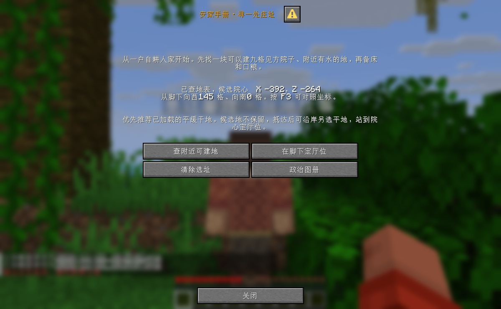
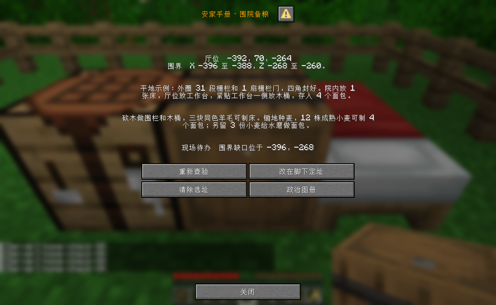
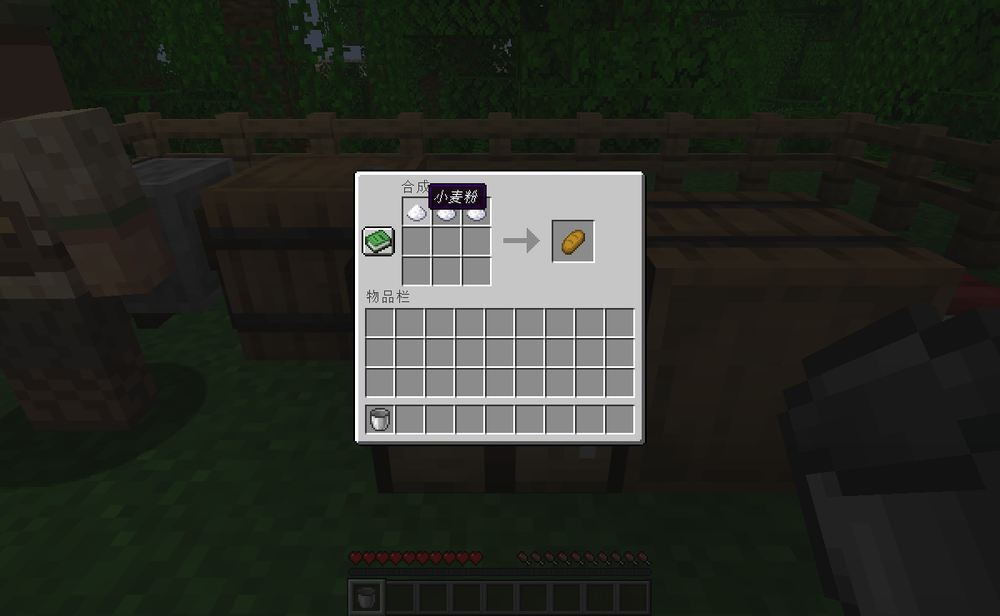
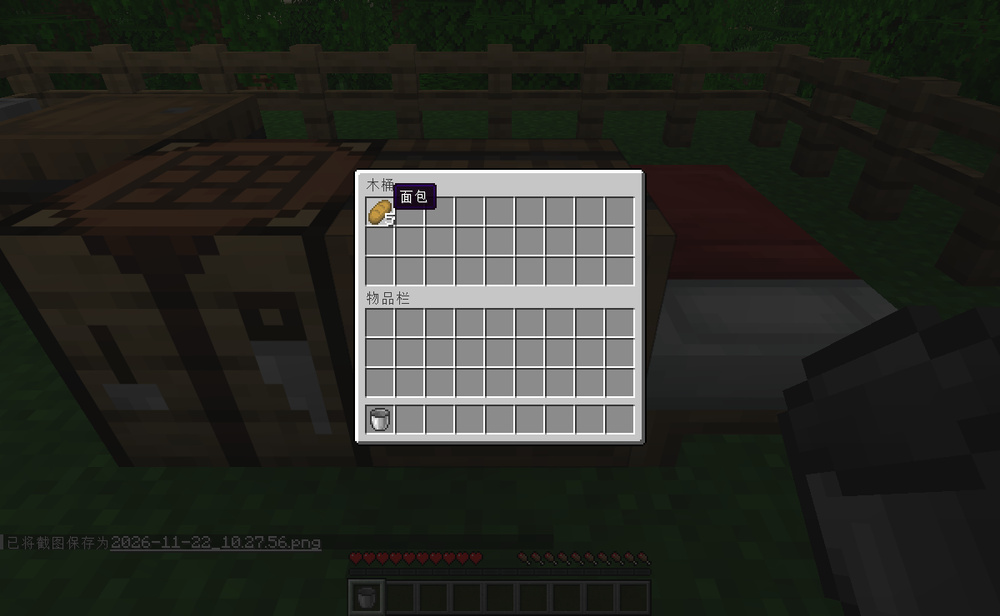

# 从一户人家到第一份口粮

本文记录 0.10.0 的旧版验收。自 0.10.1 起，口粮经过手磨或水磨、案板揉面和营火烤制。[当前版本操作](paper-0.10.1-baking.md)

服主在新世界运行一次 `/realm init` 开放庄籍。新玩家第一次进主世界时，点聊天中的「打开安家手册」，或输入 `/realm`。中途关掉界面、离线或想再看操作时，使用 `/realm start`。政治图册一直可以用 `/realm atlas` 打开。

## 在哪里落脚

点「查附近可建地」。手册以玩家为中心查十六区块以内的地籍，排除他领、他人的庄院和超出世界边界的院址。对已加载的区块会查看院心、四角的地表与高差。附近没有已知平缓干地时，可提示仍待勘察的候选地，玩家到场后自行决定。候选地只保存在自己的选址记录里，实际登记时再次核查归属。

到附近找平地，站到准备安放厅堂工作台的位置，点「在脚下定厅位」。手册记下工作台坐标，算出周围九格见方的院界。在查验通过前可以重选位置。



## 给第一户备什么

| 设施 | 实际摆放 |
| --- | --- |
| 围界 | 平地上用 31 段栅栏和 1 扇栅栏门围成 9 × 9 的院子，四角封好。已有合适的墙、树篱或水界也可接入。 |
| 床与厅堂 | 院内放一张床，在记录的厅位放工作台。普通右键仍可合成，潜行右键可查已登记的庄档。 |
| 赈济桶 | 在工作台紧贴的水平一侧放木桶，放入四个面包，一份供本户、三份为公共余粮。另留三份小麦给水磨。 |

回厅位八格内点「重新查验」。缺粮、设施错位或围界有缺口时，按现场提示补齐。通过后点「命名并登记」。一户首庄是私人地产，政治领土归属单独登记。另立分庄仍须从已有庄园迁出三户，原庄至少留一户。



## 把第一批麦送回饭桌

1. 在庄内放磨石，东侧紧贴粮桶，西侧紧贴种桶，北侧留出磨工可以站立的入口。在磨石南侧两格内备水和活板门轮叶。
2. 瞄准磨石，点「登记眼前水磨」。打开田务派一户磨粉，把三份小麦放进东桶。磨粉四季皆可，首庄当季只有这一户劳力。空桶时磨工待粮，补麦后继续原工单。
3. 从东桶取出小麦粉。普通右键厅堂工作台，三个合成格各放一份面粉，取出一个面包，亲手放回厅旁赈济桶。留足口粮、增加床位后，庄园可以逐季迎接迁入家庭。
4. 要走向领地政治，先稳定六户并完成一季公共赈济，然后在庄园档案发起建领公议。


## 实服验收

使用 Paper 26.3 build 257、BlueMap 5.29、中文原版客户端及普通随机地形。第一次生成的种子为 `-2999477474165736077`，终验在同种子的新存档复跑。庄籍由服主开启，NewReeve 使用无 OP 权限的生存账号操作。为重复测量，测试台整平了小块院地、供应建材和首批食物，并用控制台定位玩家。围建、填桶、登记、派工、制成面包和回存均经玩家界面操作。本次没有计量从空手采集原料或步行到院址的耗时。

| 检查 | 观察结果 |
| --- | --- |
| 从出生领地选址 | 在他领定址被拒。候选地经实际走访复查，厅位和围界使用方块坐标。 |
| 少放一段围栏 | 手册给出缺口坐标。补齐后出现「命名并登记」，首次入籍为一户。 |
| 派工时东桶为空 | 磨工显示「缺制粉谷物」。玩家存入三份小麦，磨工从同一个桶出料、返仓，送回三份带磨坊印记的面粉。 |
| 庄户的口粮 | 赈济桶起初四个面包。玩家用三份面粉制成一个面包，送回后桶内为五个。 |




三份原版糖按相同摆法没有产出面包，原料仍在玩家身上。BlueMap 的「私人庄园」图层出现登记的九格见方院界，世界政治地籍仍是原有的 768 个区块。



正常关服并冷启动后，赈济桶仍有五个面包，磨坊东桶已清空，庄籍、工单与 BlueMap 院界均可复查。另一名玩家 HillTenant 在选址后离线，重启后仍持有自己的候选坐标（−264，−408）。

自动化构建通过 50 项测试。针对本次存档，可用只读命令核对一户庄产、三个磨粉工时与首批入仓记录。

```sh
python3 tests/paper/verify_first_holding.py plugins/FeudalSurvey/realm.sqlite 96dd806c-724c-3e46-afb9-32950138803c NewReeve庄
```
