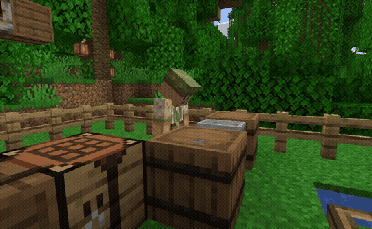
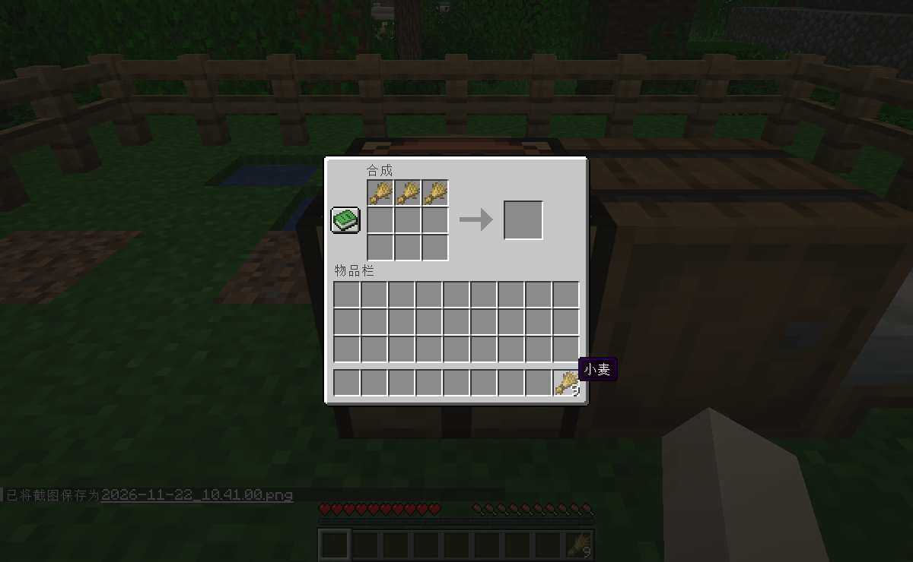
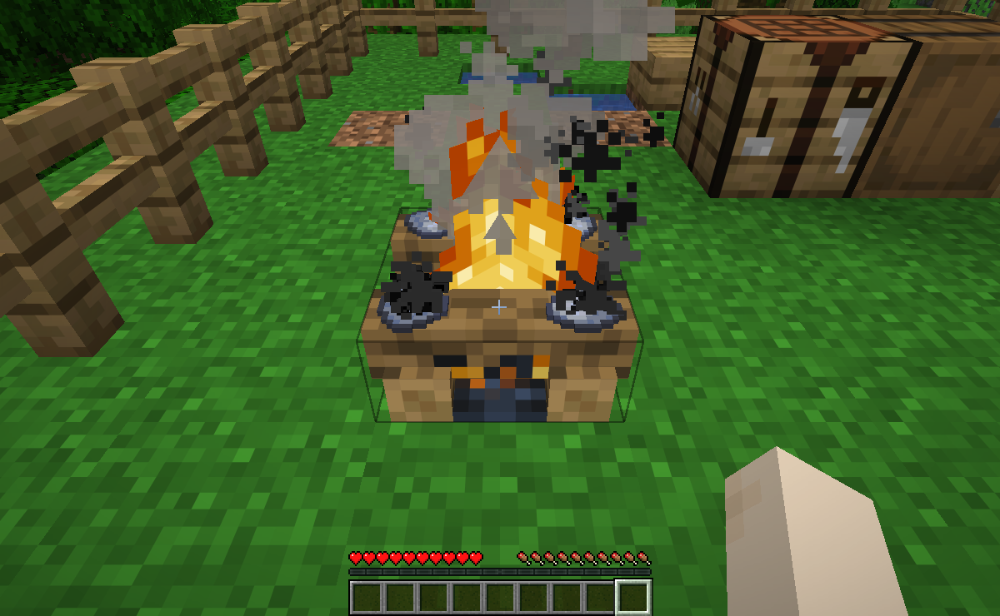

# 从麦粒到炉火

首庄的四个面包可以在取得庄籍前做出。备 12 份小麦、一个立在圆石或石头上的磨石、一块旁边有水的木台阶，以及一处点燃的营火。木案上方要留空，水可以比案板低一格。面粉沿用旧存档的物品印记。

| 地点 | 玩家操作 | 实物结果 |
| --- | --- | --- |
| 手磨 | 主手拿麦，潜行右键磨石。每次磨一份，约一秒半可再磨。 | 一份小麦换一份面粉。两次挥臂配合沿磨盘绕行的麦屑和粉尘，近处可听见磨石声。 |
| 揉面案 | 主手把三份面粉叠在一起，朝同一块邻水木台阶分三次右键。看动作栏的次数，按揉之间至少间隔 8 个游戏刻。 | 第三次按揉时才扣三份粉，得到一个生面团。超过五秒重新开始计数；先前两次按揉没有扣料。 |
| 营火 | 拿面团右键放到火上，每处营火最多铺四个。 | 保持燃烧约八秒后，面包从火边弹出，可亲自拾起。熄火会中断烤制，面团留在原处，复燃后可烤熟。 |
| 庄园水磨 | 登记水磨、在东桶备麦、派一户磨粉。 | 磨工面向磨石挥臂，随作业扬起谷屑和粉尘，面粉随工人回到东桶。田工收麦和补种时也会朝田格挥手，扬起麦穗或种粒。 |

[手磨实录](screenshots/0.10.1/hand-mill.mp4) · [案板揉面实录](screenshots/0.10.1/knead.mp4) · [营火烤制实录](screenshots/0.10.1/bake-on-hearth.mp4)

## 实服如何复验

使用 Paper 26.3 build 257、BlueMap 5.29、中文原版客户端和普通随机主世界（种子 `-2999477474165736077`）。先在 0.10.0 存档副本通电实测，再将同一副本升级。测试预置了石磨、院地、火源及原料，磨粉、揉面、投炉、灭火、复燃、取货与立庄由无 OP 的生存玩家操作。

| 对照 | 结果 |
| --- | --- |
| 原版三麦配方 | 0.10.0 中，合成器横排三份麦输出一个面包。升级后使用相同摆法，三份麦仍在原槽，输出桶为空。`/minecraft:reload` 后复测结果相同。 |
| 两种配料的合成格 | 工作台分别摆原麦、带印面粉，两次输出均为空。随身 2×2 栏用三格面粉也没有产物。将三份带印面粉放到合成器再通电，物料仍在三格内。 |
| 中途离开揉面 | 只按两次后停手，12 份面粉全数保留；超过五秒后再按一次仍未扣料。完成四批后持有四个生面团。 |
| 熄火与冷启动 | 四个生面团放上营火后，玩家用铲扑灭。等待超过烤制时长，再关服重启，四个槽里各有一个带印面团。复燃后炉面清空，玩家拾得四个面包。 |
| 立庄 | 新账号 MillerGuest 把烤出的四个面包放进空赈济桶，随后登记的「炉边庄」为一户。 |
| NPC 工作 | 缺麦的旧水磨获补七份麦后开工，东桶返还七份带印面粉。录像展示继续补麦时磨工的朝向、挥臂和颗粒运动。 |

另在测试副本缩短季长。秋季派工后成熟田格被收割，粮桶收到小麦；春季派工后同格出现麦苗。站在田边的第二个客户端分别收到了两名对应田工的挥臂动画。

构建通过 50 项自动化测试。BlueMap 与存档核对后仍为 768 个政治区块，新庄以私人庄园登记。

[面粉在工作台的对照截图](screenshots/0.10.1/flour-blocked.png) · [随身栏对照截图](screenshots/0.10.1/inventory-flour.png) · [立庄后的手册](screenshots/0.10.1/charter.png)
