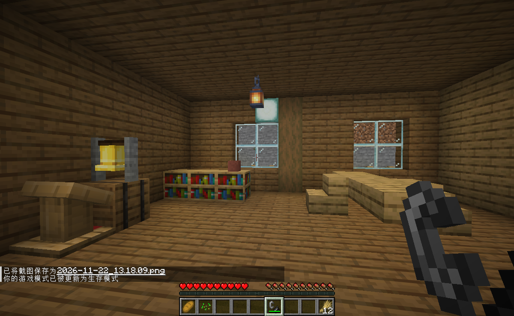

# 《封建社会》0.12.0 · 从庄宅到领地

这一版可以亲自住进庄宅、养活居民、召集建领公议，再用领印办理跨庄救济、签发矿业特许或验收道路工程。[下载插件](../examples/imperial-atlas/feudal-survey-0.12.0.jar) · [完整首发路线](首发实施路线.md) · [九支产业和建筑规划](领地建筑与有限经济.md)

## 从玩家家里开始

1. 用 `/realm` 进安家手册，或用 `/realm buildings` 打开中文建筑图谱。每支列出所需设施、谁有权办理、怎样进入操作。军营、军械库和军用器械工坊在对应分支标有开发状态。
2. 在庄档扩院，先建主宅大厅。留至少 35 格可走地面、三格净高、屋顶和门。另隔至少 9 格的私室，内放一张床和一个木桶，修可通行的门廊，入室确认。私床供玩家自己住，居民另盖民房。未获授权的访客打开私柜会收到中文提示。
3. 在准备议事的大厅放钟、讲台、档案桶和两处旁听席，站在厅内登记。两张合格居民床可容 200 人。每百人每季吃一份面包，生出的居民需要当季真实空位。粮仓和住位都宽裕时，满供下的自然增长率可从 2% 升至 8%。小数留到后季。
4. 养到 200 名实住居民，备齐住房，完成一整季公共供养并留三份公粮，在庄档发起建领公议。第一案至多 36 个区块。默认公示 24 小时且至少跨一季，裁定时重验人口、议事厅与供养。其他庄园和在途队伍的人口不计进本庄门槛。
5. 在领地人口簿查看住户、法理所属和实际持印人。整领交接需要原持印人和接管国代表各自到治所交印、接印。归还也在治所办理。领印改变公共权限，家族私柜和居民住所各依原账。

[主宅外观](screenshots/0.12.0/manor-house.png) · [玩家自住的私室](screenshots/0.12.0/chamber.png) · [访客尝试打开私柜](screenshots/0.12.0/private-cabinet.png) · [九支建筑图谱](screenshots/0.12.0/atlas.png) · [庄园季报](screenshots/0.12.0/growth.png) · [建领公示](screenshots/0.12.0/founding-notice.png) · [裁定后的领地簿](screenshots/0.12.0/founded.png)

## 实物生产与道路

| 事务 | 谁来办 | 现场操作 |
|---|---|---|
| 开矿 | 领地持印人设场，可特许承包人派班 | 找到新生成区块的天然铁、铜或金矿面，用 `/realm sample` 查验。在本领放矿口仓桶、木支护、工作台，留可步行矿道。瞄准桶用 `/realm mineopen 代号`。仓里放铁镐，瞄准矿面用 `/realm minework 代号`。本领须有四个可用工时。 |
| 采矿 | 持印人或在任持印人许可的经营者派工 | 矿工从坑口取镐，走到矿面开采，普通铁镐每班耗 10 点耐久，带粗矿及未损坏的镐走回交仓。人手和工班共用坐标耗竭账。每个核准的矿位只结算一次。天然种类、开采记录随旧场保留。 |
| 锻造和修路 | 庄主派工，本领持印人验收领地路面 | 建高炉、铁砧、料桶和可走通道，`/realm smith 庄园 登记`。一份木炭、一锭铁、四工时打一份桥路铁件。主手持成品、副手拿木板，瞄准登记道路缺口旁的支撑面执行 `/realm mend`。补好后重新查路面、承重和净空。 |
| 跨庄赈济 | 缺粮庄所在领地的持印人开单，供粮庄主备货，收粮方持印人验收 | 从庄档开赈单。供粮庄留足下季口粮，在厅旁实仓封装。玩家或 NPC 经道路和渡口搬运。全批放入目的庄粮桶后签收，才计入口粮。 |

[矿场图谱](screenshots/0.12.0/mine-guide.png) · [坑口与矿工](screenshots/0.12.0/miner.png) · [交矿回执](screenshots/0.12.0/ore-receipt.png) · [铁匠在铁砧旁工作](screenshots/0.12.0/smith.png) · [铁件交仓](screenshots/0.12.0/smith-receipt.png) · [玩家实修路面](screenshots/0.12.0/mended-road.png) · [赈粮签收](screenshots/0.12.0/relief-receipt.png)

## 服务器验收

Java 25、Paper 26.3 build 257、BlueMap 5.29，普通随机地形，庄宅场次种子为 `-2999477474165736077`。从旧存档副本升级，使用两个中文原版客户端 MillerGuest、NewReeve 办理玩家操作。控制台搭建建筑、布置首批物料、安排观察位置及邻国代表，并在测试副本缩短公示和季长。庄宅场次沿用已有 200 人的旧庄，另用季节算法测试从 100 人起的增长速率。

| 场景 | 可核对的结果 |
|---|---|
| 立庄与公议 | 炉边庄扩院为 33 × 28 格，分别登记大厅、议事厅、私床、私柜。访客开柜被拒。公示跨季后由玩家申请裁定，取得相连的四个区块。另用 SQLite 测试将人口从 200 减到 199，裁定会重新拒绝。 |
| 领印与人口 | 两人亲临治所交接炉边庄。接管国从 100 人变为 300 人。归还后恢复 100 人，炉边庄自始至终有 200 名本地居民。BlueMap 在交接时显示四个实控区块，归还后清零。对照覆盖 774 个有归属的区块。 |
| 矿藏 | 一个首次生成的区块登记了 203 个天然金属矿位。为验收开通矿道并暴露两个已登记的铁矿位，两个工班分别交仓。初版两班各交一份粗铁，实仓中共两份。随后提高了损耗，沿用同一把旧镐的复测见下。重启后在已耗竭坐标回放矿块，新工单遭拒，玩家将方块清走也没有新的粗铁掉落。 |
| 赈济与修路 | 两个庄在 18 格登记陆线上运送两份封装面包，有承运回执及赈单签收记录。另给铁匠实存的一锭铁、一份木炭，完成锻造后将这个成品移交测试玩家，玩家消耗成品和一块云杉木板，修复同条道路的缺口。 |
| 旧档 | 0.11.0 及以前已生成的区块缺逐矿位原始记录，原版矿物统计无法证明一块矿石的来历。这些旧区块不签新矿源，已存仓的旧矿仍可冶炼。试采请到新生成的区块。升级前停服，一起备份完整世界、插件数据库与配置。 |

[交印后的领地簿](screenshots/0.12.0/occupied.png) · [接管国的 300 人](screenshots/0.12.0/occupied-census.png) · [归还领印](screenshots/0.12.0/returned.png)

在另一份旧河港存档上载入本版，控制台发运三份具名面包，脚夫走到渡口，船工载同一批货到对岸，另一名脚夫接货走到终点。三张回执的货物内容一致，两次换装各用同一只实体仓桶。BlueMap 的七条货线、四处泊位、两座桥亭、两座商站均与账本一致。该存档的既有分封、帝内王号和五份领权记录也通过回归。[原版客户端的运输船](screenshots/0.12.0/river-boat.png) · [本版 BlueMap 河港图](screenshots/0.12.0/intermodal-map.png)

## 工具磨耗与铁料去向

镐、斧、铲、锄按材质增加每次作业的损耗。木制 4 点，石及铜制 8 点，铁制 10 点，金制 2 点，钻石及下界合金制 32 点。按原版本来会产生的磨损计，武器和护甲沿用其既有规则。已损工具继续用原耐久条。耐久附魔保留免耗机会，生产工具的经验修补停用，可在铁砧用对应材料维修。新普通铁镐能进行 25 次单点作业；若这 25 班都采铁，需从产出中留出三份粗铁冶炼成锭，才能补造下一把新镐。道路修件另耗铁锭和木炭。

本版的整领接管需要双方同意。围城强制占领、离线守备、多段赈济统一运单、矿井排水与品位，以及 30 人和 72 小时压力验收仍按完整路线排期。
