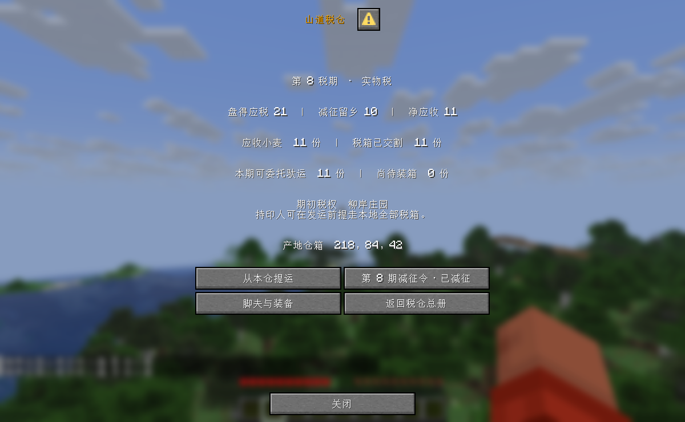
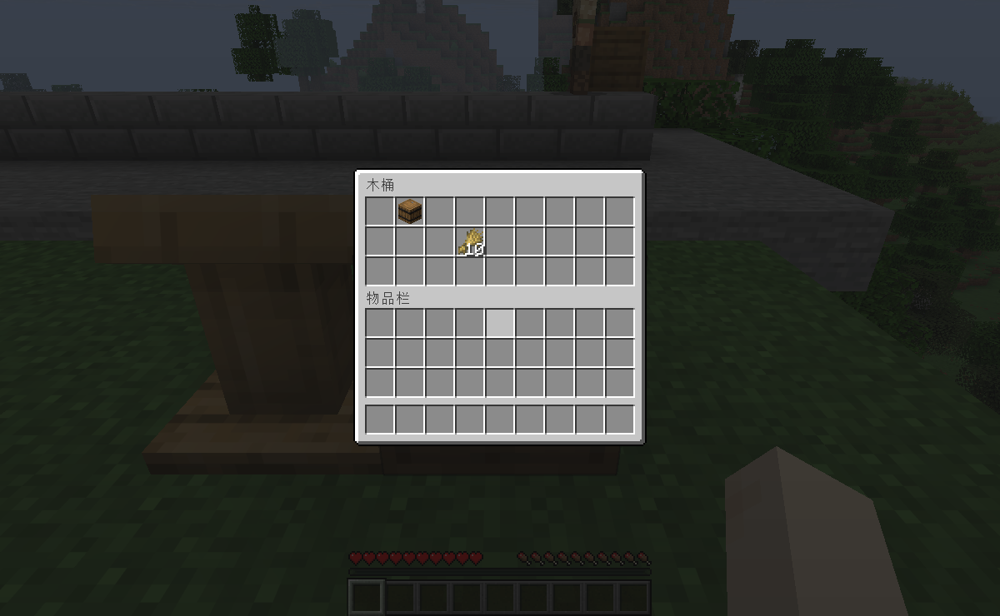

# 0.12.2 地方减征与实物税

一座缺粮庄所在的领地可以为本地税仓减征一期。地方领主决定在哪一仓留粮。若该仓的收益先前已封给另一家族或修院，税权持印人可以同意、拒绝会签，或在税期开始前撤回。

## 玩家怎样办

1. 在缺粮庄厅仓旁打开庄档的跨庄赈济，点「按实缺开单」。面包申请量受本庄下一季缺口限制。
2. 本领持印人在这张未结赈单上点「按本赈单拟减征」，从本领税仓中选一处，填写 1–100 的整数百分比。一份令只管下一税期，同仓同税期只能有一份有效令。
3. 两印归一人时立即核准。分属两人时，税权持印人从税仓账或赈单打开对应减征令，点「以税权持印人身份会签」。任一方在新税期开始前均可撤回。改比例需撤回旧令、另立新令并重新签署。
4. 新税期首次盘到应税小麦时复核授权，用实有麦数乘减征比例，向下取整。其余小麦按原税权封箱，自动驮运额度按净额与距离计算。持印人也可到仓提走全部尚在产地的应税箱，运往登记公库交割。
5. 打开税仓账可查盘得数、减征留乡数、净应收与已交割数。留乡的小麦可以当场取走送磨坊，做成熟食才可供居民食用。若到下一税期仍把原麦留在应税仓内，它会参加下一次盘点。

跨期前未会签，或计征时领地、持印人、税权发生了使原授权失效的变更，都按正常税额计征。撤销关联赈单也会使授权失效。已经封装交付的旧税箱和此前税账各按原期保留。

## 双人实服记录

Paper 26.3 build 257、Java 25、BlueMap 5.29。沿用前版随机普通主世界的验收副本，种子为 `-2271199516753095334`。预置缺粮状态、山道税仓分属两家的领印与税权，以及 21 份待盘小麦。为在一次测试内跨期，正常停服后将测试副本的税期时钟拨到到期前 5 秒。两名玩家均使用中文原版客户端、普通生存权限。以下图片是客户端 F2 原图。

|环节|实测结果|
|---|---|
|拟令与会签|MillerGuest 以地方领印为第 8 税期拟减征 50%，自行代签被拒。税权持印人 NewReeve 签署后重启，令号和签名保留。|
|实物盘点|山道税仓中本期的 21 份小麦留乡 10 份，另 11 份封为 8 份与 3 份两箱。上期的 1 份税箱单独保留。|
|步运与交割|NewReeve 到源仓提走两箱，步行至柳岸庄园公库。距离超过六格时交割被拒，走近后两箱分别入库，仓账实收合计 11 份。|
|停服复核|从区块存档读得产地仓有普通小麦 10 份，公库有普通小麦 11 份。两张当期税箱回执均已签收。原来申请 3 个面包的赈单仍待备货。|

[地方拟令](screenshots/0.12.2/awaiting-signature.png) · [税权人会签](screenshots/0.12.2/ratified.png) · [盘点后、交割前](screenshots/0.12.2/net-assessment.png) · [留乡文书](screenshots/0.12.2/local-retention.png)

## 回归与复核

Maven 通过 60 项测试，包括异人会签、撤回重拟、税权变更、全免不封箱、同一期重复盘点和跨期恢复。BlueMap 实时标记与账本对上 773 个区块、2 座桥亭、7 条货线、4 个泊位和 2 座商站。另复核了已有水陆联运的两次同柜换装、领权继任与玩家交易记录。

在该验收副本正常停服后，安装 Python 的 `nbtlib` 并运行 `python3 tests/paper/verify_tax_remission.py <测试服目录>`，可同时比对 SQLite 和两个实体仓桶的区块存档。[存档复核脚本](../tests/paper/verify_tax_remission.py) · [可安装插件](../examples/imperial-atlas/feudal-survey-0.12.2.jar)
