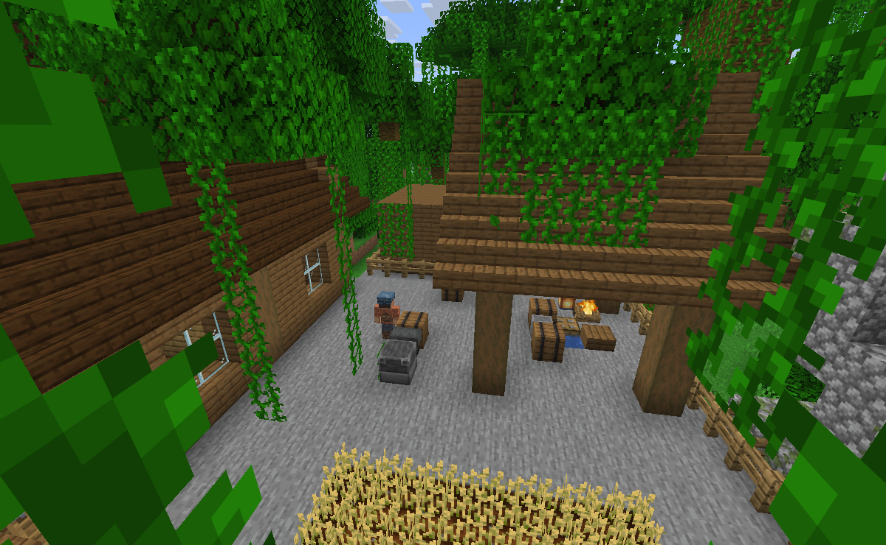

# 《封建社会》0.14.0 · 从百人庄园到第二代领主

进服输入 `/realm` 打开经营簿。庄主能从这里看到厅仓的面包、下季所需、住位、公议条件和家中的接续人。持有领印后，同一页会出现领地政务。一个账号拥有几座私庄时，可以在簿上换庄。

## 第一次开服

使用 Java 25、Paper 26.3 build 257。把试玩地图解压到一个空服务器目录，将插件放进 `plugins/`，启动并按服务器的白名单设置放行玩家。控制台执行一次 `realm init`，由署理皇廷开局。可另装 BlueMap 5.29 查看各家领界、庄园与商站。已有服务器先停服备份世界和插件数据，只替换插件即可。[插件](../examples/imperial-atlas/feudal-survey-0.14.0.jar) · [河台庄试玩地图](../examples/imperial-atlas/RiverManor-0.14.0.zip) · [BlueMap 安装与版本](paper-0.5.2-bluemap.md)

地图取自随机生成的普通主世界，种子为 `-2999477474165736077`。出生点往西约 152 格是预建院落。包中只保存院落附近九个地形区块，外围按原种子生成。第一次进入时可以自行登记庄名和家族。每季为三个活跃分钟，空服暂停；建领公示至少两个现实分钟，并须跨过一季。普通插件配置分别为六小时和二十四小时。若想自行开荒，可以直接在普通新世界中按安家手册选址。

## 一位庄主怎么游玩

| 阶段 | 在游戏里做什么 | 如何判断办成了 |
| --- | --- | --- |
| 安家 | 到 `-408 70 -264` 的工作台旁，瞄准台面，选「选址与安家 → 用眼前已有庄厅定址 → 命名并登记」。自行造院也可以先在脚下定址。 | 经营簿出现 100 名居民。尚未落籍的开家代表与手足住进首庄；首批居民已包含他们。 |
| 经营与婚配 | 看工作台西边的口粮桶，在经营簿打开「在本庄议婚」，核对婚书，再到婚约页开启养育。扩院围界填方块坐标 `-433 -282 -401 -255`。 | 住位足够且有余粮，人数逐季增长。每逢年度核算，食宿齐备时，每百人可以有一次自然死亡与一次出生相抵，限本地未具名人口。满房家庭也有机会生育。 |
| 种麦与制粮 | 瞄准 `-417 70 -259` 的磨石登记一级水磨。在水磨页「登记托管田地」填 `-430 -264 -424 -258`，耕地高度填 `69`。瞄准 `-417 70 -257` 的邻水木案与 `-415 70 -257` 的营火分别登记，然后常设口粮工班。 | 东桶备有 48 份小麦，西桶有 24 份麦种。一级磨坊最多托管 64 格，须步行可达。工班按季收麦、补种，把磨粉揉面烤出的面包送回厅仓。起始的 48 个面包用完后，要靠生产或交易续粮。 |
| 立领 | 到 `-426 70 -274` 的议事厅在庄档登记。达到 200 人、有足够住房并完成至少一季供养后，回庄厅打开经营簿申请建领。示例的区块边界填 `-27 -18 -26 -17`，可选「入帝」。 | 公示显示四个区块、答辩截止时间与异议件数。跨季并过期后在厅旁裁定。获准入帝后可请封伯爵，领邦保有自己的领印和人口。 |
| 授益 | 在自己的区块从领地政务登记税仓，按地形补建或绑定柜台和实仓，再选「拟授收益」。可把某仓的地租授给另一位在线玩家。 | 受领人取得收益封契。区块和居民仍归原领；伯爵以下可以授益，更小一级的独立国家不会因此产生。 |
| 同邻家交易 | 在「商站与交易」登记带橡木牌的空桶。业主把货放第二格后报价；另一家亲到柜边，把钱放第一格，成交后从第三格取货。业主可在柜边撤下余单。 | 款进业主收款格，实货进买家背包。各地行情按玩家真实交易更新。缺货、缺钱或无人接单时，订单会等待。 |
| 换代 | 生前在经营簿「生前核对继承」查看各枚领印和私产的去向。生存模式下本代身亡后，复生打开 `/realm`，从有资格的男性亲属中接续。 | 接班人取得自己的家档、庄产与法定领印。已签给别家的税权按原封契继续有效。幼主可以经营与读账，重大授封须候成年。 |

一家的玩家接续人和每块领地的法定继承人可以不同。女儿保留婚书、亲谱和财产，玩家接续先看本家男性后裔，再看本家兄弟。外孙是否能承领按当地继承法；仅在本家无人接续且外孙属于 AI 家族时，才有迎回外孙接班的例外。[继承法与外孙实测](paper-0.13.1-succession.md)

## 实服记录

两位非管理员使用原版中文客户端进入同一个 Paper 26.3 build 257 实例，从空白庄籍开局。测试在预建房舍、实桶备粮的普通地形进行，加快了季序，用控制台移动测试玩家、布置现场物资及触发生存死亡。人口、出生及性别、封契、商单、继承人均由正常游戏规则产生。

| 实际办理 | 复核结果 |
| --- | --- |
| 从首庄到帝国成员 | 河台庄登记时 100 人，随后两百人住满。水磨有制粉交仓记录。第 22 季张贴四区块公示，跨季并经过答辩期后取得领地，再获准伯爵爵位。[边界公示](screenshots/0.14.0/public-notice.png) · [请爵结果](screenshots/0.14.0/peerage.png) · [领内人口](screenshots/0.14.0/country.png) |
| 两家权利 | 河台伯爵把河台地租仓的收益授予另一家。领内仍是四个区块，地租封契名下领土为零。初设仓的区块缺少自动搭建位置，持印人将现有房间的讲台和麦桶登记为税仓。[仓务设施](screenshots/0.14.0/tax-store.png) · [受益方政务](screenshots/0.14.0/rent-holder.png) |
| 实物买卖和撤单 | 河台柜预存 16 份小麦，每批 4 份，每批一枚金粒。来客带两枚金粒，成交一批后带走 4 份麦和一枚余款。停服重启后，买家撤单被拒，业主撤下余下两批。停服柜内有 12 份麦及一枚已收到的金粒，成交记录一笔。[商站报价](screenshots/0.14.0/market.png) · [柜台成交](screenshots/0.14.0/trade.png) |
| 下一代 | 同一对夫妇自然出生三女一子。儿子在第 144 季出生，当季庄内出生两人、自然死亡两人，总人数仍为 200。第 146 季父亲身亡，身后文书把商站、庄产和伯爵领交给儿子。接续后邻家的税权持印人未变。[生前预览](screenshots/0.14.0/succession-preview.png) · [身后交割](screenshots/0.14.0/handover.png) · [第二代经营簿](screenshots/0.14.0/next-generation.png) |
| 重新解压试玩地图 | 第三个新账号从空白庄籍认领现成工作台，验出 200 个住位、登记水磨和 48 格可步行到达的耕地，并开办常设口粮。玩家将原有 48 个面包移入背包，烘焙工领麦、制粉、揉面、入炉。成品在途时停服，重启后一个新面包进入厅仓，磨坊原麦从 48 降至 45。工人能绕到可通行的柜面交粮。[认领庄厅](screenshots/0.14.0/sample-ready.png) · [田界表](screenshots/0.14.0/field-survey.png) · [水磨田务](screenshots/0.14.0/bakers.png) |

安装最终发布的插件再重启后，原玩家仍可打开第二代经营簿。BlueMap 5.29 实际网页标记显示河台伯爵现任持印人为「儿子4」，河台柜在榜订单为零。测试机外网无法取得地图客户端资源，复用了同版原版客户端缓存后核对了实际网页端点。纸服初建公产聚落时按需异步载入候选区块，地形就绪后再在主线程验址。自动化套件共 73 项；这份连续存档另以 SQLite、玩家背包、Anvil 箱柜与 BlueMap 标记交叉复核。[停服复核脚本](../tests/paper/verify_playthrough.py)

本轮验收覆盖一处庄园、两个玩家家族与一次真实换代。生育按食宿、实际出生名额和年度机会判定，目前婚后高龄生育率没有单独模拟。自然时间的多代平衡、多人长期并发、军营征召与围城仍在完整首发路线中。水陆联运、断桥停运及更换领主后的货物交割有单独的实测档。[水陆联运](paper-0.12.1-relay.md) · [完整首发路线](首发实施路线.md)
