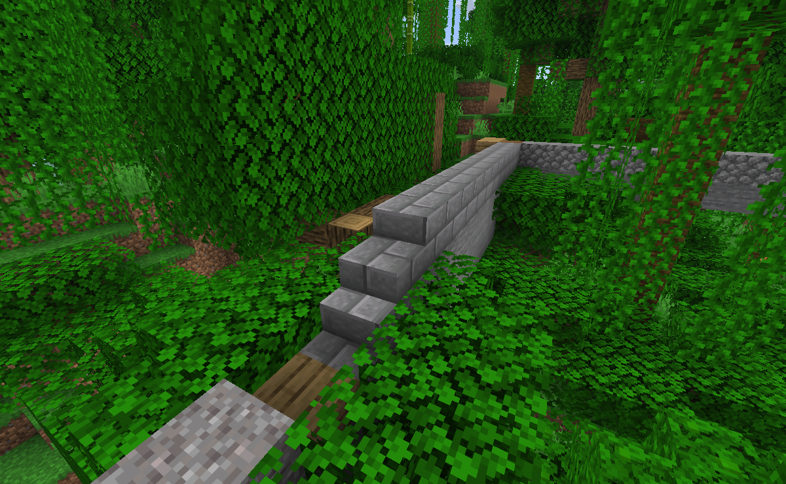

# 《封建社会》0.16.0 · 量庄界、铺坡道、到货站签收

进服点欢迎消息里的「打开经营簿」。在主世界双手留空，潜行时按交换副手键也能打开，默认键位为 **Shift＋F**。手里有物品时保留原版换手操作。在登记的庄厅潜行右键工作台或右键讲台可直接查庄档，在公共站桶旁空手潜行右键可发货或签收。[插件](../examples/imperial-atlas/feudal-survey-0.16.0.jar) · [从安家到建领的试玩地图](paper-0.14.0-playthrough.md) · [经营簿实机截图](screenshots/0.16.0/journal.png)

## 庄园到底有多大

安家手册里的首庄定址以工作台或讲台的 X、Z 为中心，向东西南北各伸四格。四条边都算在内，因此是 **9×9＝81 个方块**。从地籍的「测量并立庄」自行登记院落时，长和宽各可取 8 至 96 格，庄厅须在所填范围内。两种入口都按地籍登记的矩形计算，面积等于（东界－西界＋1）×（南界－北界＋1）。院界决定住房查验和设施登记的范围。磨坊还有单独的托管田、等级上限和步行可达条件。[磨坊田务](paper-0.14.0-playthrough.md)

| 庄主想办什么 | 现场操作 |
| --- | --- |
| 查面积 | 庄档显示四界、长宽和总方块数。每条边都在厅位高度上下两格内逐格检查，围栏、围墙、树篱和水都可作界线，至少留一扇栅栏门。 |
| 扩一侧或多侧 | 围好新院，选「庄档与住房 → 扩建庄界」。依次瞄准两个相对的角，点「量眼前第一角」「量眼前第二角」，从哪个角开始都可以。走动时可关界面，到下一角再从经营簿打开。两角量好后保存草案。 |
| 登记新界 | 带草案回原庄厅八格内，选「在庄厅验收新界」。新矩形要完全包含旧院，每边最多 96 格，须在世界边界内，与其他庄园无重叠，所跨区块须为无主地或自己持印的地块。现场继续查围界、粮桶和住房。 |
| 取得领地 | 政治领土另按 16×16 的区块登记。扩大私庄会增加院内可用的方块。取得新的行政辖地，仍要走建领公议、开拓或割地手续。 |

河台庄原界为 X −433 到 −401、Z −282 到 −255，共 33×28＝924 格。双人测试服中，庄主量了新围院的两个角，回厅把东界延至 −400。新庄档是 34×28＝952 格，领地仍为原有四区块。[原庄档](screenshots/0.16.0/manor.png) · [两角测量](screenshots/0.16.0/survey.png) · [验收后的庄档](screenshots/0.16.0/expanded.png)

## 五类路面

| 路面 | 铺设示例和条件 | 玩家运量上限 | 玩家步速 |
| --- | --- | ---: | ---: |
| 夯土路 | 土径、夯实泥土 | 64 份 | +5% |
| 碎石路 | 砂砾下另铺一层合格路材 | 96 份 | +12% |
| 圆石路 | 圆石、苔石及其台阶和楼梯 | 128 份 | +16% |
| 木栈道 | 木板、木台阶、木楼梯；悬空桥跨要有桥面和支点 | 128 份 | +20% |
| 砖石大道 | 石砖、红砖、平滑石、磨制安山岩、深板岩砖、泥砖等，以及其余合格台阶、楼梯 | 160 份 | +28% |
| 野地 | 未达到铺路条件的地面 | 32 份 | −20% |

这些数值是本版的试玩参数。台阶与楼梯沿用铺面材质，含水构件要先排干。货线会检查两格交界处的实际高差、承托与净空，改建造成断点时工班停车。玩家在经营簿点「脚下路况与运力」可直接查看。脚夫、税运和迁居队伍也随路面调速。NPC 的载量继续取决于背架和现场配置的驮畜。[站在橡木下半台阶时的运力](screenshots/0.16.0/wood-slab.png)

## 两队同到一站

每座出发站的陆线共用其实体脚夫，水线共用其船工与船只。工班在外或正在返程时，该站不能再用同一人开车。不同工班独立前进、等待路费或签收。几个工班共享同一个终点桶时，先交的实物占第一格，后到工班即使已签收也须等该格腾空。[站边发货](screenshots/0.16.0/send.png)

实服使用 Paper 26.3 build 257、BlueMap 5.29 和两个无 OP 的原版客户端，沿用随机普通主世界种子 `-2999477474165736077`。测试控制台预置道路、库存、角桩，并把角色移到各现场。玩家实际点击货站表单发货、到站签收，在庄档测界和验收。管理员沿用货线登记命令。

1. 粮队带 4 份小麦越过半砖和楼梯，停在缺失的一块石砖前，运单进度为 9/19。另一座站的脚夫独立走完 15 格圆石路，把 3 根橡木原木运到相同终点。两张运单在同一张中文货站界面显示各自的进度，收货人能签自己的货。[两张运单的现场截图](screenshots/0.16.0/shared-station.png)
2. 原木先卸到桶里。路面修通后，粮队也抵达并办完签收，此时卸货格仍被原木占用。在这个时点停服重启，先到的单保持已交付，粮单保持待卸。收货人从桶内取走原木后，4 份小麦才卸入同一个格。停服存档中的两名签收人、木料和粮数可以逐项复核。[终点实桶](screenshots/0.16.0/received.png)
3. 服务端逐一读取玩家在夯土、碎石、橡木下半台阶、石砖楼梯和圆石上的实际移速修正，分别为 5%、12%、20%、28%、16%。BlueMap 重启后仍发布两条独立货线。

收费亭也能从界面办理。站在路边瞄准讲台，在「脚下路况与运力」选择「登记眼前收费亭」，填写亭名、金银和价格。表单记住最初选的讲台，提交时仍须人在亭旁并有本国代表权。路段须三格宽、七格长，两端接路，讲台背路一侧放柜桶。业主右键已有桥亭可调价；承运者也可由玩家在现场交给他们真实路费。[路亭定价表单](screenshots/0.16.0/toll-setting.png)

第二轮专门检验两队使用同一收费亭。领主在界面登记每次 1 枚金粒。控制台在两名原有脚夫的钱袋各备 2 枚金粒，发出两张具名测试单，两个客户端分别在站桶签收各自的货物。一次试跑中，先返程者挤走了仍在等卸货的同伴。修正后从这一状态重启，仍带着 3 锭铁的原脚夫从 X −429 附近连续步行，重过同一亭，回到 X −405 的站桶卸货。去程已核销的路费只计一次。[两队都已到站](screenshots/0.16.0/both-arrived.png)

两队各有一笔去程和一笔返程回执，每笔一枚金粒，收款柜合计四枚。停服后用下方脚本复核两名脚夫、四张收费回执、实柜金粒、收货人、原木和羊毛背包、两个终点桶、实际坡道方块、庄界和 BlueMap 图层。[收费柜实物](screenshots/0.16.0/toll-revenue.png) · [停服存档核验脚本](../tests/paper/verify_shared_station.py)

在装有 Python 和 nbtlib 的环境运行 `python tests/paper/verify_shared_station.py 测试服目录`。脚本针对上述河台庄验收副本。本轮覆盖两个玩家、两支陆运工班。大规模共站和多船同时靠泊仍待独立验收。
