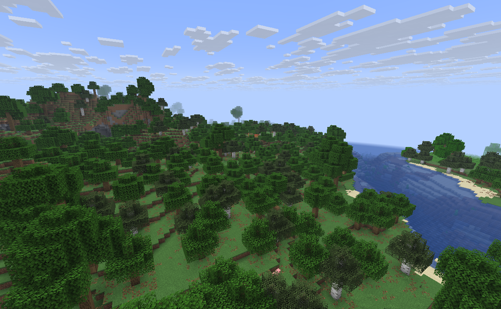
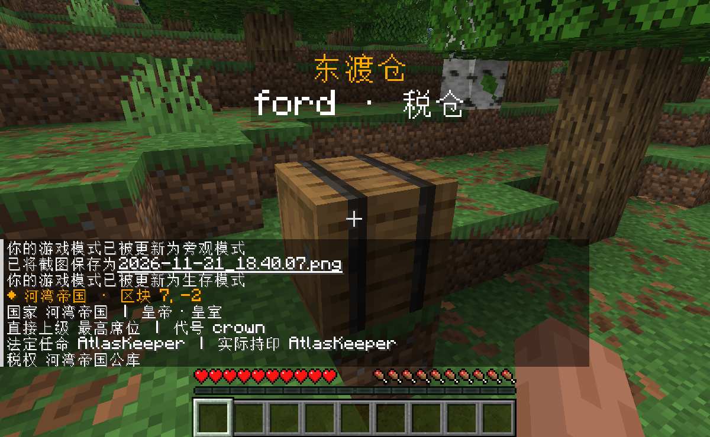

# 封建社会 · 随机主世界实测

《封建社会》取名自马克·布洛赫的同名著作。河湾帝国是本次试玩中建立的国家。以下截图由 Minecraft Java 26.3 原版客户端按 F2 取得。



## 世界与地形

在空数据目录以 Paper 26.3 build 257 启动，采用 `level-type=minecraft:normal`、空 `level-seed` 并开启结构生成。服务端抽到种子 **`-2271199516753095334`**。控制台的 `seed` 与主世界存档中的值一致。存档记录的生成器是 `minecraft:noise`，噪声设置与生物群系预设都是 `minecraft:overworld`。

| 税仓 | 地表库址（X, Y, Z） | 首期应收小麦 | 自动入库 |
| --- | --- | ---: | ---: |
| 王城市集 | (8, 63, -24) | 16 | 16 |
| 西磨坊 | (-72, 72, -24) | 16 | 8 |
| 东渡仓 | (120, 68, -24) | 16 | 0 |

三座税仓由插件按各自所在地表高度定位。世界全景使用旁观视角，亲征、运箱和交割使用生存模式。测试控制台将角色放在东渡仓附近作为起点。角色亲征后带着税箱穿过林地返回王城。服务端从物品栏读到封缄桶内有 16 个 `minecraft:wheat`，交割后王室公库从 24 增至 40。原有的平地往返用时只适用于[早期对照测试](paper-0.3.0-realm.md)。



[王城交割回执](screenshots/0.3.0-natural/receipt.png) · [游戏内《封建社会》图册](screenshots/0.3.0-natural/directory.png)

## 重新测试

本次构建通过 21 项自动化测试。重启同一存档后，控制台仍读到同一种子，王室公库存粮仍为 40。

每次新开随机世界先采用[试玩配置](../examples/imperial-atlas/server.properties)，在新的实例目录启动服务端。要重访上图地形，可在首次启动前填入本次实测种子。已生成的存档保留自己的地形。

停服后可用以下命令同时核对配置和存档。即使把旧超平坦存档的配置改为普通世界，校验也会从已保存的生成器识别出来。

```sh
python -m pip install nbtlib==2.0.4
python tests/paper/verify_natural_world.py /path/to/server
```
