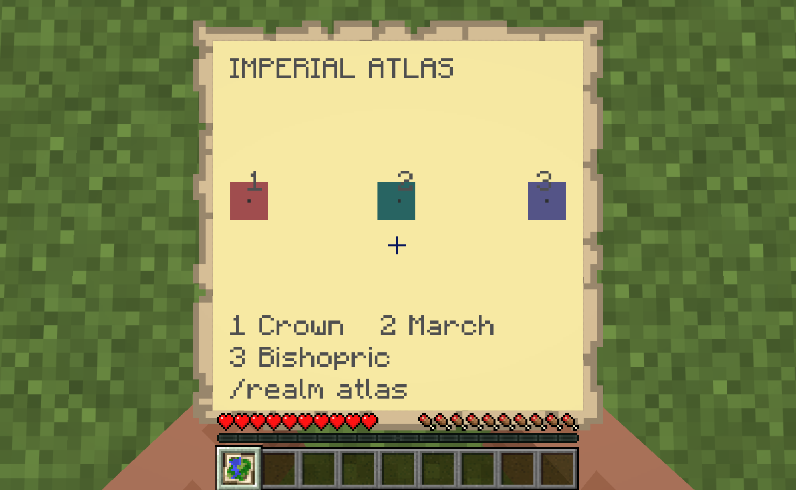
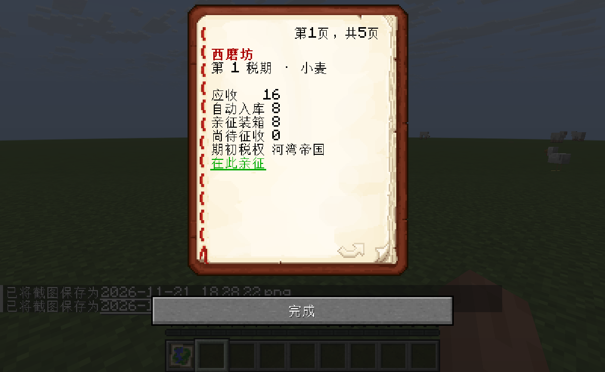
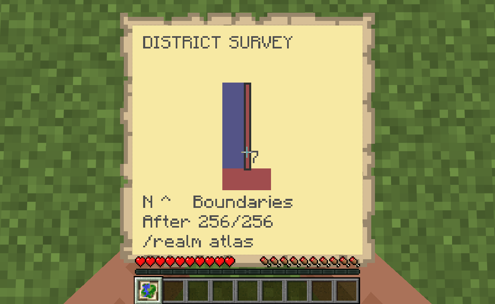
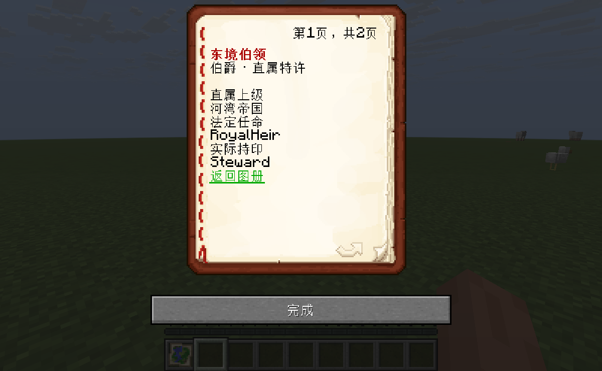

# 河湾帝国 0.3.0 · 实服验收

使用 Paper 26.3 build 257、Java 25、SQLite 和隔离的平坦主世界测试。截图来自 Minecraft Java 26.3 原版客户端的 F2，分辨率为 1200×740。主测账号在原版客户端操作，另有三个通过游戏协议登录的普通权限账号分别担任领主、继承人和流官。控制台用于建国、布置测试位置和只读核对物品。步行计时由客户端实际移动取得。

| 里程碑 | 结果 | 源码提交 |
| --- | --- | --- |
| 领地与国家 | 同一图上可查王城、直属伯领、主教驻地；未授予区域保持空白 | [ea3ba9a](https://github.com/XuanYuanYunBai/feng-jian-she-hui/commit/ea3ba9a) |
| 财政 | 同一期独立计算自动入库、现场装箱、在途与交割 | [fbb88b5](https://github.com/XuanYuanYunBai/feng-jian-she-hui/commit/fbb88b5) |
| 分封 | 公爵封伯爵、伯爵授庄园收益；流官自行追加及转封都被拒绝 | [7a761f1](https://github.com/XuanYuanYunBai/feng-jian-she-hui/commit/7a761f1) |
| 继承与王号 | 暂管、请袭、任命与交印可分别发生；同一公国先取得帝内王号，后经另一次和约独立 | [ce9383d](https://github.com/XuanYuanYunBai/feng-jian-she-hui/commit/ce9383d) |

## 领地图

下图为新建帝国的总图。每个色块按实有登记区块绘制，数字与中文图册的领名对应。放大某一区域使用 `/realm local`。伯爵直接向帝国效忠，主教驻地也依直属特许管理自己的税源。

[中文图册](screenshots/0.3.0/directory.png) · [伯领地块、上级与税权](screenshots/0.3.0/county.png) · [实际签发的修院直属特许](screenshots/0.3.0/patent.png)

## 征税和步行成本

首期王城市集、西磨坊、东渡仓各应收 16 份小麦。三个仓自动入库 16、8、0，王室公库起初为 24。东渡仓亲征 16 份，入库后成为 40。交付版还在全新世界通过原版客户端右键税仓、点击书中亲征、手持税桶步行返城，走通同一笔账。用服务器只读命令查到该桶的原版容器第零格确有 16 个 `minecraft:wheat`，入库后同一箱号标记为已交割。独立测试还从西磨坊装走未收的八份，步行运回后公库存粮达到 48。重启复查为两箱、两份交割记录。君主亲访直属 NPC 伯领，得到四份自愿赠粮，伯领保留十二份，重复访问没有再次扣款。

[五仓同一期账目](screenshots/0.3.0/ledger.png) · [现场右键东渡仓打开的税账](screenshots/0.3.0/ford-account.png) · [东渡仓的封缄税箱](screenshots/0.3.0/ford-crate.png) · [王城交割回执](screenshots/0.3.0/ford-received.png) · [西磨坊交割后公库存粮](screenshots/0.3.0/mill-delivered.png)

以王城库址为起点，普通步行到东渡仓用时 26.1 秒，原路返回 26.0 秒。西磨坊去程 19.1 秒，带箱返回 18.8 秒。沿平地测量，东西两端的库址间距分别为 112 格和 80 格，库址周围五格可办交割。

按首轮一步一个区块计算，王城 16×16 初始辖区有 **171／256** 个区块处于自动收益为零的范围。将 `realm.chunks-per-tax-step` 设为 2，同一边界和首都位置下，该数降到 **25／256**。首发保留步长 1 供对照。调参影响新税期，旧账和土地归属均可复核。

## 流官与官印

北部巡区先获 240 区块。君主在地图中预览相邻十六块，确认后达到 256。随后再加一块被整笔拒绝。另用 SQLite 自动化测试验证，同一个人兼任两处流官时，两处面积共同占用上限。

[追加至上限后的拒绝回执](screenshots/0.3.0/governor-limit.png)

东境伯领出缺后由 Steward 暂管。君主任命 RoyalHeir，Steward 拒交官印。停服、重新启动，并登录原版客户端，图册仍分别列出两人。另一次在东渡伯领的实测中，旧官的私庄和官印先交给不同继任人；后来两位玩家联署、家族请袭、君主确认，下一次出缺才按文书世袭。

[确认世袭后的地方志](screenshots/0.3.0/hereditary.png) · [公爵获王号后仍属帝国](screenshots/0.3.0/kingdom.png) · [另签和约后成为独立王国](screenshots/0.3.0/independent.png)

## 史料与模拟尺度

- 帝国直属权可适用于伯爵、城市或宗教机构。游戏用直属特许把效忠对象与头衔级别分开；伯爵之下授小地产及收益是本服的分封下限。[《瑞士历史辞典》帝国直属权](https://hls-dhs-dss.ch/de/articles/009832/2012-06-25/)
- 波希米亚的王号确认与皇位竞争和帝国内部权利有关。游戏分别登记王号协议和解除隶属关系的独立和约。[1212 年波希米亚金玺诏书研究](https://real.mtak.hu/162972/)
- 877 年西法兰克《基耶尔济敕令》第九条为伯爵出缺期间安排了暂管。游戏借此区分暂管、君主任命与家族世袭；不同地区和时代的官职实践存在差异。[那不勒斯大学史料](https://www.rm.unina.it/didattica/fonti/anto_ame/cap_IX/IX_5_it.htm)
- 流官采用中国制度中的定辖与任命作为参照。256 区块上限、每仓十六份小麦、支持点数与二十分钟税期均为游戏参数。军役条款目前以文字登记，地方化由资历、玩家联署和协商推进。[国家民委关于改土归流的介绍](https://www.neac.gov.cn/seac/c103391/202306/1165317.shtml)

构建命令为 `mvn clean verify`。21 项测试通过，包含已有勘测、货运回归及政治、财政、封契、继承测试。交付插件的 SHA-256 为 `152a866eee0b85e0cf67ac39a5e375efa56ba7e79951d7bda4e6315984609a3d`。[安装与完整试玩步骤](../examples/imperial-atlas/试玩说明.md)
