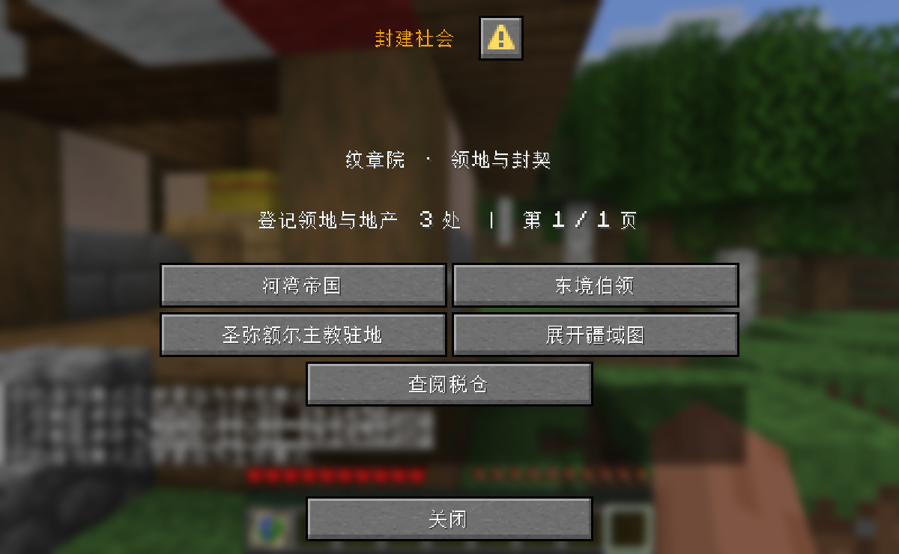

# 《封建社会》0.3.1 · 账房与中文对话框

输入 `/realm` 打开纹章院。点领名可查看上级、官印与财权；点“查阅税仓”可在总册中选择仓房。玩家可在任意位置查账，征收与交割仍需亲赴现场。界面按 Paper 官方文档使用 `Dialog.create`、`DialogBase`、`DialogType.multiAction` 和 `Player.showDialog`。货运表单通过 Dialog 输入框和回调读取收货人。[Paper Dialog API](https://docs.papermc.io/paper/dev/dialogs/)



## 进入仓房

每处仓房有独立的石木地基、木地板、双坡屋顶、牌匾、账台、灯与粮垛。正面留出入口；西磨坊装有风帆。右键账台或中文牌匾就能打开本站税账。已封缄的税箱仍是一件可以随身运输的物品。


[近看中文牌匾、账台与粮垛](screenshots/0.3.1/storehouse.png)

## 原版客户端实测

使用 Paper 26.3 build 257、Java 25 和原版中文客户端，在此前随机生成的普通主世界中测试，种子为 `-2271199516753095334`。以下为 F2 原图。控制台用于布置观察位置、切换测试地点和核对实物。

| 操作 | 实测结果 |
| --- | --- |
| 在西磨坊右键账台，点“在此亲征” | 第一期应收 16 份，已自动入库 8 份，账台只发出余下的 8 份。服务器物品栏读到带编号的税箱，内装 8 个小麦 |
| 在王城手持税箱右键账台，点“交付手中税箱” | 税箱完成交割，公库存粮由 40 增到 48 |
| 在纹章院点“河湾帝国” | 打开该领的头衔、上级、法定任命、持印人、区块数和库存 |
| 在货站空手潜行右键，填入在线收货人并发货 | 原版中文表单成功开单；终点用“签收货物”完成交割，实际站桶收到 6 个小麦 |

[西磨坊税账](screenshots/0.3.1/account.png) · [王城交割回执](screenshots/0.3.1/receipt.png) · [中文货运表单](screenshots/0.3.1/freight.png) · [手持疆域图](screenshots/0.3.1/map.png)

## 存档与升级

在 0.3.0 的存档上加载王城、西磨坊、东渡、伯领、主教五处税仓区块。插件为可施工的位置建造仓房，移除旧版单桶展示。仓房与账台位置写入各自区块。选址会检查地表、坡度和上方空间；施工空间被占用时可以保留原地块，再由持印人腾出空地并执行 `/realm build`。

两次停服后各自从存档核对，五处账台的坐标与数量一致，每处都有 49 格屋顶、25 格地板和中文牌匾。第一次停服前在王城账房放入的花盆，重启后仍在原位。

22 项自动化测试通过，包括地图中文字形和授地数字的宽度检查。

在隔离测试服加载所有已登记的税仓区块后停服，可按以下命令逐块核对屋顶、地板、中文牌匾与唯一账台。

```sh
python -m pip install nbtlib==2.0.4
python tests/paper/verify_storehouses.py /path/to/server feudal-world
```

[插件下载](../examples/imperial-atlas/feudal-survey-0.3.1.jar) · [试玩指南](../examples/imperial-atlas/试玩说明.md)
