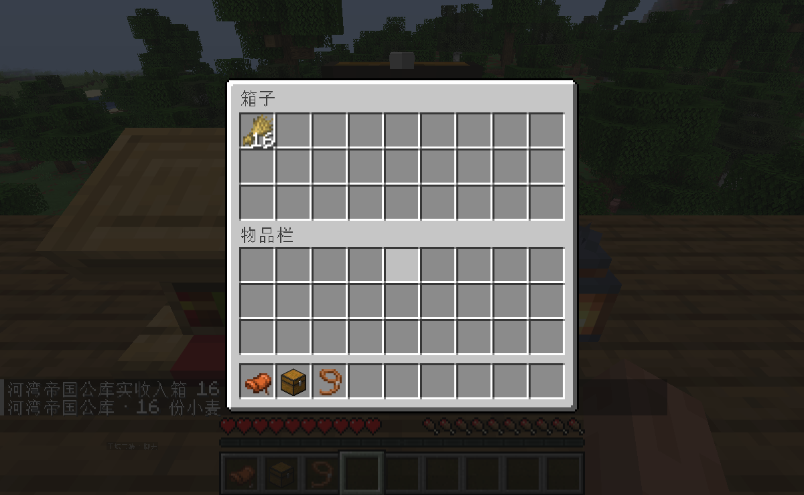

# 0.4.0 仓务与运输实测

在 Paper 26.3 build 257 上，用原版中文客户端进入随机种子的普通主世界。读档确认生成器为 `minecraft:noise`，种子为 `-2271199516753095334`。下图均为客户端 F2 截图。测试在独立的旧版存档副本中搭设木栈道，缩短等候新税期的时间。插件的默认税期仍为约 20 分钟在线游戏时间。

## 脚夫走到货站才卸货

在同一条 12 格公共货线上，初始脚夫拒绝了 9 份小麦的运单，随后承接 8 份。途中读取村民的原版物品栏，可见封桶内装有 8 份小麦。签收后，终点木桶第一格出现 8 份小麦。脚夫沿路走回起点，再次受理同一路线的运单。最终构建上，同一脚夫运送相同 8 份小麦，普通步行一次约 5.0 秒，交付步鞋后一次约 4.3 秒。计时从装妥起算至到站，实际耗时随道路与服务器负载变化。

## 装备与驮畜

东渡仓脚夫收下 4 张皮革和 4 根木棍后，单趟运力升至 16 份。交付一双皮革靴后启用提速，重复点击返回“该队已经配备步鞋”。手持全套驮具却未瞄准成年驯骡时，服务器拒绝登记，鞍、箱子和拴绳均保留在玩家背包中。

测试放置一匹马和一头驴作为亲本，由原版繁育机制生成幼骡。服务端记录其出生原因为 `BREEDING`。为缩短测试时间，用控制台设置成年与驯服状态。玩家瞄准这匹骡子并交付驮具，装备材料从背包扣除。登记前后的实体 UUID 一致，重开服务器后所登记的仍是这匹骡子。

复测时将新税期的税距步长调整为 3 区块，使东渡仓可托运其当期 16 份小麦。读取该骡子的原版驮箱，可以看见两个不同编号的税桶，每桶内各有 8 份小麦。默认步长下，东渡仓须由玩家亲提。

## 新仓启用，原箱留粮

玩家在王城区块搭建新装卸台，将新讲台和新箱登记到仓务系统。首次盘点新公库为 0。玩家从东渡仓提出 16 份小麦，沿测试栈道步行逾 100 格，手持税箱交割后，新箱实有 16 份小麦。重新开服后再查，新公库依然有 16 份，旧桶有 72 份，两处各自保留原物资。

## 复验与边界

使用 JDK 25 在项目根目录运行 `mvn clean verify`，24 项测试通过。可用 `python tests/paper/verify_natural_world.py 服务端目录` 核对测试生成器和种子，该脚本依赖 nbtlib。装货、返程、改建、实物交割和装备操作见[试玩说明](../examples/imperial-atlas/试玩说明.md)。

当期税粮按原型定额在产地封箱。脚夫与驮队依赖实际可行走的道路、装卸空间和已加载的区块。玩家可在堵路时亲赴脚夫身边接运。公库盘点以登记容器内的小麦为准。
