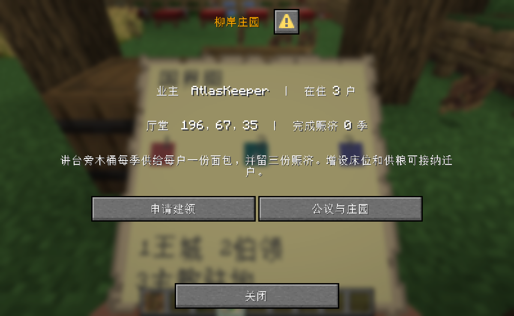
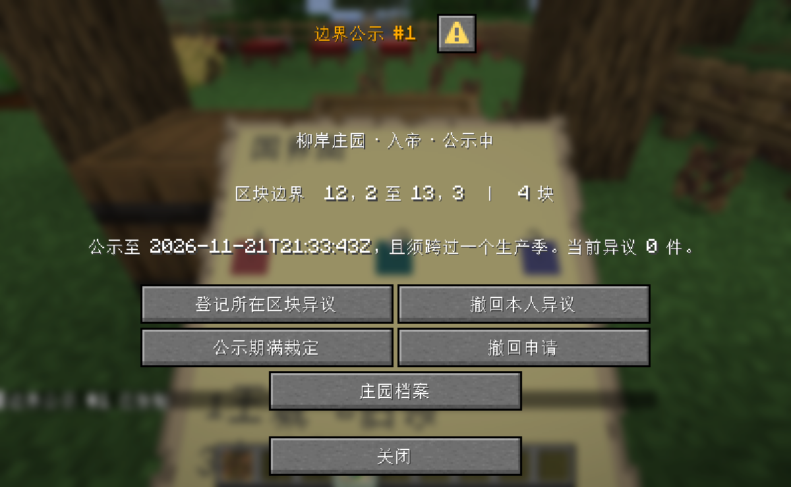
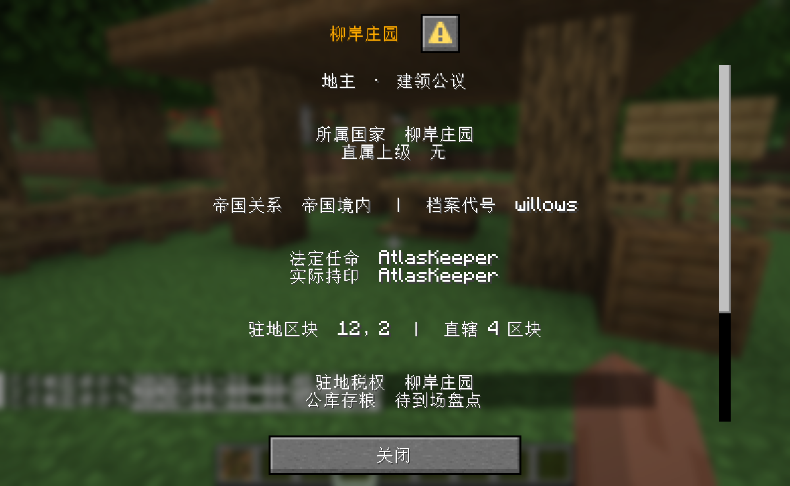
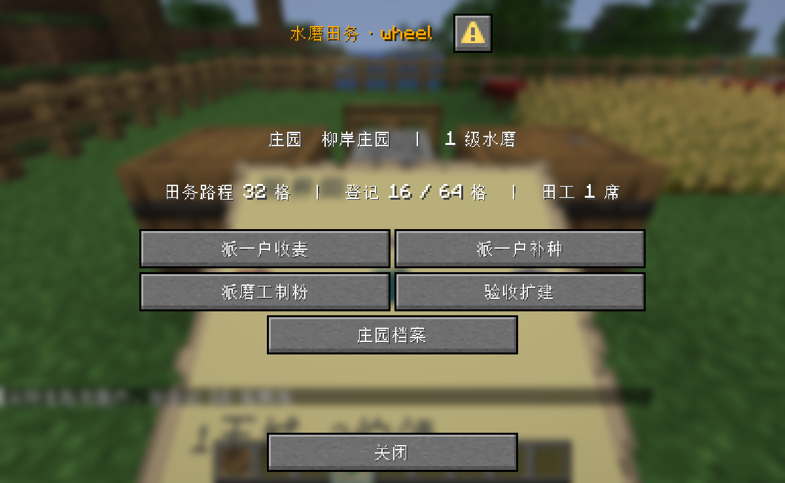
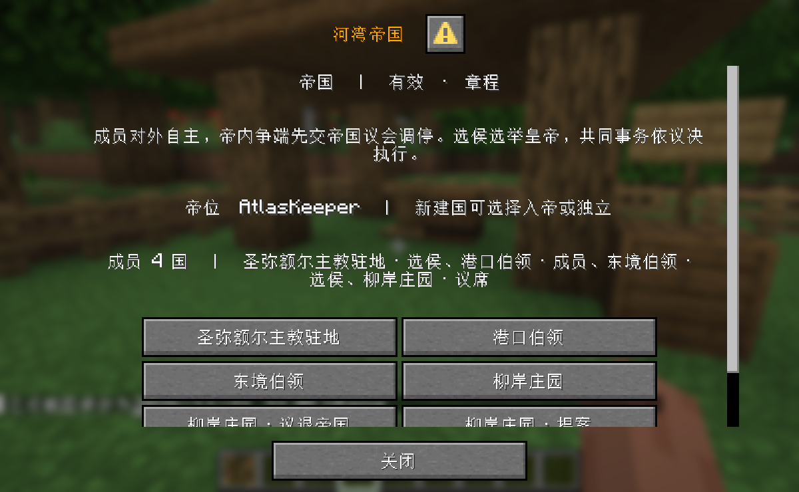
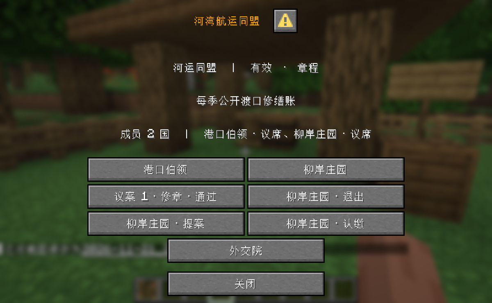
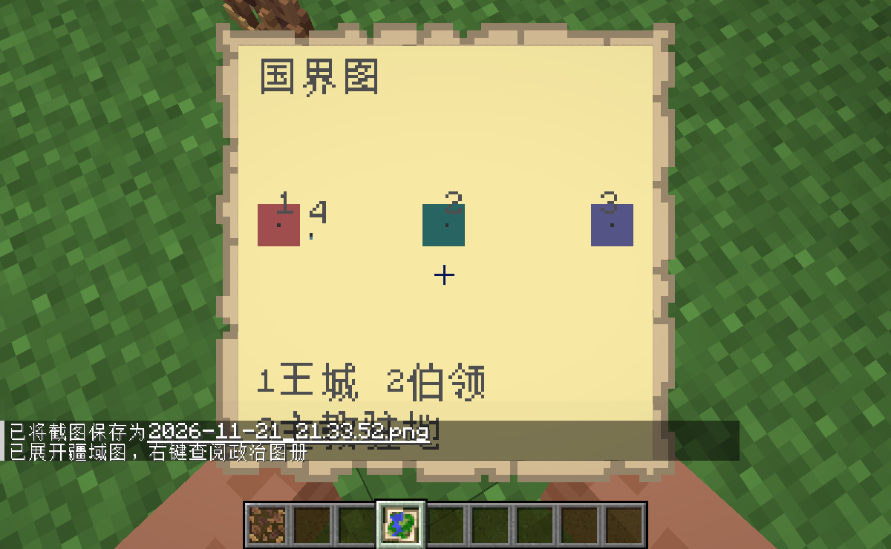
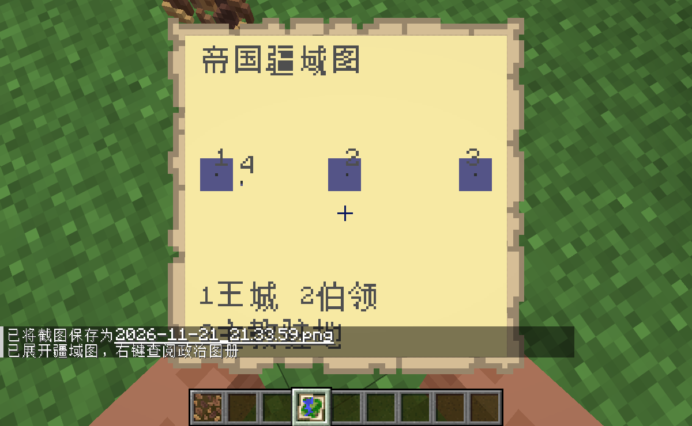
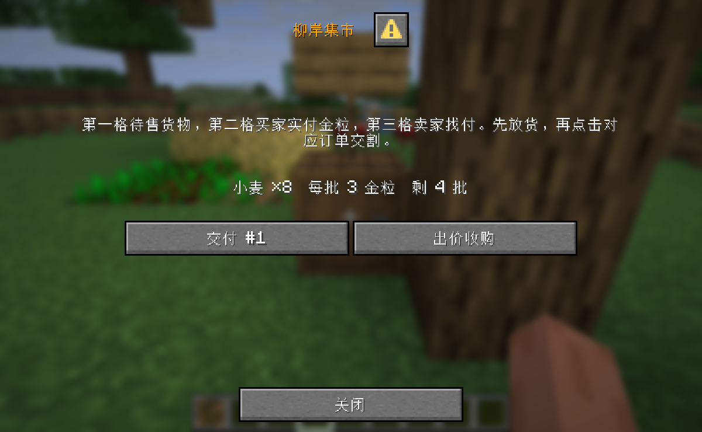
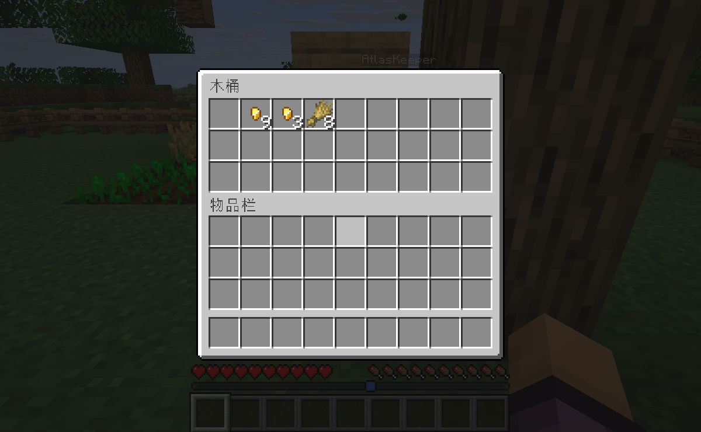

# 封建社会 0.5.0 · 建领、田务与外交

首轮可玩的路线是围建庄园、安置住户、供养公共粮桶、召开公议、成立领邦，再决定以哪一个国家的身份参与帝国及其他国际组织。测试环境为 Java 25、Paper 26.3 build 257、中文原版客户端，普通主世界种子 `-2271199516753095334`。截图用客户端 F2 拍摄。

## 从庄宅到国家

管理员在普通主世界输入 `/realm init` 建立初始帝国和成员国，皇廷由 NPC 署理。显式指定在线玩家名会让该玩家即位，并为其家族建立河湾公国。普通玩家从 `/realm → 庄园与建领公议` 开始。

1. 在同一片地建一座矩形围院，每边 8–96 格。沿边界设墙、篱、栅栏或水岸，设一座栅栏门。厅内放讲台，紧邻设置赈济木桶，每户安床一张。地籍测量以讲台上下两格为本版的验收高度。
2. 首庄安置三户，桶内备三份口粮及三份公粮。瞄准讲台填写代号、名称和围界方块坐标。每季每户消耗一个面包，有空床并留足口粮可新增一户。另立新庄须从已有庄园调出三户。
3. 稳定六户且完成一季赈济后，到讲台申请建领。选区用**区块**坐标，单案最多 36 块。现实公示期和生产季都须满足，田主可在争议区块现场提出异议并撤回。裁定时只登记含治所的连通无争议部分。
4. 首位玩家皇帝出现前，新建国自动入帝。以后可选入帝或独立，该选择跨空位和摄政持续开放。入帝初称地主，可向皇廷请爵。帝国外可自称伯爵。建领时庄宅自动成为首都。
5. `/realm permit 受许头衔 西 北 东 南` 签发开拓特许。在边地庄宅使用 `/realm frontier 庄园 头衔 西 北 东 南`。新地须与本领共边，每案最多 16 块，每四块须有一户。公示与经营满足后现场裁定。流官由君主增拨。
6. 迁都先在新庄内瞄准实际库箱输入 `/realm seatvault 国家 庄园`，再用 `/realm capital 国家 庄园`。新治所须处于本国直辖区。原仓货物需自行搬运。

正式默认一季为六个有人在线的游戏小时，答辩期为 24 个现实小时。为了在一次实服测试里观察连续季节，隔离测试实例把两项设为 60 秒，由普通权限测试角色办案。场地、床位、作物和起始口粮由测试控制台布置。角色从三户增至六户，实际完成公示与裁定，柳岸庄园成为含四个区块的无爵领邦。

## 磨坊、农工与税仓

将磨石设在庄内，东邻粮桶，西邻种桶，北留通门，南侧两格内设置水和活板轮叶。瞄准磨石输入 `/realm watermill 庄园 磨坊代号`。地主可以委托自己的田，由实际走得通的路线确定是否在服务范围内。

| 操作 | 游戏效果 |
|---|---|
| `/realm field 磨坊 地主庄园 西 北 东 南 耕地Y` | 勘测可达的真实耕地，按方块登记。一个田格只能交给一座磨坊 |
| 右键磨石，派一户收麦或补种 | 农工走到田里，每收一格或播一格耗一个工时，每户每季 64 工时。秋收春播，满仓、缺种或道路不通会等待 |
| 派磨工制粉 | 磨工从粮桶取小麦、持成品返仓。一份小麦制一份具名面粉，每季一个磨工工位 |
| `/realm millup 磨坊` | 磨石东侧两格增建附仓、西侧两格放堆肥器作为农具工位，三级再加一层。三级的路程为 32／48／64 格，田务登记上限为 64／128／256 格 |
| 将应交实麦放入税仓的产地仓箱 | 按真实待缴库存开税单和封箱。财政账本记录自动可征份额，运粮沿用徒步脚夫、背架和实际交付的驯骡。到仓可亲提尚未缴纳的份额 |

随机种子实测中，一号水磨登记 16 格田。第一名农工在试验农时内实际收割九格、运回九份小麦。另一名农工从种柜取种，现场复种。图中工人采用项目原创的人形皮肤。面粉目前是具名实物，后续食物加工和腐败尚未覆盖完整产业表。

## 国家、帝国与多边条约

在 `/realm → 外交与国际组织` 查看组织章程、成员、议席和议案。国家档案单列公权和持印人。帝国持有帝位和帝位领产，帝国成员、议席、选侯分别登记。国家可以重叠加入多个组织，也可成为个人兼领的帝外国。

- 持印人在外交院以本国身份起草条约。选「河运同盟」或「防御联盟」会在全体创始国批准后成立常设组织；选「条约」则单独存档。最后批准时，各具名签署人须在十二格内。首测支持 2–24 个缔约国。
- 条约也可把 `@empire` 或 `@组织代号` 列作缔约方。组织议会须对这份具体文书通过外交授权，皇帝或受托国代表才能以组织名义签署。皇帝本国不会随之成为缔约方。
- 成员可以提案、申请加入、按席投票、修章或退出。组织议决依席位计算。普通组织只剩一国时进入一季清算，归档后可查过去的签署与欠款。帝国另设帝位选举、退帝公议、请授议席和选侯特许。NPC 选侯可依创始章程在署理或空位时推举玩家君主。
- 成员可在组织档案认缴小麦、羊毛或木材，指定实际货线、数量和期限。收货人在终点签收后，以 `/realm accountfor 认缴号 运单号` 报交。核对承诺时间、货种、货量、发货人、在册货线和签收状态。同一份回执只能核销一次。
- `/realm map country` 和 `/realm map empire` 切换原版手持图。安装 BlueMap 5.29 后另有领邦疆界、帝国成员、私人庄园、边疆公示四层，仅发布公共边界。

两名普通权限玩家分别代表柳岸领邦与港口伯领，在同一厅堂签署河湾航运同盟章程。两国分别投票通过「每季公开渡口修缮账」。实服数据库核对柳岸同时持有两份成员资格，BlueMap 5.29 的公开图层也已通过 HTTP 实读。

服务器重启后，南苑伯领邀请河湾航运同盟签订《港仓公约》。三名测试玩家分别执掌南苑、柳岸和港口。柳岸与港口表决授权后，柳岸的持印人代表同盟签字。生效文书中分别存有南苑的国家签名和同盟的组织签名。重启前的集市成交仍只有一笔，收购单仍余三批。

## 市场与桥税

- 木桶上立橡木告示牌，瞄准空桶输入 `/realm stall 代号 名称`。商站主人把实物金粒放入第二格，右键牌子按货种、每批货量、每批价和批数出价。卖家把货放入第一格，现场确认后从第三格取款。收货柜满、货种不符或买方金粒不足会阻止本次交割。
- 用 `/realm bridge 代号 桥名 国家 每次金粒` 登记本国桥亭。瞄准讲台，西邻收费桶，东侧须有三格宽、七格长、三格净高的可通行桥面。过桥人将金粒放入柜桶首格后现场登记路费，收据锁定当时的收费权人。
- `/realm notice 原告国 桥亭 UTC开场时间 理由` 公示桥税争端，至少提前 24 个现实小时。帝内争端先提交帝国调停。争夺有两个分属不同日期的 90 分钟时段及备用时段。参战领主按身份登记，在现场携口粮控制桥面。双方都在时暂停，失控时进度回落。累计 1200 个有效秒转移未来收费权，并为原权利人登记反向诉求。防御联盟成员可代表自己的国家支援守方。当前战场由到场玩家争夺。

双客户端实测中，商站主以十二枚金粒挂出四批订单。另一名玩家现场放入八份小麦并签收，柜中实余九枚预算，第三格实际付出三枚，收货格实际存入八份小麦。卖家随后取走三枚金粒，订单余三批。

## 存档和验收范围

从 0.4.1 升级时，领地账本在同目录保存迁移前的 SQLite 副本。原头衔、税仓、封契和在途运单保留编号。历史上混记在皇室名下的资产标为「皇室旧领（待清册）」，保持原保管关系。旧税单照旧交割，新单按实物开立。

数据库回归覆盖两国共主、换帝与空位、无爵入帝、拒爵与准爵、部分有异议的拓地、迁都、条约与组织的独立存续、成员退出、修章表决、运单逐笔核销、桥税转移与恢复。实服截图来自庄园建国、成员档案、实际收种和两层手持地图。完整产业与家族生活、军队 NPC、30 人联机与 72 小时压力验收仍是后续里程碑。

### 本版仍在开发的部分

| 系统 | 当前边界 |
| --- | --- |
| 地籍与开拓 | 庄园使用矩形围界。现实公议可剔除异议区块，跨国割让、复杂地役与多边界多边形仍待制作 |
| 地方生计 | 田务已覆盖小麦，磨粉形成实物。完整轮作、佃租分成、食物货龄、地质银矿和多产业供需尚未接齐。远处未加载的庄园暂停观察与作业 |
| 外交与组织 | 成员、议席、选侯、一次性外交授权、条约签字、实物认缴和桥争议已接入。通用文本章程中的自定义条款仍需玩家执行；组织驻所、完整公仓预算和全部类型的同盟义务仍待扩展 |
| 家族与政体 | 沿用现有封契、继任、请袭、拒交印与双边王号文书。五类政体完整议事、家产分割、跨境教区任职和教会经营尚待制作 |
| 战争与发行 | 桥税争夺已接入现场玩家、口粮、公开时段和反向目标。完整军队编制、离线守军、多类战争目标、500 名士兵和 72 小时压力验收尚未完成 |
