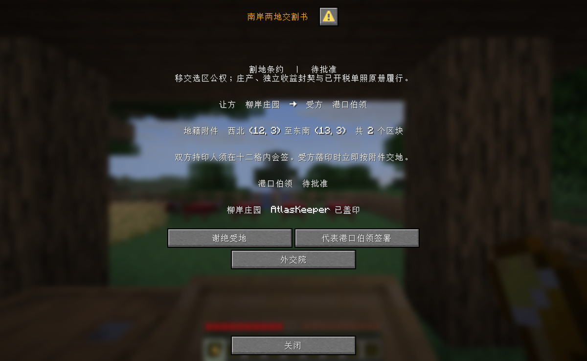
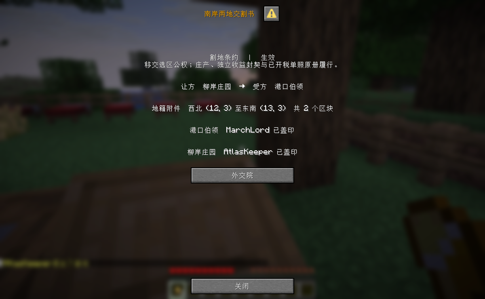
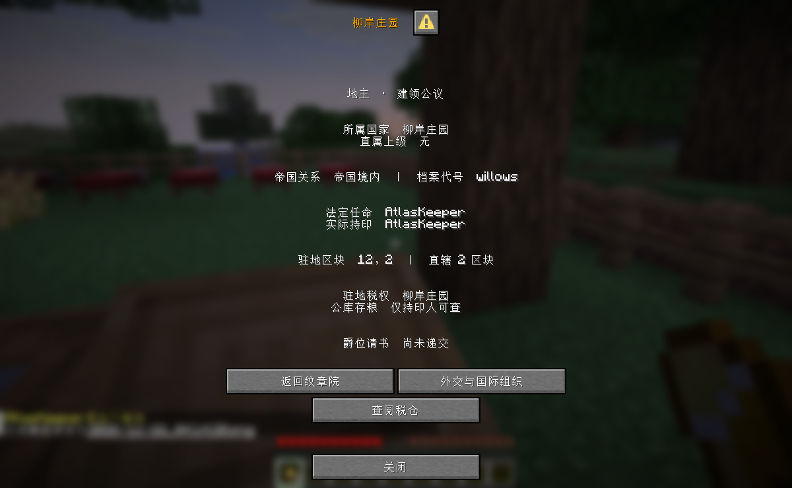

# 封建社会 0.5.1 · 两国如何议让土地

建领公议和开拓特许用于登记新地。两个已有国家也可以协商边界，把一方直辖的土地交给另一方。双方在外交院查阅同一份地籍附件，再到场交换文书。帝国成员可以用本国名义办理。

## 在游戏里交地

1. 让方持印人打开 `/realm`，进入「外交与国际组织」，在本国名下选择「议让土地」，点选受让国。
2. 输入文书代号、名称和矩形两角的**区块坐标**。默认坐标取玩家脚下区块，两端都计入面积。一份文书最多 36 个区块。让方须直接管辖全部选区，并保留治所。可以约定飞地。要让出当前治所，须先完成迁都。
3. 提交后，让方已经盖印，领地仍由让方管辖。受方持印人在外交院打开具名文书，可核对两国、边界、面积和签名。会签前，让方可撤回，受方可谢绝。办结的文书保留在外交院。
4. 双方持印人到同一世界、相距十二格以内，由受方选择「代表本国签署」。系统重新核验让方的持印权、驻地和每一块土地。任一项有变，整份交割暂停，双方可撤回或谢绝后重拟。成功时同步登记签名和新地籍，可用国家地图查阅新边界。

交割只变更指定区块的公权。地上的私人庄园仍由其业主经营，独立收益封契按旧约收租。已经开出的税单和封箱仍向原受益人交割。新开的税单依当时有效的税权归属。桥亭收费权有独立登记，仓货和在途粮食依原路线运输。

## 实服验收

沿用上一版的随机主世界，种子为 `-2271199516753095334`。测试服务器使用 Java 25、Paper 26.3 build 257，从 0.5.0 存档副本加载。柳岸原有四块直辖地，让方选取南侧的 (12, 3) 和 (13, 3) 两块交给港口伯领，保留治所。两名测试角色分别以各自国家的持印人身份办理。

双方相隔 39 格时，服务器提示须在十二格内交换正本，港口伯领的签名栏仍为空。双方会合后，港口伯领完成签署。两块指定土地归港口，柳岸仍持两块直辖地及原有的两个组织成员资格。通过 HTTP 读取 BlueMap 的领邦疆界层，北侧治所仍标作柳岸，南侧两块已标作港口。

重启服务器后，两份签名和地籍仍可读取。港口另拟一份原地返还的文书，柳岸选择谢绝，南岸两块继续由港口管辖。

37 项自动化测试全部通过。其中覆盖了起草后重启、两份文书争让同一块地、换印后旧约无法交割、首都保护、谢绝与撤回，以及一般税仓和有独立地租契约的税仓在下一期分别向谁纳税。

## 历史取舍

1360 年的布勒蒂尼和约写明英法之间让予的领地，当年又在加来批准。这里取其「明确列地、分别批准」的做法。历史上的交割还可能涉及赎金、放弃权利的文书和分期履行。此版把玩家可执行的约定限于一份双边直辖地文书，矩形和 36 区块上限用于在游戏内逐项核对。[《大英百科全书》1911 年版 Brétigny 条目](https://en.wikisource.org/wiki/1911_Encyclop%C3%A6dia_Britannica/Br%C3%A9tigny)
