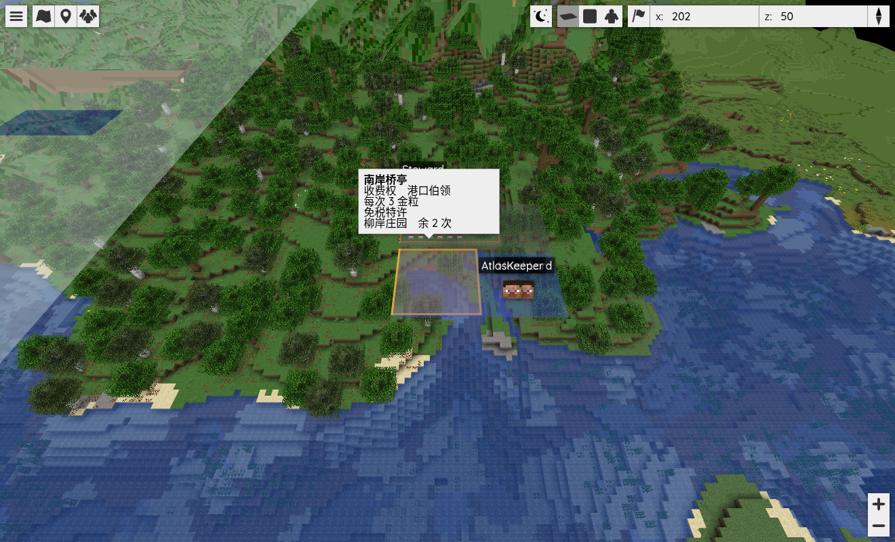
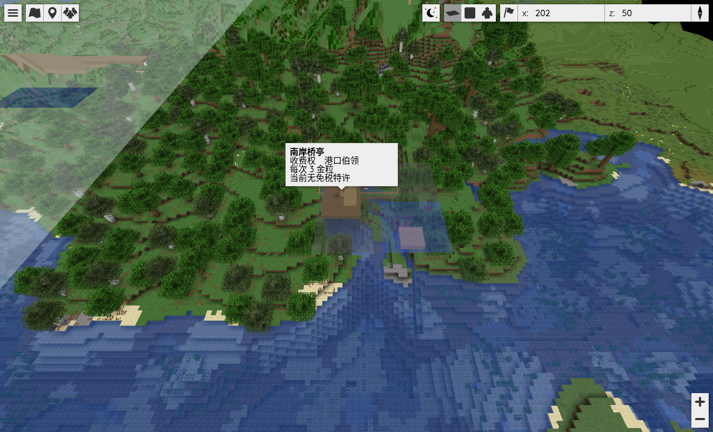

# 封建社会 0.5.2 · 桥亭免税特许与 BlueMap

港口伯领把南岸桥头的一块地让给柳岸，桥亭的收费权仍依旧约归港口。柳岸持有一份可用两次的免税特许。两国持印人可以在游戏内办理，其他玩家可以在网页地图上查看哪一国管地、哪一国收税、谁还有免税次数。

## 在桥亭办理

1. 在本国辖区建桥亭。讲台西侧紧邻收费木桶，东侧留出三格宽、七格长的实体桥面和三格净空。瞄准讲台登记，例如 `/realm bridge southbridge 南岸桥亭 harbor 3`，每次收费三枚金粒。
2. 收费权持印人在桥亭六格内右键讲台，选择「颁发定次免税特许」，选受许国和次数。每份可授 1–64 次，同一国在本桥用完一份后可再获新契。
3. 受许国持印人到同一桥亭选择「代表本国免税通行」。桥面须可通行，印信须与任命一致。柜桶不会收钱，账本录入零额回执并扣一次。受许国换印后由新任使用余次，桥税权易手后原特许继续有效。
4. 次数用尽后，把足额金粒放进收费木桶首格，选择「确认本次路费」。金粒移入同一柜桶的收款格，回执记下当时收费权人。十秒内重复点按同一次通行会被拦下。

当前由领主代表本国在亭内核销。普通行人仍可在世界中步行过桥。商队自动验单、受托车夫代用特许及拦截逃税车队属于后续玩法。

## 安装与打开地图

测试采用 Java 25、Paper 26.3 build 257、BlueMap 5.29 的 Paper 版。在停服的测试实例中，将本版《封建社会》JAR 放入 `plugins/` 并替换旧版。以下脚本从 BlueMap 官方发行页下载固定版本，校验 SHA-256 后放入指定实例。[封建社会 0.5.2](../examples/imperial-atlas/feudal-survey-0.5.2.jar) · [安装脚本](../examples/imperial-atlas/install-bluemap.sh) · [BlueMap 5.29 官方发行](https://github.com/BlueMap-Minecraft/BlueMap/releases/tag/v5.29)

```sh
bash examples/imperial-atlas/install-bluemap.sh /path/to/test-server
```

首次启动会生成 BlueMap 配置。按其安装说明检查 `plugins/BlueMap/core.conf` 中的 `accept-download`，允许获取渲染所需的 Minecraft 资源后重启。在服务端本机打开 `http://localhost:8100/`，选择主世界。新建世界需等待所查看区域完成渲染。进入「标记」可切换图层。[BlueMap 安装说明](https://bluemap.bluecolored.de/wiki/getting-started/Installation.html)

| 公共图层 | 在地图上可查的内容 |
| --- | --- |
| 领邦疆界、帝国成员及帝位领产 | 当前国家管辖范围、帝国范围与帝位领产 |
| 私人庄园、边疆公示 | 已登记庄园的围界，以及建领或开拓中的公示 |
| 待签割地文书 | 金色边线圈出拟交割的区块。会签、谢绝或撤回后移除。只有会签生效才改动领邦图层 |
| 桥亭与通行特许 | 点桥亭图标，查看收费权人、标准桥费和各国可用的免税次数 |

## 随机地图实测

本轮从 0.5.1 存档副本启动，普通主世界种子为 `-2271199516753095334`。测试控制台搭建桥面、木桶、讲台并提供测试金粒。国家持印人通过玩家指令办理，两张网页截图直接取自测试服的 BlueMap 前端。



港口与柳岸会签后，区块 (12, 3) 归柳岸，待签轮廓消失。桥亭仍由港口收费，每次三枚金粒。柳岸核销一次后，网页与中文桥亭档案同步显示余一次。


第二次核销后，地图撤下用尽的特许。下一次按标准桥费付款，柜桶收款格实际增加三枚金粒。期间重复点按未扣第二次。账本保留两张零额免税回执和一张三枚金粒的缴费回执。重启后再次核对，柜桶仍有三枚金粒，三张回执与桥亭权属均已恢复。



39 项自动化测试全部通过。实服核验覆盖了 772 个区块，在拟约、会签、用尽特许及重启后分别对照公开图层与地籍。

可对正在运行的实例复核地图。核验脚本只读 SQLite，把全部领邦区块、待签文书和桥亭特许与 BlueMap 的 HTTP 数据逐项对照。以下地图代号对应本测试存档。[核验脚本](../tests/paper/verify_bluemap.py)

```sh
python3 tests/paper/verify_bluemap.py /path/to/test-server/plugins/FeudalSurvey/realm.sqlite \
  http://localhost:8100/maps/feudal_world/live/markers.json
```

## 历史取舍

亨利一世给伦敦市民的特许明确把市民和货物列为通行等税费的豁免对象，受益资格可以属于一个共同体。游戏采用按国登记、由持印人代表行使的办法。每桥定次和十秒防重收是试玩规则，历史文书中的伦敦特权范围更广。[福特汉姆大学《中世纪资料集》所收 1133 年伦敦特许](https://sourcebooks.fordham.edu/source/1133hank1tax.asp)
