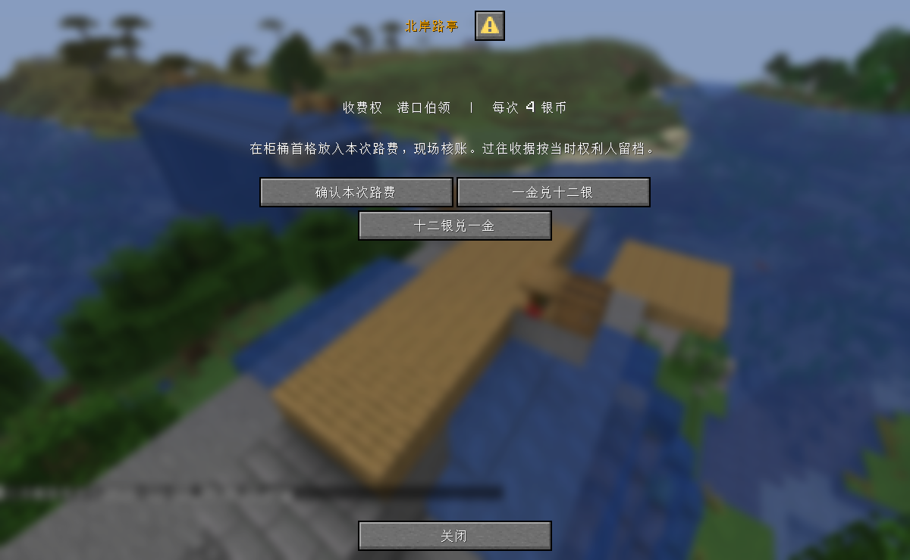
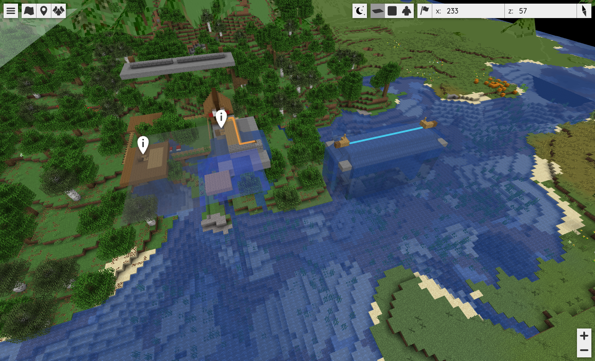

# 封建社会 0.6.0 · 依路行货、依港行船

货站可以位于不同高度。管理员在实地指定起点和终点后，服务器沿着已建成的设施勘路，记录每一格的位置和高度。沿途地形改变后，脚夫、驮队或船只会在受阻处等待。玩家仍可亲自提货。

## 陆路与税粮

- 建两个货站木桶，把站桶顶面与路面接起来。中间至少有一格实路。路面可用土径、圆石、苔石、石砖、砖、平滑石、磨制安山岩、深板岩砖、泥砖、泥坯或木板。砂砾路须铺在其他合格路面材料之上。一般路段下方须有固体承托，上方留三格净空。
- 管理员使用 `/freight route 线名 起X 起Y 起Z 终X 终Y 终Z`。路线可转弯，每前进一格可升降一格。勘测两端和沿线区块须已加载，单段最多 512 步。老命令仍可省略终点高度。
- 发货人在起点木桶首格放货，空手潜行右键办理运单。承运队沿勘测路线逐格前进，到站签收后原路回站。拆路、拆桥或堵住通道会暂停在途运单。修复原路后继续。
- 税仓与公库附近各留一个接上路网的铺装装卸位。驮队还需要旁边有容身空间。自动运税沿铺装路寻找通路，仓间只有普通草地或土块时，税箱留在税仓。中途阻断时，已装的税箱留在承运队。旧存档的税仓脚夫需能从其现有位置接上路面。

## 收费亭与定价

在路边设讲台，讲台背向道路的一格放收费木桶。面向路的一侧修三格宽、七格长的铺装路段，沿路两头各接一格有路基的引道。亭可设在四个朝向。跨空或跨水的桥面可用同一规则登记，费率可设为零。孤立讲台或野地上的木桶不能单独登记收费权。

| 动作 | 玩家操作 |
| --- | --- |
| 登记 | 本国持印人瞄准讲台输入 `/realm bridge 亭号 名称 国家 金或银 金额`，例如 `/realm bridge northgate 北岸路亭 harbor 银 4` |
| 调价 | 收费权的合法持印人在亭内选择「调整币种及费率」，或输入 `/realm rate northgate 银 4`。每次 0–64 枚，零为免费。新费率只作用于之后办理的缴费 |
| 准备钱袋 | 在亭内可兑换金粒和带本服印记的银币。本版按一金粒兑十二银币双向兑换。手持钱币在运输 NPC 旁使用 `/realm purse` 给该队补充路费，最多携一组同币种钱币 |
| 自动过亭 | 承运人从随身钱袋付款，实物进收款格。相同运单在同亭同程只收一次，空载返程单独收费。钱袋币种不符或不足时会停在亭旁，可补钱，也可在柜桶首格放钱，由玩家选中等候运单代付 |
| 查验 | 右键讲台或点击 BlueMap 桥亭图标可看现行费率和收费权人。每笔已收路费记录当时权利人、币种和数额。原有金粒收费与收据按金保留 |

货线按勘测时确定的线路运行，受托预付的钱袋留在运输队。已有的定次免税特许仍由受许国持印人在亭内办理。银币为本服实物货币，兑换比例是本版的计价选择。

## 港口与航运

从港仓木桶的一侧，同高向水面伸出连续两格木板栈桥。在末端左侧或右侧立一个栅栏系缆桩。栈桥正前方留出泊位，水面方块比港仓木桶低一格。两港之间须有连通的开放水面，航道和靠泊处要留足实船通过的宽度。

1. 先由玩家把一艘空船停在起运泊位。管理员输入 `/freight sail 航线 起港X 起港Y 起港Z 终港X 终港Y 终港Z`。
2. 船工在码头上船，货物由船工随身携带。终港的港仓、栈桥和系缆桩通过检查后，收货人才能正常签收卸货。卸货后同一艘船返航。
3. 陆水联运可以共用港仓木桶。上一段签收的实物进入桶内，再为下一段开单。目前水运限同水位的连续航道，换装按段签收开单。被毁的船不会自动补发。

## 随机世界联测

测试从 0.5.2 的普通主世界升级，种子为 `-2271199516753095334`。测试控制台搭建道路和港池、放置物资与测试船，玩家账号以各自国家的持印人身份办理。BlueMap 5.29 与 Paper 26.3 build 257 同服运行。

- 北岸货线从 (218, 72, 45) 发出八份小麦，走过有高差的桥头，并在另一侧转弯，最后交到 (222, 74, 59)。拆掉坡道路面或桥面后，运单都停在受阻地点。重建后脚夫到亭候费，五枚银币进柜后才过桥。外邦持印人调价遭到拒绝。
- 另一趟货运由玩家给脚夫十二枚银币。新费率为四枚银币，去程和空载返程各产生一张四银回执，钱袋剩四枚。此前五银回执保留原额。在本国孤立搭建讲台与收费桶时，登记被拒绝。
- 税仓另备八份真实小麦。测试将隔离实例的税期计时提前到换期前五秒。仓外路面缺一格时，封缄税箱留在税仓；补路后脚夫走到公库，公库箱实收八份小麦。
- 航线使用两座实体码头和一艘橡木船，承运六份小麦。封堵水道后船工持货停船。恢复水道、拆掉终港系缆桩后仍无法完成靠泊；修好后终点港仓实收六份。

42 项自动化测试全部通过。BlueMap 的逐格核验覆盖 772 个区块、两座收费亭和四条货线，包含从旧存档读出的直线。

旧货单保留原签收人、货物、路线和在途步数。旧直线路线升级后按原坐标复核实际铺装。原路是草地的，需要在原位置补铺道路，或由管理员登记另一条已勘通的新线。[插件下载](../examples/imperial-atlas/feudal-survey-0.6.0.jar) · [BlueMap 安装及验证](paper-0.5.2-bluemap.md)
