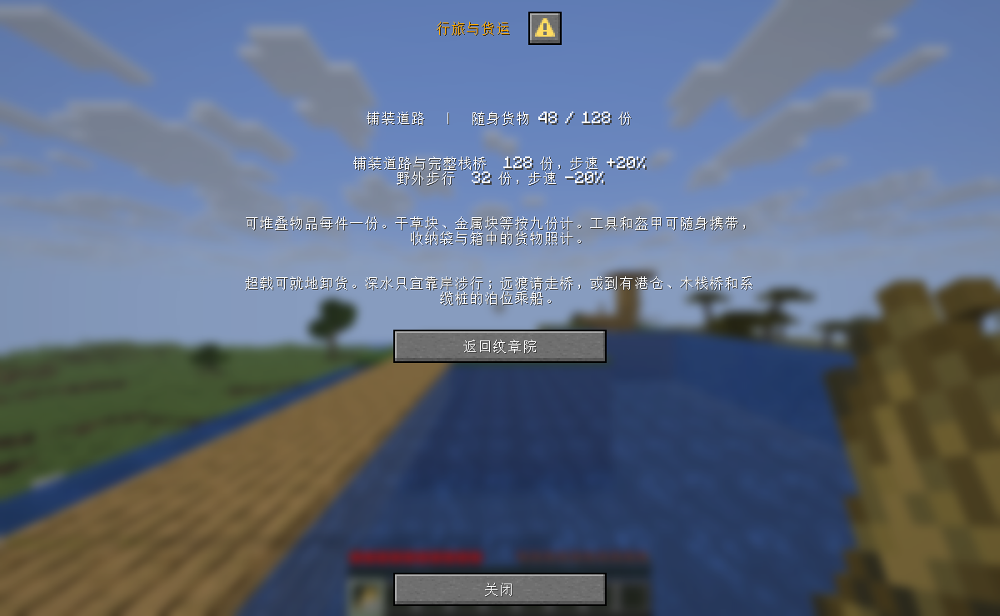
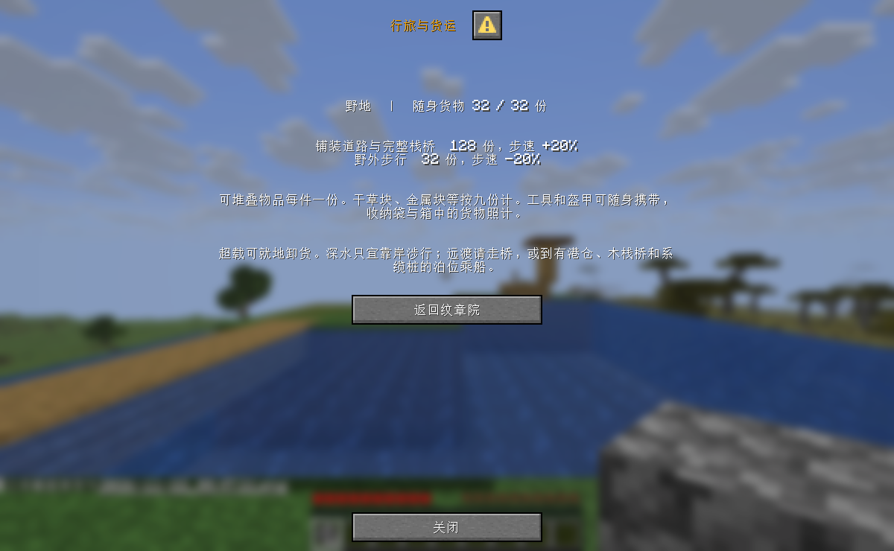
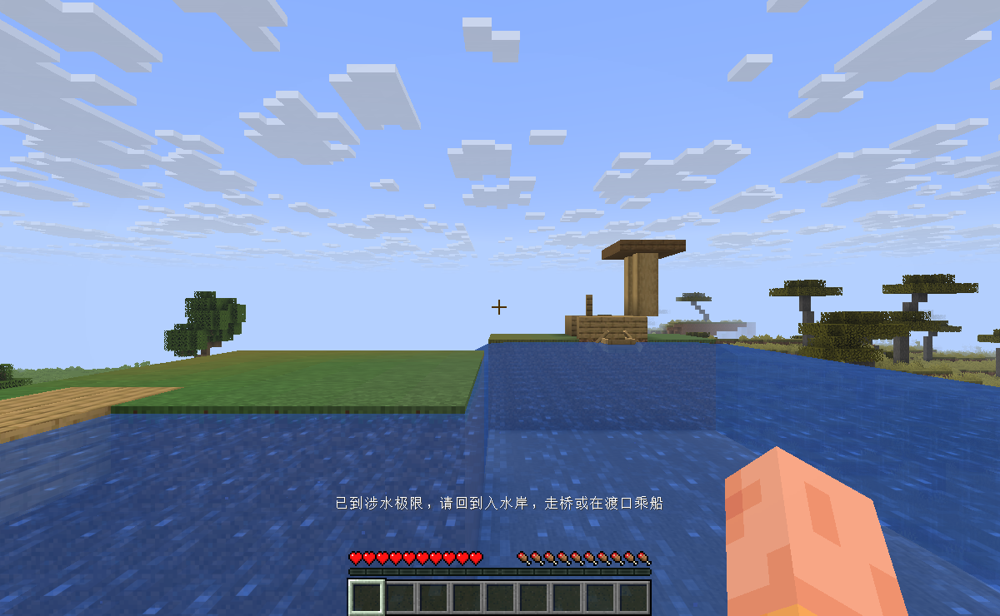
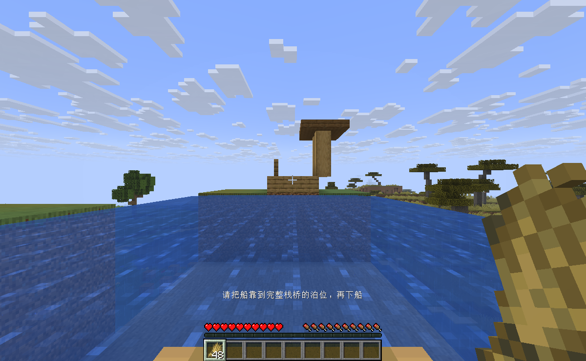
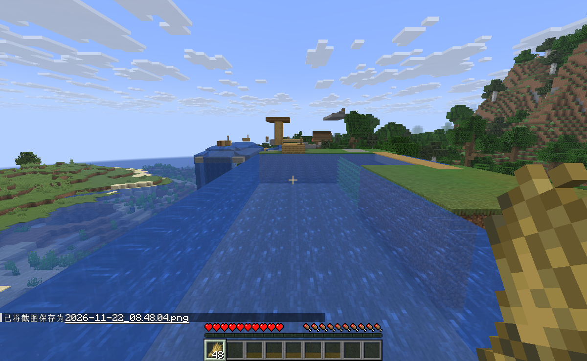
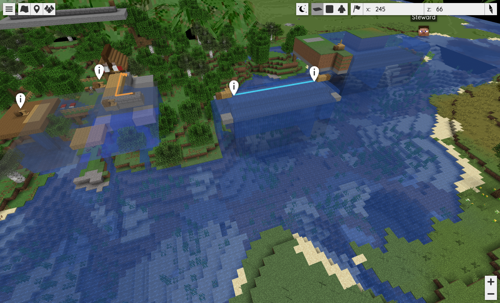

# 封建社会 0.7.0 · 背货走路，靠岸行船

玩家亲自征收远处的粮税时，先看税仓到公库之间有没有铺通的路。48 份散麦可以一趟沿路背走。如果磨坊门口还剩一段野地，可先铺通这段路，或把麦子留在仓箱里分两趟搬。亲收仍按原有征收规则入账，距离带来的代价体现在往返和交割上。

## 路上怎么走

在中文图册里点「行旅与货运」，或直接输入 `/realm travel`，可查看当下路面、背负的货量及上限。规则作用于登记主世界生存和冒险玩家的步行、游泳与乘船。以下是本版的平衡值。

| 地点 | 随身运力 | 实际操作 |
| --- | ---: | --- |
| 铺装路、合格桥面、完整栈桥 | 128 份 | 步速加成 20%。装到 128 份时仍可行走 |
| 野地、普通岸地、浅滩 | 32 份 | 步速降低 20%。超载迈入野地时停在路沿，可把货交到箱里、分给同行者或放下 |
| 深水 | 靠岸可涉行约 3 格 | 两格及以上相连的竖向水体触发涉水限制。可浮出水面并退回入水岸，身上超载也可以自救 |
| 渡船 | 登船时最多 128 份 | 自备原版船，靠完整渡口上下。玩家亲自划船，船箱可存实物。已配给公共船工的船留给货线使用 |

常规可堆叠物品每件占一份运力。干草块、煤块、金属和粗矿储存块、钻石块、绿宝石块等九合一物资每块占九份。不可堆叠的随身工具和盔甲免计，容器内部照计，副手和光标拿起的货也算在内。超载只阻止继续搬运，货物留在原处的玩家背包中。

## 怎样修出可用的桥和渡口

- **路面**沿用公共驿道的材料和路基检查。可将草方块铲成土径，也可在有承托的路基上铺圆石、石砖或木板并留三格净空。砂砾下需有另一种合格路面材料。
- **无亭桥**可在两岸之间铺至少两格宽、同高而连续的实桥面，两条并排路面都须有净空。两条路面在桥台或桥墩处都要有实心承托，相邻承托横排间距最多 16 格。宽河可以加设桥墩接下一跨。建成即可背货通行，已有特许桥亭沿用整段桥面和引道检查。
- **渡口**从港仓木桶沿一个方向接两格同高木板，末端旁立栅栏系缆桩。紧接前方留出开放水面，水面方块比木桶低一格。由玩家放置一艘空船，停到栈桥正前方的泊位，靠近后右键上船。划向对岸，在对岸泊位按潜行键登上栈桥。缺失系缆桩时要先修好或另寻渡口。
- **找渡口**时可在 BlueMap 打开「公共航线泊位」图层。它记录已勘测公共航线的两端。玩家另建的小渡口也可上下船，靠泊当时会重新检查实体结构。

落进深水的玩家可以上浮和退回入水岸。离线重登会保留入水岸记录。若因意外直接出现在深水，服务器在已加载的周边 24 格内寻找可登陆地点。在远海找不到岸时保留自救移动。

## 实机验证

测试使用 Paper 26.3 build 257、原版 26.3 中文客户端和 BlueMap 5.29。沿用普通生成的随机世界，种子为 `-2271199516753095334`。测试在该存档中搭建了对照路段、河渠和两座渡口，步行、划船、右键登船与潜行下船均由生存角色实际操作。

| 操作 | 实服结果 |
| --- | --- |
| 背 48 份麦从铺装路走向草地 | 玩家停在路沿，麦子仍在手里。实测道路移动速度属性为 0.12，野地为 0.08 |
| 在野地背 32 块圆石，再换成内装四块干草的潜影盒 | 圆石可背走，盒中的干草折合 36 份，无法继续横移 |
| 在路上携带 129 份麦，再取走一份 | 129 份时停步，降到 128 份后可以前进 |
| 背 48 份麦走桥 | 有亭木桥和自建无亭双格桥均可通过。拆掉无亭桥中间一排后，玩家停在桥头 |
| 空手从岸边游向对岸 | 开阔水面和长满海带的水道中，入水约三格后都无法继续向河心推进，仍可原路上岸 |
| 持货从西渡口驾船到东渡口 | 水中央上船失败，拆西岸桩后上船失败。修桩后可右键登船。河中按潜行仍留在船上，拆掉东岸桩也无法下船。修好后再次潜行，人物和货物一起落到东岸木板上 |

BlueMap 的两个公共泊位分别在 (241.5, 75, 66.5) 和 (259.5, 75, 66.5)。在线图层与同服账本核对通过，共核对 772 个区块、两座桥亭和四条公共货线。独立的小渡口用于玩家划船试验。

**中文运力面板**　铺装路段测试携带 48 份麦，野地测试携带 32 块圆石。

**涉水与乘船**　岸边涉水受限后可以原路返回。船靠对岸后，玩家站在实体栈桥上。

