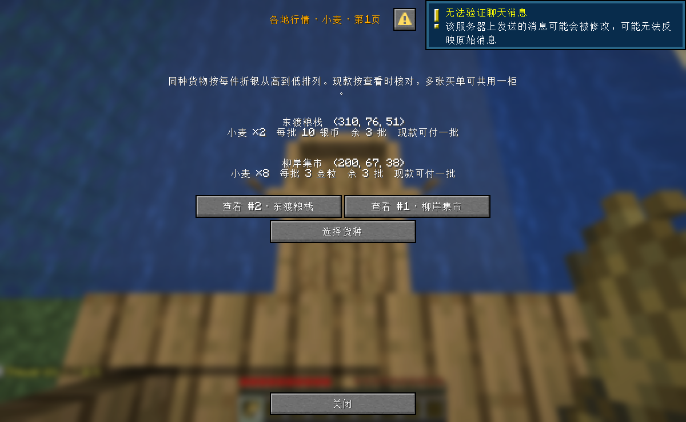
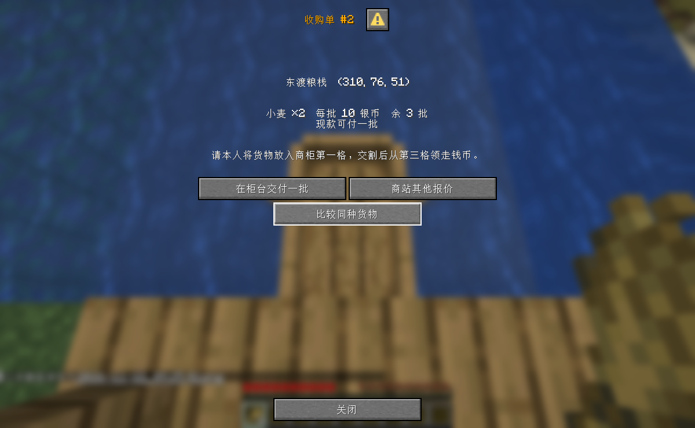
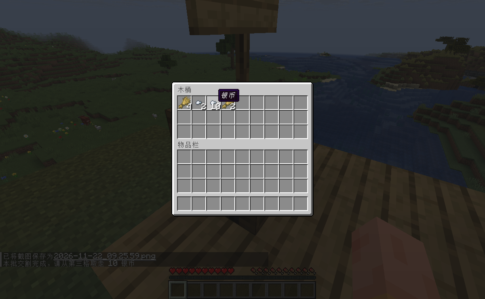
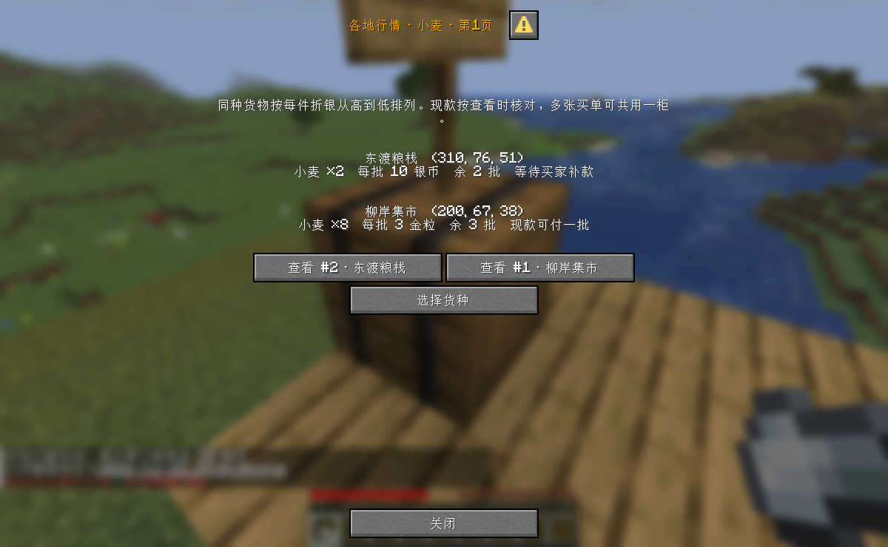
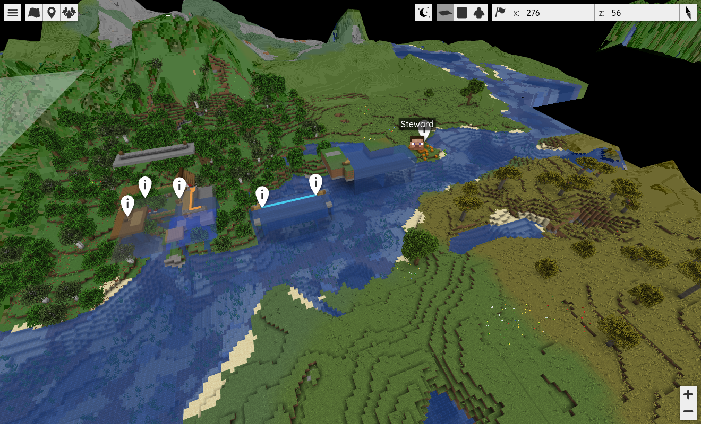

# 封建社会 0.8.0 · 带麦去哪里卖

柳岸集市每八件小麦出三金，东渡粮栈每两件出十银。按桥亭一金兑十二银的比价，柳岸每件折合 4.5 银，东渡每件 5 银。如果两家都能收足八件，东渡多付四银。多走一段路要多久、过桥要付多少，以及柜里能否拿出下一批钱，都可能改变选择。

## 出发前看行情

在中文图册点「各地行情」，或输入 `/realm prices 小麦`。行情按货种分组，同种货物按每件折银价从高到低排列。画面保留原币种、每批件数、整批价和公示余批。打开某一张单，可以看收货柜坐标、交割方法及这家商站的其他报价。BlueMap 的「商站与收购」图层显示柜台位置及在榜单数。

各柜共用本站买家钱格。打开行情时，已加载的柜台会显示「现款可付一批」或「等待买家补款」。未加载的柜台显示「待到访验资」，柜台拆损显示「柜桶待修」。查看报价无需加载远处区块，也不会替商户预留货款、批次或运力。实际成交时再次核验。

## 买卖双方怎样操作

| 谁 | 操作 |
| --- | --- |
| 买家设柜 | 在空木桶上立橡木告示牌，瞄准桶身输入 `/realm stall 代号 名称`。右键告示牌进入商站。 |
| 买家出价 | 把金粒或桥亭兑换的银币放在柜中第二格，选择「出价收购」，填写货种、批量、总价、批数和币种。例为 `/realm bid eastquay 小麦 2 10 3 银`。原有金粒报价保留，旧格式命令默认按金粒张贴。 |
| 卖家交货 | 本人把货运到商站，放入木桶第一格，在六格内打开收购单并选「在柜台交付一批」。每次只结一批。货物进入买家柜中，卖家从第三格领款。 |
| 暂停与续卖 | 货不够、钱币品种不符、钱不足或先前货款尚未领取时，本批暂缓。买家补款、卖家领款后可继续使用原单。 |

## 随机主世界实测

Paper 26.3 build 257、原版中文客户端和 BlueMap 5.29 同服运行。测试从 0.7.0 存档副本升级，普通地形种子为 `-2271199516753095334`。旧柜台原有的小麦金价参与比价。控制台布置新商柜、把买家从桥亭兑换的钱置入柜中，并为卖家准备六件小麦。两名玩家分别使用买家和卖家的命令，卖家从西岸划实体船到东岸，用原版木桶界面放麦和取钱。

- **出价。** 东渡买家先试用十二枚普通铁粒挂银价，柜台拒绝。放入兑换所得的十二枚带印银币后，成功张贴每两件小麦十银、共三批的收购单。
- **在途与交割。** 卖家在西岸查看报价并尝试交付，被要求抵柜。划船靠泊东岸后，卖家放入六件麦，确认首批交割。柜里留下四件待售麦、两件已收麦和两枚买方银币。卖家亲手从第三格取走十枚银币。
- **资金约束。** 第二批还需十银。买方仅余两银，复交被拒，收购单保持余两批，账本只有一次本单成交。行情随即显示「等待买家补款」。
- **补款与结单。** 测试控制台为原柜追加二十枚带印银币。卖家继续交完两批，合计领到三十银，买家柜中实收六件麦、余币两枚。第四次交付得到「本单已结」，成交记录仍为三笔。BlueMap 上该站的在榜单数降为零。

本版 47 项自动化测试全部通过。在线 BlueMap 图层与同服账本核对了 772 个区块、两座桥亭、四条货线、两处泊位和两座商站。

