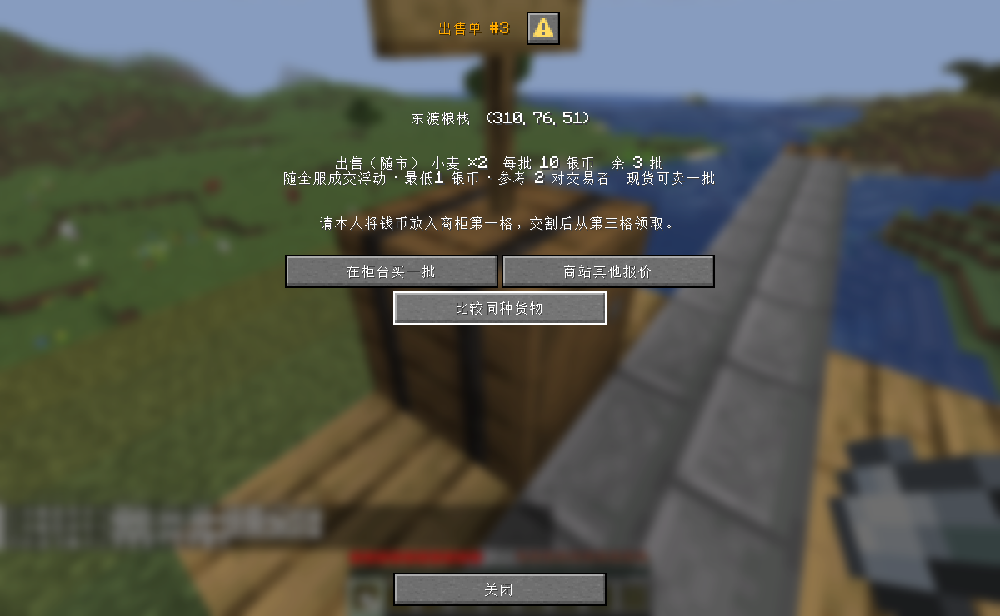
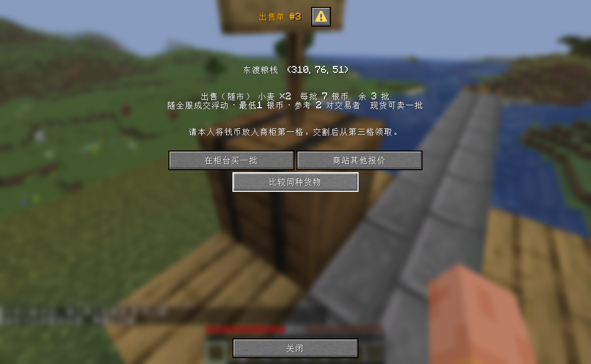
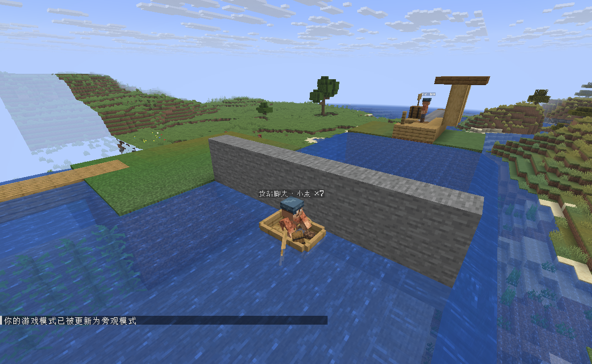
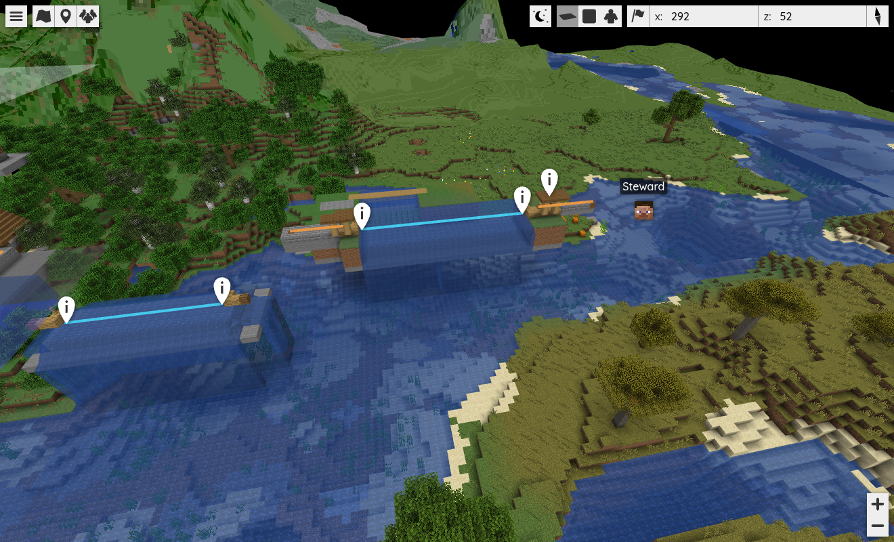
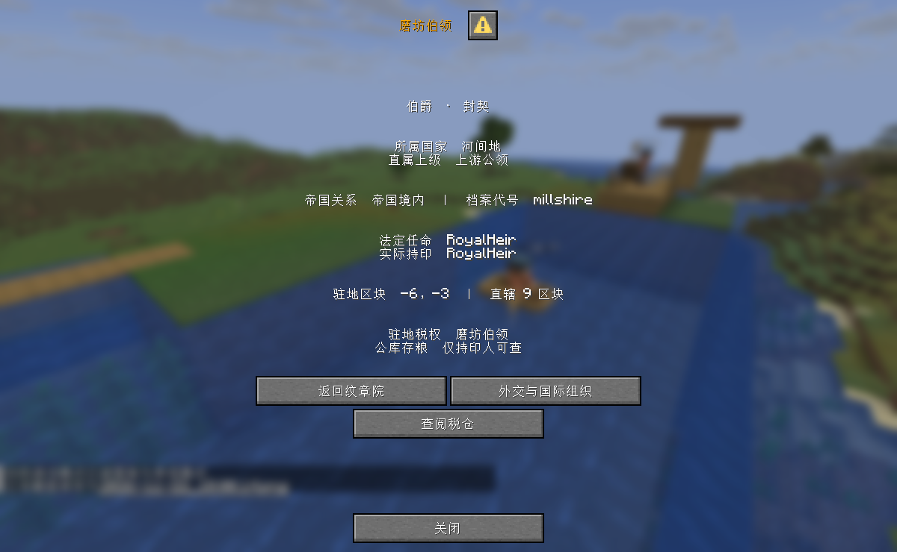
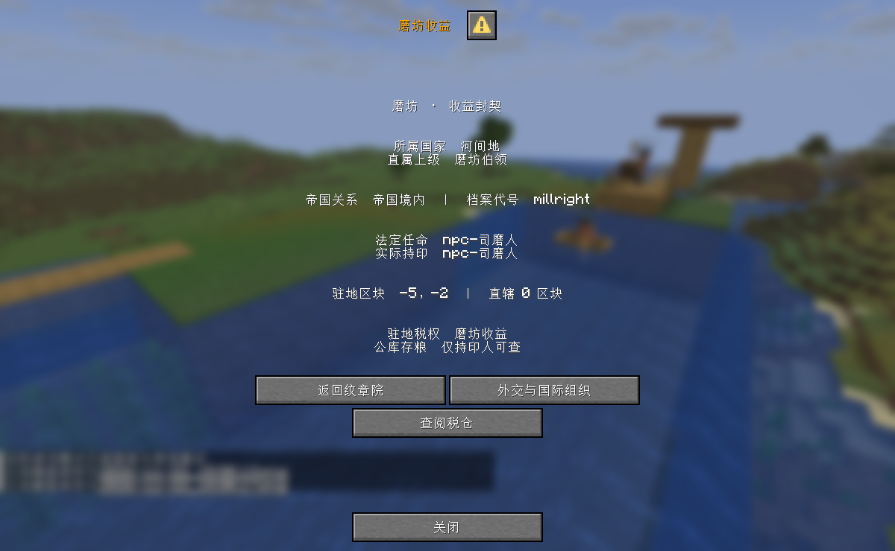

# 0.9.0 · 玩家开市、水陆换装与封契继承

测试在普通随机主世界存档的独立副本上运行，种子为 `-2271199516753095334`，使用 Paper 26.3 build 257、原版中文客户端和 BlueMap 5.29。控制台搭建路港、放置测试船和首批粮食并执行运单操作。政治文书和商站订单由不同玩家账号在游戏中签署。截图来自本次实例。

## 开服时谁出钱，谁出货

商站只有在玩家登记后才有业主。业主往第二格放足至少一批钱或货，才能张贴对应的收购单或出售单。来客本人到柜，把付款或货物放进第一格，第三格领取对价。每一批都重新核验现场货款、现货和空间，实际成交价随收据留档。业主可以离线，空服时库存、钱币和未成交的订单原样留存。角色不能与自己的商站成交。

在 `/realm market 商站` 打开「出价收购」或「挂牌出售」，可选择「固定」或「随市」。例如 `/realm ask eastquay 小麦 2 1 3 银 随市` 表示每批两件、出售三批，每批最低一银。调价时，行情按以下规则计算。

- 固定价由业主填写。随市价取该货物最近最多 31 对不同交易者已完成的固定价成交，每对只保留最近一笔。每件单价折银后取中位数。重复刷同一对交易、挂出无人接的高价、按随市价成交，都不会额外增加样本。
- 买单以业主填写的金额为上限，卖单以该金额为下限。无成交样本时用这笔订单的业主限价起步。每批以订单币种四舍五入到整数，一格实币支持 1–64 枚。一个金粒兑十二枚银币是面额换算。
- 玩家确认的整批金额与当前金额不同，会重新打开报价，等待重新确认。服务器不会替无人应价的商品兜底。全服玩家数量很少时，价格仍受少数真实交易影响，业主限价决定本柜可接受的边界。

原版商人交易界面和猪灵易物在各维度关闭。银币沿用已有存档的印记，并在玩家合成及自动合成器中排除，防止金粒通过兑银变成铁制材料。实服上，玩家点开带交易配方的流浪商人时收到商站提示，向猪灵递金后手里仍有一枚金锭。同一台红石合成器先装九枚带印银币，通电后九枚原样保留；换入九枚普通铁粒，再次通电产出一个铁锭。

**双向成交实测。** 旧存档中的两组小麦交易给出每件 4.75 银的中位数，出售两件报价十银。一笔两件四银的固定价出售完成后，中位数变为 3.25 银，原随市出售单变为七银。顾客按旧价确认，商品与钱币保留在柜中；重新确认后按七银成交。业主把柜里实际收到的钱改作收购款，顾客又以七银卖回两件。三笔成交价依次为四银、七银、七银，业主离线期间也能按已备库存履约。核对双方合计仍为 32 银、六件小麦。

## 同一车粮怎样换船再上路

只在起点木桶放入七件命名为「秋收第七车」的小麦。三个运输段各自开单，货站脚夫和船工使用实体背包及实体船。中转时没有往港仓补入测试物资。

| 运单 | 实际经过 | 签收后 |
| --- | --- | --- |
| autumn1 | 田边站 (266,75,52) → 西港木桶 (274,75,52)，铺装陆路 | 起点空，西港七件 |
| autumn2 | 船工从西港同一木桶装船，泊位 (277,74,52) → (305,74,52)，东港木桶 (308,75,52) | 西港空，东港七件 |
| autumn3 | 脚夫从东港同一木桶装货，沿路至市集站 (318,75,52) | 东港空，终点七件 |

封住 (292,74,52) 的航道后，船工在第 14 步停止。恢复水面后继续航行。两处换装的站桶登记号首尾相同，三张运单的物品序列化内容逐字节相同。重复签收没有增加粮数。BlueMap 的两段驿道和一段航线按实际勘测的路面、泊位绘制。

当前联运按段签收、换装和开单。公共货运一次处理一单，上一队返站后才能开下一段。跨段一张联运单、自动调度多队同时周转仍待实现。

## 分封做到哪一层

| 实服操作 | 验收结果 |
| --- | --- |
| 皇帝直接分封国王，再改走协议 | 直接授王被拒。皇帝先授公爵，双方另签王号协议后，该公国成为帝国内王国并保留成员身份 |
| 国王授公爵，公爵授伯爵 | 凭合法任命及官印从实际直辖地划拨。转封完成后，王室直辖 26 区块、公爵直辖 15 区块、伯爵直辖 9 区块 |
| 伯爵再设伯国，或授磨坊收益 | 再设伯国被拒。磨坊收益授予成功，收益封契直辖零区块，税源转给受益人，磨坊地块仍归伯爵 |
| 流官扩地 | 初授四区块。流官自扩、转封都被拒，君主另拨一块后合计五块。另在冷启动的测试副本为王室预登记 252 块空地。君主给同一流官新授第二区，再追加到两区合计 256 块（5 + 251）。追加第 257 块时被拒，该块仍属王室 |
| 伯爵家族请求世袭 | 缺少支持时请袭失败，两名不同玩家到领内联署，上级公爵确认。原伯爵交位后，RoyalHeir 同时成为法定任职人和实际持印人 |

因此可实玩的是有界领土、有限层级、任命与官印、独立税权，以及地方支持推动的准袭。现有支持依据玩家联署和任职税期计算；封建军役条款的自动履约和完整家族谱系仍在设计范围内。

本版通过 `mvn clean verify` 的 49 项测试。Paper 正常关服并用存档副本重启后，三段运单、封地继任和三笔商站成交记录均通过核验。主场景的 BlueMap 在线标记与数据库核对一致，共有 772 个已登记区块、7 条货线、4 处泊位、2 座桥亭和 2 座商站。对本场景可用 `python3 tests/paper/verify_river_fair.py <插件数据目录>` 只读核对三段货单、换装站印、继任和实付记录。完成封地边界测试的副本可在上述命令末尾加 `--governor-cap`。在线地图核对使用同目录下的 `verify_bluemap.py`。
